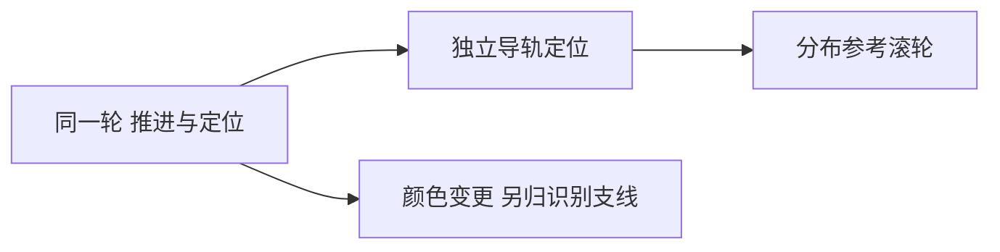

# 设计启发式：让草图产生机制差异，而不只增加数量

当团队围绕同一种结构反复美化，设计启发式可以提供一次有方向的扰动。它不负责证明性能，也不替代需求澄清。提示的价值要落在“原来的作用关系怎样改变”，而不是卡片使用次数。

## 提示为何有用，证据到哪里为止
Yilmaz等2016年的研究从获奖产品、专业设计师连续草图和工程/工业设计协议研究抽取可迁移的设计操作。它支持从多方案过程提取变换模式；它不是证明每条提示对所有机械任务都提高性能的临床式对照。论文讨论部分明确指出，给定任务如何选择启发式仍是开放问题，77项也不一定穷尽。这里采用原创提示，不冒用官方卡片编号。[E19-1]

提示应足够具体，能画出变换；又不能直接指定唯一零件。比如“把定位与驱动的承载路径分开”会促使增加独立参考件；“更智能”没有明确变换。提示来源、对象和被改属性必须同时保存。

## 从一张基线走到可比较的机制族
以下是平台构造教学，不是客户需求或实物成绩：桌面推送惰性试片，驱动轮同时承担横向定位，目标是在概念阶段减少驱动磨损对定位基准的依赖。允许增加一个无源参考件；暂不评价成本和精度。

|轮次|动作及草图关系|保留什么|形成的新问题|
|---|---|---|---|
|V0|驱动轮→推进；同一轮缘→横向定位|已知功能边界|磨损影响两种作用|
|V1|原创提示H1：分开参考与动力；固定侧导轨→定位，驱动轮→推进|推进路径|导轨摩擦、污染和卡滞|
|V2a|原创提示H2：把连续接触换为分布接触；两参考滚轮替代长导轨|独立定位路径|滚轮间距和局部接触压强|
|V2b|仅将轮缘改成蓝色|无机械关系变化|识别可能改善，但不回答本任务|

第一次画图先不评分，接着逐边核对：谁作用于谁、作用是什么、通过何种接触。V1与V2a是两个机制族，V2b归入视觉识别附支线，不计为第三种定位方案。这里“保留V1/V2a用于下一轮”是可辩护的概念选择：两者都真的移走了共同定位载体；绝不是精度更高的结论。

继续研究应向R14交接作用图，向R33/R34交接接触和维护限制，向验证环节交接“驱动件磨损变化时参考是否仍稳定”的对照试验。输出保留V0，不能只留漂亮的V2图，否则无法审查改动来自哪里。

## 真正会失败的使用方式
第一种失败是提示越用越多，结构不断叠加，却没人承担新增夹持、清理和恢复功能。此时停止发散，回功能模型核必要支撑。第二种失败是把同义改写算作新机制，比如“加AI识别”和“智能检测”都没有改变观测量或作用关系；应合并并补画实际机制。第三种是直接复制获奖产品表面特征，忽略其载荷/尺度/材料，应用提示替代了原理验证。

迁移到文档审核，可用“分开生成与核验”产生独立核验者方案，但机械图中的接触和摩擦不能迁移成准确率证据，需重建信息流、责任及冲突利益。和C-K相比，启发式提供局部变换刺激；C-K跟踪概念与知识如何共同扩展。和TRIZ标准解相比，它通常不要求先满足特定物场前提。

## 证据与读者交接
E19-1：作者论文《Evidence-based design heuristics for idea generation》，PDF6–7抽取过程，PDF22–23 Discussion；本轮核读归档DH-RESEARCH.txt第238–280、632–702行。原文链接：https://dalyresearch.engin.umich.edu/wp-content/uploads/sites/237/2018/02/Yilmaz-Daly-Seifert-Gonzalez-Evidence-based-design-heuristics-for-idea-generation.pdf 。
E19-2：官方Idea Development Protocol，PDF1–2；https://www.designheuristics.com/wp-content/uploads/2014/06/Design-Heuristics-Idea-Development-Protocol-and-Materials.pdf 。
作用图筛查、H1/H2、表中教学及交接均为平台适配。下一位使用者需要带走基线、每轮提示、变更边和新增风险，不能只带方案名称。
