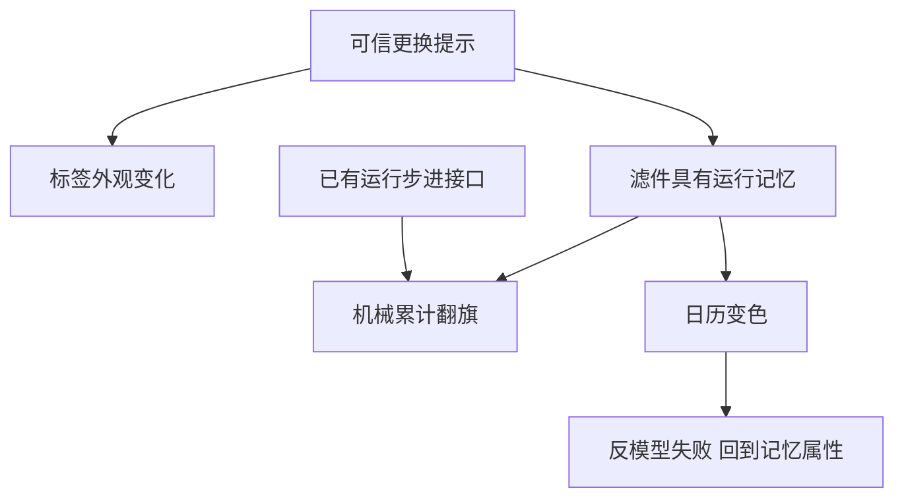

# C-K设计理论：把“想象中的对象”和“已知的事实”分开扩展

C-K适合需求有方向而对象定义尚不封闭的创新：不是从固定选项里挑一个，而是追问对象还能具有什么属性。若问题只是已知模型内求最小质量，先用优化；若关键数据尚未取得，也不能把概念树当作事实库。

## 两个空间，四种操作
概念C是在当前知识K下尚不能判真假的命题。K中记录带范围的已知命题，也可以记录已知为假的命题。不是所有问句都属于C：一个可直接查到的标准尺寸缺数，首先是知识取得任务。原论文区分限制分割和扩张分割：前者沿对象已有属性细分，后者给对象引入当前K中未作为其属性的东西。概念的新颖性总是相对于明确的K，而非写出一句前所未见的话。[E20-1]

K→C用知识启发属性，C→C分割或包含，C→K发起检验以取得逻辑状态，K→K通过推导或其他知识工作扩充知识。它们会反复交错，不是四个必然依次完成的阶段。[E20-2]

## 完整构造例：不靠额外显示屏提示滤件寿命
下面所有条件是教学假设。对象是每班使用的桌面空气滤件；目标“用户能在更换前得到可信提示”，不允许另加供电显示屏。K0：已有滤件只有日期标签；维护制度按实际运行小时更换；静置时间不计寿命；设备已保存累计运行小时h，并有一个无源机械计数接口；更换周期假设100h。

|概念分支|操作及属性变化|触发知识工作|结果与回返|
|---|---|---|---|
|C0 可信提示更换时机的滤件|初始未定概念|明确“可信”对应运行小时|不直接写成现有产品|
|C1 标签用红/绿两色|C→C限制分割：细分已有标签外观|问颜色靠什么随运行改变|只有静态颜色，不支持累计提示|
|C2 滤件本身携带运行记忆|K→C扩张：给滤件引入记忆属性|C→K研究接口是否能传递运行增量|假设接口每小时输出一次步进，得到K1|
|C21 机械累计、到100次翻旗|C→C再分割；K→K计算累计|推导n=Σ运行小时步进；100次=100h|在假设模型中满足且不需显示屏|
|C22 按日历变色|另一分支|构造运行10h/静置90h反模型|日期100h但运行10h，不能满足同一目标|

这里不是“AI想出机械旗就结束”。必须保存两个可区分状态：运行100h和运行10h静置90h。C22对这两个状态给同一日期输出，违反需求；C21在给定理想计数接口下输出100与10，足以作**模型层面的选择**，所以选C21进入接口原型，搁置C22。实际步进丢计、复位错误和维护作弊尚待试验。

若查证接口其实不存在，K1必须撤回，C21退回未决概念，继续研究机械能输入或修改约束；不能把假设接口画在架构上便称已验证。输出应包括每条知识的来源/适用对象，每个概念新增属性及其待证项，和推翻它的反模型。

## 边界、失败及迁移
把未知转为“常识正确”会造成假合取：例如凭常识断言污染与压差唯一对应，忽略流量变化。应构造同一压差、不同堵塞量的状态，若存在就回到概念扩张。另一个失败是树越画越大却没有C→K动作；每一关键分支要提出能改变决策的最小知识工作，不以节点数验收。

迁移到需求审核，可构想“会展示来源缺口的需求卡”，从现有普通文本卡增加可追溯属性；但不能把机械记忆的可靠性推给文本系统，必须新定义引用有效性及版本变更规则。C-K提供扩展和回返框架；QFD把已表述需求映射响应；形态学把已定义功能的解组合起来，三者输入成熟度不同。

## 关键主张依据
E20-1：Hatchuel与Weil，2003，PDF8–9限制/扩张分割及汽车紧急停车例；本轮核读CK-2003.txt第345–372行。
E20-2：同文PDF9–10“四操作/设计方形”，本轮核读374–409行。取得入口：https://www.designsociety.org/download-publication/24204/a_new_approach_of_innovative_design_an_introduction_to_c-k_theory 。
滤件、数字、K0/K1及筛除都是平台构造，不是原作者案例，也不证明成品存在。交接R14时带功能候选，交接验证时带接口计数假设和反模型，知识未证部分保留未证。
