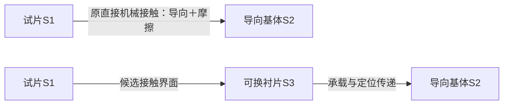

# 物场分析与标准解：先确定作用出了什么问题，再选择变换

物场分析把“这个装置不好用”改写为：哪个对象受到哪个载体、经哪种物理作用，产生了什么需要或不需要的改变。它的价值不在画三个符号，而在缩小待解决的作用问题。标准解再为某类问题提供结构变换方向；它不直接给材料牌号、尺寸或安全结论。

本稿依据MATRIZ公开《76 standard inventive solutions》选定条目，讲清1.1.1与1.2.1两种不同入口，并用一个完整构造例展示后者。它不是76条规则的完整实施。文献给出的变换方向标为【原典选段】，诊断表、设计例与交接方式标为【平台适配】。[E25-1][E25-2]

## 适合处理什么，什么时候先不用

适合的是已经能指出作用对象、物理相互作用与缺陷，但具体改善机制仍未确定的情境。例如导向件引导物件移动，同时划伤表面。若只知道“客户想更智能”，还没有任务和作用问题，应先做要求研究与功能分析，不能先假造一个物场。

这里的S1是本轮关心的作用对象，S2是施加作用的载体，F是物理相互作用。命名时应写可辨认的对象和改变：纸片、导向面、机械接触，比“产品、设备、能量”更有分析价值。同一部件在另一子问题中可能换角色；不要把符号永久绑在BOM位置上。

先分清四种状态：

| 当前证据 | 可成立的问题表述 | 不应马上做什么 |
|---|---|---|
| 已有对象，但实现目标改变所需的载体或作用尚未形成 | 不完整作用模型 | 不能把“加传感器”当唯一补全方式 |
| 有明确作用，但改变程度不够 | 有用作用不足 | 不因三个符号齐全就宣布系统有效 |
| 同一相互作用既有用又有害 | 需要保留有用作用、改变有害作用 | 不直接删除原作用而丢主功能 |
| 不知道缺陷原因或作用程度 | 作用状态尚未辨明 | 不把未知改成“不完整”以便套规则 |

【原典选段】1.1.1讨论对象难以按要求改变且不限制引入物质和场时，补入缺失要素；1.2.1讨论两物质间同时存在有用与有害作用、又不必维持两者直接接触时，考虑插入第三物质。两条前提不同，不能互换。[E25-1][E25-2]

## 一次完整操作：让构造滑动导向同时保留导向并减轻摩擦

以下全部为【平台构造】，不是割胶现场或材料试验。任务是在台架上让一块惰性试片沿导向槽移动。冻结三个设计条件：剩余总间隙必须在0.1—0.3 mm；执行器可提供1 N切向推力；原试片与原导向基体不要求直接接触。允许使用便宜、可更换的衬片。

假设试片宽10.0 mm，槽宽10.6 mm；接触法向力固定5 N。原表面对的摩擦系数假设为0.4；候选衬片界面为0.1。两个系数均是本例假设，不是可采购物性。

**第一步，冻结作用图与缺陷。** S1为试片，S2为导向基体，F为机械接触。需要的是约束横向位置；不需要的是原基体直接接触带来的摩擦和表面损伤。模型并不缺S1/S2/F，因此不走“缺要素补全”的1.1.1。

**第二步，逐项检查1.2.1的前提。** 本例明确允许取消S1与原S2的直接接触，且允许加入第三物质，因此可把“在两者之间安排可更换衬片”保留为研究方向。若任务要求裸金属直接导电，这个前提会改变，不能沿用本条结论。

**第三步，将解模型转成有内容的机制。** 在导向槽两侧各加入0.2 mm的衬片S3。S3承担接触与磨耗，原导向基体继续通过衬片提供位置约束。不是简单把S2删掉，而是重新安排接触对象和负担。

**第四步，按同一组假设检验两项局部约束。**

| 中间量 | 原构造 | 衬片构造 | 对本例的判断 |
|---|---:|---:|---|
| 总间隙 | 10.6−10.0＝0.6 mm | 10.6−10.0−2×0.2＝0.2 mm | 原构造超出0.3 mm；新构造落在0.1—0.3 mm |
| 估算摩擦力μN | 0.4×5＝2 N | 0.1×5＝0.5 N | 原构造超过1 N推力；新构造低于该构造推力 |
| 直接接触关系 | 试片—原基体 | 试片—衬片—原基体 | 原基体直接接触被取消，导向作用仍有传递路径 |

所以，给定这些假设，衬片方案比原构造更适合进入下一轮台架研究。这是可辩护的**局部改版选择**：不仅规则前提成立，两项明示约束也经过检查。它还不能证明不划伤或能长期使用，因为污染颗粒、衬片刚度、磨耗和摩擦波动尚未进入模型。应把这些列为下一轮要推翻或保留该选择的条件，而不是把“第三物质”写成产品已经成功。

## 回返与两个实质反例

一是**有用作用丢失**。若槽原本依靠导电接触传递信号，绝缘衬片可能满足摩擦要求却破坏信号作用。此时应回到作用边界，补上信息功能，再研究别的材料或变换；不能把被遗漏功能解释为标准解的代价。

二是**形式补全掩盖未知**。割胶声明模型中已经有树体、刀具和机械作用；组织边界未知，不等于少了一个物质或场。再加一个传感器也未必建立表面信号与内部组织的关系。应先查作用状态与测量机理，而不是将未知归入1.1.1。

还有一种常见误用：加入润滑剂后摩擦降低，就认为可以迁移到生物组织。接触介质兼容性、污染、清洁与产物质量条件不同，这不是同一个问题。衬片台架的结果不能转成胶乳接触材料建议。

## 怎么交接，而不是交一个标准编号

交给下一方法的记录应包含：原作用图；需要保留的改变；有害作用；选定条目的版本和前提；原/新接触关系；尺寸与物性假设；两项检查；仍可能推翻方案的条件。R14核遗漏作用，R33核真实材料与条件，R34核安装/更换/清洁，R44安排最小补证。

与功能裁剪的区别是：本例保留导向载体并改变作用关系，未以删除部件为目标；与FOS的区别是：这里从作用问题找结构变换，尚未跨领域寻找已经实现该作用的技术。二者可以接续，但不能互相冒名。

### 证据位置与内容身份

- **E25-1【原典选段】** MATRIZ公开英文列表，PDF第1页1.1.1。支持补全方向及允许引入要素的前提，不支持本例衬片或任何真实材料数值。[原件入口](https://matriz.org/wp-content/uploads/2025/09/Altshuller_76-standard-inventive-solutions_en.pdf)
- **E25-2【原典选段，本轮补读】** 同一列表PDF第3页1.2.1，PDF第4页1.2.2/1.2.4作前提对照。支持“不需维持原两物质直接接触”的分流条件；本稿不复制完整标准体系。
- **E25-3【平台构造/计算】** 本例尺寸、推力、系数与改版理由，见`示例/R25-衬片局部改版.json`。没有客户确认、实测物性或专家审核。
