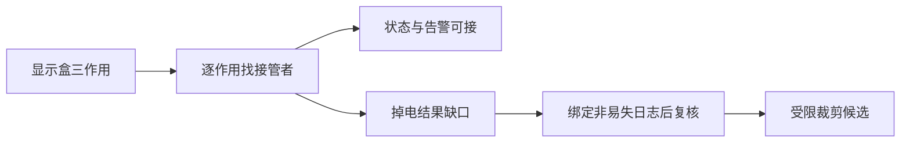

# 功能裁剪：删的是载体，不能删掉尚未接管的必要作用

裁剪不是减件比赛。它从功能模型出发，探索移除某个载体后，必要作用能否由对象自身、其他载体承担，或因目标改变而真正不再需要。裁剪只在作用和支撑已经说清时适用。[E26-1]

## 一次完整的接管判断
先列被裁部件全部作用，包括恢复、维护、异常时支撑；逐条声明删除理由、接管者、能力条件及新增依赖。任一必要作用无人承担，裁剪候选就不闭合，不能用“另加智能模块”占位。

构造桌面检测支架：独立显示盒承担①显示当前检测状态、②显示断联告警、③断电后保留最近结果。计划裁去显示盒，借主控屏完成三项。教学假设：主控屏可显示状态，通信每秒更新；断联由独立超时计时器2s触发；最近结果原保存在显示盒的掉电存储。工艺允许告警延迟≤3s，最近结果必须掉电可取。

|必要作用|V1接管证据|判断|V2修订|
|当前状态|主控已有数据显示接口|可接管|保持|
|断联告警|2s超时≤3s|模型可接管|明确屏与计时器供电|
|掉电结果|主控只有易失内存|接管失败|增加已有非易失记录服务绑定|

V1不能裁。V2假设主控已有非易失日志，提交成功后才更新屏幕，重启可按任务ID读回；此时三项作用均有明确接管路径，可以裁去显示盒进入集成研究。新增日志不是凭空免费的：需核断电写入一致性、版本与容量。若非易失日志也不存在，则回到保留显示盒或重构的方案，不能把预期功能写成现成功能。

## 两种特别隐蔽的失败
第一种只登记正常显示，没有登记掉电保留，裁剪后常态演示很好，异常时功能丢失。第二种把告警迁移到同一通信链上的软件，链路失败时连告警信息也到不了；需要当地超时检测或其他独立路径，不能只搬界面。功能被重新分配不等于依赖减少。

迁移到报告流程，可裁去重复的人工汇总步骤，但必须证明审阅所需信息、例外处理、签署责任被接管；自动摘要不能接管签署权限。与R25不同，裁剪聚焦载体去除和功能转移；与DFMA不同，它先判断是否可移除，后者还评价装配/制造负担。

## 依据与交接
E26-1：MATRIZ Level1 Manual PDF35–38，裁剪规则涉及作用不再需要、对象自身承担、其他载体承担等前提。https://matriz.org/wp-content/uploads/2019/01/Level-1-Manual-Word.pdf 。本例不是该书图例，不声称采用完整专有算法。
交接应输出裁前/裁后功能映射、接管依据、新增接口与未证恢复情境；R14重查闭包，R34评价工程负担，验证包重放断联与断电。
