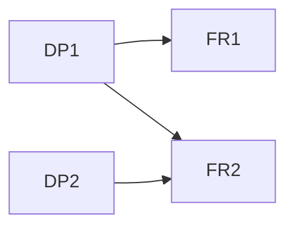

# 公理化设计：看清功能之间为何相互牵动

公理化设计把客户属性、功能要求FR、设计参数DP和过程变量联系起来。独立公理要求维持功能要求的独立性；不是要求零件越独立越好，也不是把矩阵中未知项填零。信息公理涉及满足要求的概率，缺概率范围时不能靠主观复杂度代替。[E30-1]

## 从功能要求到局部设计矩阵
先把FR写成可判断的作用，去除方案词，再列可以操纵的DP、单位、工况与允许范围。用机理或局部扰动识别每个DP对各FR的作用。这里矩阵**列为DP、行为FR**。零表示当前模型下确实无影响，unknown表示尚未研究，两者完全不同。三角形耦合可通过顺序调整，满矩阵通常需进一步重构；是否成立取决于FR/DP选择与工作点，不是一次排矩阵便永久独立。

## 构造算例：先调保持力，再调退出位移
假设一个线性化教学机构，在给定工作点附近，FR1变化为接触力ΔF1[N]，FR2变化为退出位移ΔF2[mm]；DP是两个调节量Δp1、Δp2[mm]。机理模型：ΔF1=2Δp1，ΔF2=.5Δp1+3Δp2。因此A=[[2N/mm,0N/mm],[.5mm/mm,3mm/mm]]。目标ΔF1=2N、ΔF2=4mm，允许每个DP在0–2mm内。

先调p1=1mm达到力目标；随后p2=(4−.5×1)/3=7/6mm，得到[2N,4mm]，两参数均在允许范围。若反过来，先p2=4/3mm获得4mm位移，随后p1=1mm会把位移变成4.5mm，需再调p2。结论是选择“先p1后p2”的操作顺序，避免可预测的回调；不是宣布系统非耦合。

|阶段|p1 mm|p2 mm|F1 N|F2 mm|
|---|---:|---:|---:|---:|
|先力|1|0|2|.5|
|再位移|1|1.1667|2|4|
|错误顺序末端|1|1.3333|2|4.5|

下一步在局部工作点附近施加独立小扰动重估系数，检查未知交叉作用与非线性。若测得p2也影响F1，就必须更新矩阵与调整策略，不可继续沿旧零项推理。若目标改成F2=8mm，算得p2=2.5mm超范围，也不能以代数有解称设计可行。

## 失败、迁移和邻近方法
把“采用电机”写成FR会把方案固定在需求层，应改成必要作用。把不同工况下的导数拼进同一矩阵，会得到现实中不存在的调节规律，应按工作点分层。信息公理也不能用关系项数量替代成功概率，缺分布即保留待研究。

迁移到报告系统，分别设置“检索覆盖”和“写作语气”两个参数，若语气调整改动事实范围，则出现耦合；需定义可观察的FR并做扰动研究，不能凭二维表认定独立。与DSM相比，公理化设计联系FR—DP两个域；DSM常在同一对象集合内表示依赖。与QFD相比，它关注功能独立性及设计映射，而不是客户权重转换。

## 证据和交接
E30-1：MIT Axiomatic Design Introduction，四域及两公理，https://web.mit.edu/axiom/www/introduction.shtml 。局部矩阵、单位、顺序和数字为平台构造，不是MIT机构测试数据。
交接包括FR身份/边界、DP范围、矩阵方向、每格依据、工作点、求解顺序与不可行目标；未知影响转测量，不以零通过。
