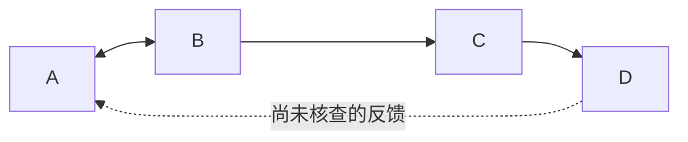

# 设计结构矩阵DSM：用依赖关系决定协调边界

DSM把同一组对象的关系放进方阵，可表示部件、任务、团队或参数。价值在于识别反馈圈和组织接口，而不是把黑点自动聚类成最佳产品模块。首先必须写明对象类型、依赖含义与行列方向。[E31-1]

## 画矩阵前先确定箭头
本稿统一i→j表示“j需要i的输出才能开展”；在矩阵中用行i列j标记。其他文献可能用相反图例，导入时必须转换。数值1表示本模型已知依赖，0表示核查后认为无，unknown保留未查，不得当0。异构的物理接触、信息依赖和同团队关系不应混在一个未经区分的标记里。

## 构造例：把反馈圈留在同一协调单元
假设四项任务A确定传感参考、B确定安装基准、C完成控制集成、D安排演示。A与B相互依赖；B输出给C；C输出给D。依赖集{A→B,B→A,B→C,C→D}，暂时没有其他依赖。

|行输出→列接收|A|B|C|D|
|---|---|---|---|---|
|A|—|1|0|0|
|B|1|—|1|0|
|C|0|0|—|1|
|D|0|0|0|—|

逐点可达检查发现A可到B且B可回A，形成强连通分量{A,B}；C不能回B，D不能回C，缩点图为{A,B}→{C}→{D}。因此选择A/B联合迭代，完成接口基线后交C，再交D。这里的“选择”是任务协调安排：不声称A/B必应做成同一个物理模块。

假设每个任务均需1天，A/B允许并行讨论1天后再共同修订1天，则该教学计划为联合单元2天+C1天+D1天，共4天。时间来自额外排程假设，**不是DSM仅凭边数推导**；资源限制、返工次数变动都要另算。

若D→A其实未知，应做两种场景：无该边时上述序列成立；有该边时A/B/C/D全在一个循环，需前置演示条件或拆出早期反馈。不能为获得漂亮上三角而删除这一未知。

## 失败与迁移
箭头反向会把交接顺序倒置。把没有填过的格当0会漏掉晚反馈。这两种错误都不是图形风格问题，而会改变计划。另一个风险是以最少跨组边为唯一目标，忽略高权重安全/职责接口；任务聚类必须让执行者确认。

迁移到需求—文档版本网络，可以识别互相约束的规范，但文档引用并不等于工作等待，要重新定义边的操作含义。DSM研究同域关系；R30研究FR到DP映射；R17研究功能解组合兼容，输出不能互代。

## 来源与交接
E31-1：DSM官方Introduction介绍对象类型及两种方向图例，https://dsmweb.org/introduction-to-dsm/ 。SCC与排程是平台图算法/构造示范，不是该机构对本项目的组织建议。
输出节点清单、方向图例、每条边出处/状态、SCC、顺序及未知边场景；真实团队批准和资源排期另行取得。
