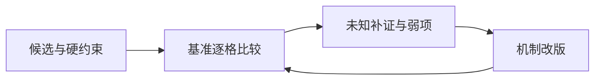

# Pugh概念选择：用相对比较推动改版，而非让符号替你决定

Pugh矩阵让多个概念相对于同一基准逐项比较，便于讨论差异、补证和组合改进。它不把优劣符号自动转换成真实效用；基准变化可能改变净符号。硬约束先筛选，关键未知不填“相同”。[E36-1]

## 完整操作与构造例
先保证候选属于同一任务和工况，登记硬约束；选可解释的datum；写清准则方向和证据；逐格比较；讨论弱点如何改版；变换datum复查，必要时回到补证。仅凭净+最多不能宣布全局最优。

承接独立构造DATUM-TEACH-001：A调节3次/模块2个，B调节2次/模块4个，C调节1次/模块3个；清理表现全部未知。次数和模块都越少越好。

|相对A|调节次数|模块数|清理|已知净符号|
|---|---|---|---|---:|
|B|+|−|?|0|
|C|+|−|?|0|

相对B时C为+/+/?，净+2，A为−/+/?净0。相对C时B为−/−/?净−2。这个实际复算说明符号比较与基准相关，清理未知仍独立存在；它不证明C在所有价值权衡下最优。

为展示正向决策，另加**独立教学限定**：本轮仅研究调节操作，允许模块≤4个，清理不在本轮选择范围，且声明该选择不能用于整机采购。A/B/C均满足模块约束；以调节次数唯一目标，C的1次优于B2/A3，所以选C进入调节流程台架。这项选择依据是明确收窄的目标和硬约束，不是净分伪装效用。

接着改版C2：保留C的调节原理，用一体支架替代两模块，设定模块降为2，调节仍1。于是C2相对A为+/=，相对B为+/+，在两个已知计数上不差并至少一项更好，可优先研究C2；但支架可制造和清理仍待证，不能把构造计数当真机结果。

## 真实研究输入如何处理
真实割胶教学主链TAP-C01..08的要求阈值、工程可行性与关键表现仍unknown，原包输出没有排名。本文补充的充分小例不改变该事实。若清理成为真实项目关键必要条件，上述收窄选择就必须暂停，转清理证据计划，而不是把?按0计后继续推荐。

## 失败与迁移
清理未知按相同填写，会制造没有差异的假象。用净+抵消一个硬安全失败，会改变准则身份，必须先拒候选。第三种错误是在不同工况下比较各候选最佳值，使矩阵没有共同基准。

迁移到内容检索方案，可以按同一资料集的可追溯率、人工核查量比较，但准则需要真实定义与独立核查，机械模块数不等于软件复杂度。与加权评分不同，Pugh的符号用于相对讨论和改进；若需要补偿式价值模型，应另定义权重、尺度和敏感性，不能偷偷加在符号后。

## 证据与交接
E36-1：MIT DesignUnit4 PDF1的Pugh Concept Selection及Design Selection列表强调发展/组合/改进与反思，https://appinventor.mit.edu/explore/sites/all/files/teachingappcreation/unit4/DesignUnit4.pdf ；MIT D-Lab Concept Evaluation/Pugh Chart Analysis说明datum及逐准则比较，https://ocw.mit.edu/courses/ec-720j-d-lab-ii-design-spring-2010/pages/projects/ideas/ 。该教程允许加权；本稿不加权是平台选择，不是原法唯一版本。Pugh原著未取得正文，不称逐章复现。
DATUM数据与逐基准输出承接该包教学03；C2与限定选择为本轮平台构造。输出包括datum、准则/方向、逐格理由、硬约束、未知、改版变化及适用范围；交验证时必须带尚未知的清理问题。
