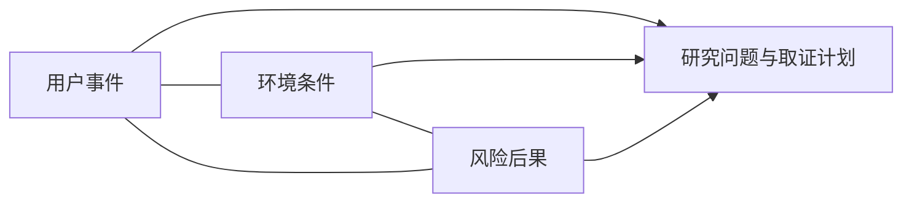

# 3I调研：把用户、环境和风险放在同一研究边界中

已核出版社2017简介把3I列为用户需求、产品环境、产品风险三类调研，第5章5.2/5.3/5.4目录对应。仅据这些材料可确认覆盖职责，不能猜三个英文I、问卷、评分或原作者选题算法。[EWB2-1] 本文给出可操作的平台研究适配，所有具体步骤不署名为专章原法。

## 为什么三类不能各填一句话
用户说“想自动化”并不说明何时最需要帮助；环境说“户外”也不足以决定方案；风险填“注意安全”更不形成约束。三类材料要在同一使用事件上交汇：谁在什么条件下做什么，哪些限制改变行为，失败后谁承担后果，哪些资料还未取得。

## 完整构造例：先研究粉尘恢复，再选检测路线
任务是桌面惰性试片检测研究。明确假设的构造记录，不是真实访谈：用户每班需恢复基准一次；环境固定为有粉尘台架，不能改洁净室；风险关注误把失效参考判为可用，可能造成研究数据失真。候选V视觉参考要求洁净面且每班4次校准，候选C接触参考允许粉尘代理条件、每班1次校准，但可能产生压痕。两候选属性均是教学设定，非现有供应商承诺。

|调研域|事件/条件记录|对路线的作用|待补证据|
|---|---|---|---|
|用户|每班允许1次恢复|V的4次违反范围|实际维护容忍度|
|环境|粉尘台架不可改|V洁净条件不可沿用|粉尘类别/浓度/沉积|
|风险|错误参考污染研究数据|C也需失效识别|压痕、偏移及状态判定|

取舍不是“C得分更高”，而是V在两个已设硬条件下不可直接采用，C尚无该冲突，所以选择C作为**下一步台架课题**：研究粉尘/压痕对基准重复性的影响。此结论不等于C已安全或客户已经选型。若用户恢复次数其实没有依据，要撤回该硬条件，V不能据此被永久排除。

操作顺序：固定事件与任务身份→把原话/观察/推断分列→三域覆盖并关联→将冲突写成研究问题→确认哪些条件不可改/可讨论→形成选题候选及最小补证计划。环境与风险发现可以反过来补访谈，不要求三条线按固定次序完成。

## 失败、迁移及交接
一是把现场未取得的天气、树体参数填成经验常数，后续模型虽能算却针对虚构场景。二是把用户期望当风险已被接受；风险接受需要适当责任者及验证，不能靠调研表。三是将R08事件编码等方法拼进3I后说是原作者标准步骤，应各保留方法归属。

迁移到报告发布应用，可研究读者任务、使用网络/权限环境、错误发布风险；机械粉尘条件不迁移，重新界定版本与引用风险。3I是研究覆盖框架，R08/R09等提供具体取证方法，WB03把调研发现落实为规划关系，二者职责不可替代。

## 来源与输出
EWB2-1：高教社ISBN9787040481778正式简介3I段与第5章目录；https://xuanshu.hep.com.cn/front/book/findBookDetails?bookId=59cf87baba9eb884cf8238c4 。只核简介/目录，原专章细则仍需合法取得。
输出包括带身份的事件、三域证据/假设、矛盾条件、选题理由和补证项，不输出伪客户确认。真实割胶当前仍缺现场材料，以上充分构造例只教研究逻辑，不填补其空白。
