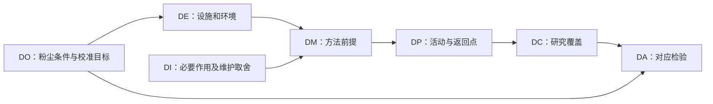

# 7D总体规划：把目标、环境、方法和检验改成同一份计划

7D的作用是让设计规划的不同方面彼此对得上。填完七个栏目，只能证明内容存在；真正的规划判断是：这个目标在这个环境里，是否能由所选方法、过程与内容研究，并由相应检验回答。发生冲突时，要能指出改哪一域、同时影响哪些域，而不是再加一句“加强协调”。

2019年闻邦椿本人署名回顾明确列出DO目标、DI思想、DE环境、DP过程、DC内容、DM方法、DA设计质量检验【作者自述】。2017出版社简介写7P，目录6.2.1/6.2.2写7D；此处保留这个来源差异，不替作者判定笔误或改名。以下依赖图、修订记录与构造计划是【平台适配】，不是未取得的专章原算法。[EWB3-1][EWB3-2]

## 它解决的是规划一致性，不是替代专门计算

适用时机是：设计任务已经有一个可讨论的边界，但环境、方法、资源和检验还需统筹。若用户需要还完全模糊，应先做调研；若问题已是“某杆的强度如何”，应交专门分析，而不能用七域完整性代替方程或试验。

七域可以这样阅读：

| 域 | 要做出的规划判断 | 典型产物 |
|---|---|---|
| DO目标 | 这轮究竟要证明或排除什么，成功边界是什么 | 带条件的研究目标和不在范围内的结论 |
| DI思想 | 设计取舍遵循什么原则，遇冲突先保什么 | 不可被亮点/总分抵销的取舍原则 |
| DE环境 | 使用、组织、设施和外部条件是什么 | 环境条件、已具备资源与未知清单 |
| DP过程 | 按什么依赖安排工作，何时回返 | 活动关系、停点与版本更新路径 |
| DC内容 | 哪些作用、性能或接口必须研究 | 研究对象与覆盖边界 |
| DM方法 | 用什么办法取得所需认识，其前提是什么 | 方法及输入前提、替代路线 |
| DA检验 | 哪种材料能够检验目标，而非只展示方案 | 目标—观测/分析—判定依据映射 |

这些产物名称是平台的操作化解释；原来源支持七域名称及总体规划位置，不足以将本表署名为作者逐条原文。

## 完整构造实例：从一个矛盾的台架计划改成可执行的研究计划

假设团队要研究一套模拟粉尘环境中的试片定位装置。注意：本轮目标是**研究计划可开始**，不是装置已适合真实野外。构造输入已经给足：有模拟粉尘台架、无洁净室；研究边界是定位重复性与维护动作；要求每班参考校准不多于1次；所有阈值仅为教学委托，不是客户要求。

初始V1选择一种假定需要清洁表面、每班校准4次的视觉参考方法。七域表如下：

| 域 | V1规划 | 审阅时看到的问题 |
|---|---|---|
| DO | 在模拟粉尘台架研究定位重复性，并控制参考校准≤1次/班 | 目标可比较，但只对这一研究环境成立 |
| DI | 保留必要定位与恢复作用，不以增加维护换取漂亮演示 | 与4次校准存在直接取舍冲突 |
| DE | 有粉尘台架，无洁净室 | 不支持方法的洁净前提 |
| DP | 先搭视觉参考，再直接做完整循环演示 | 方法前提尚不成立就进入集成 |
| DC | 图像参考、相对运动、异常恢复 | 缺污染后参考失效/重建的研究 |
| DM | 假定视觉方案需清洁表面、4次校准/班 | 与DE、DO同时不相容 |
| DA | 在洁净演示台拍视频，展示运动顺畅 | 不能回答模拟粉尘条件下的维护与重复性目标 |

这时可以作出明确判断：**V1不具备开始其原集成计划的条件**。不是因为表缺字，而是已有三条可定位冲突：环境—方法、维护目标—方法、目标—检验。

### 不只改DM：一次有传播记录的V2修订

团队提出第二方法：接触式机械参考。教学假定它不需洁净室、每班校准1次。由此可以选择V2进入受限的台架准备，但条件是同步修订其他域，而非仅把“视觉”换成“机械”。

| 受影响域 | V2具体改动 | 为什么要一起改 |
|---|---|---|
| DM | 换成上述接触参考研究路线，保留假设来源 | 方法前提与现有设施不再直接冲突 |
| DC | 加入接触载荷、试片压陷、污染积聚和参考重建 | 新方法带来新副作用，不能只继承视觉内容 |
| DP | 先核参考接触与维护步骤，再接相对运动；异常状态不清就返回参考研究 | 先解决可能使结果失真的依赖，不直接演示集成 |
| DA | 在同一模拟粉尘条件记录重复定位与校准动作，并检查接触状态；视频仅作过程记录 | 检验要回答DO，不替换成更容易成功的环境 |
| DO/DI/DE | 保留原研究边界和维护取舍，不悄悄降低目标或补造设施 | 避免“为了通过规划”而改写委托 |

现在得到的是**规划层的可辩护选择**：在给定假设下，V2比V1更适合开始这一轮台架研究，因为三个已发现冲突得到处理，并且新风险进入DC/DA。仍未证明接触方法的重复性或安全性；试验可能推翻它。若接触载荷造成不可接受压陷，回DM比较其他参考路线，或回DO检查要求是否有依据，不把失败隐藏在“已完成研究”下。

实际资源负责人、工时批准和试验许可不由这份规划产生。DP安排说明依赖；不是组织已经承诺人力。这个区别使7D与Stage-Gate衔接时不会把“规划一致”当“获准制造”。

## 两种误用与另一情境的迁移

**误用一：换环境验证原目标。** 野外目标用洁净演示验证，可能得到清楚的视频，却回答了另一个问题。应明确改变后的适用范围，或恢复目标环境，不能把两者混写。

**误用二：局部改方法，其他域不更新。** 从视觉改机械后，还只检图像质量而不看接触载荷和维护，就留下新的盲区。变更影响不必遍历所有域，但必须说明检查了哪些关系、为何无需改另一些关系。

资料交付平台也可以按同样的规划问题工作：DO是接收者可核对正确版本，DE可能离线且无统一账号；DM若依赖随时联网查询就冲突。V2可研究随包版本清单，但DC须增加离线来源身份、DA须检查离线接收者能否完成核对。迁移的是规划一致性，不是机械试验参数，也不是已经证明资料可靠。

## 给引擎和后续方法留下什么

每个规划版本至少留下七域内容、关系依据、冲突ID、修订前后差异、保持的目标、尚未检验的假设和回返责任。R48接收目标变更问题，R14接收新增作用/接口，R42接收检验映射；不要只交七个标题或一个“规划通过”标记。

与WB01的区别是：WB01说明体系与文献层级，这里处理一次具体规划；与WB04的区别是：这里决定研究什么、为何能这样研究，WB04才进一步联合审查同一候选的功能与性能。两者可往返，不能互相代替。

### 证据位置与内容身份

- **EWB3-1【作者自述】** 东北大学2019署名文章，“案例3”第6—8项，尤其第7项七域名称。效果叙述不是独立评估。[来源](https://neunews.neu.edu.cn/info/1002/849441.htm)
- **EWB3-2【出版社简介/目录】** 高教社ISBN9787040481778书页，简介7P、目录6.2.1/6.2.2 7D及6.3—6.8。仅支持名称/组织与差异；没有章正文细则。[来源](https://xuanshu.hep.com.cn/front/book/findBookDetails?bookId=59cf87baba9eb884cf8238c4)
- **EWB3-3【平台构造/适配】** V1/V2条件、校准次数、关系图与改版选择均为本稿独立教学，不是实测或原作者实例，见`示例/WB03-规划修订.json`。
