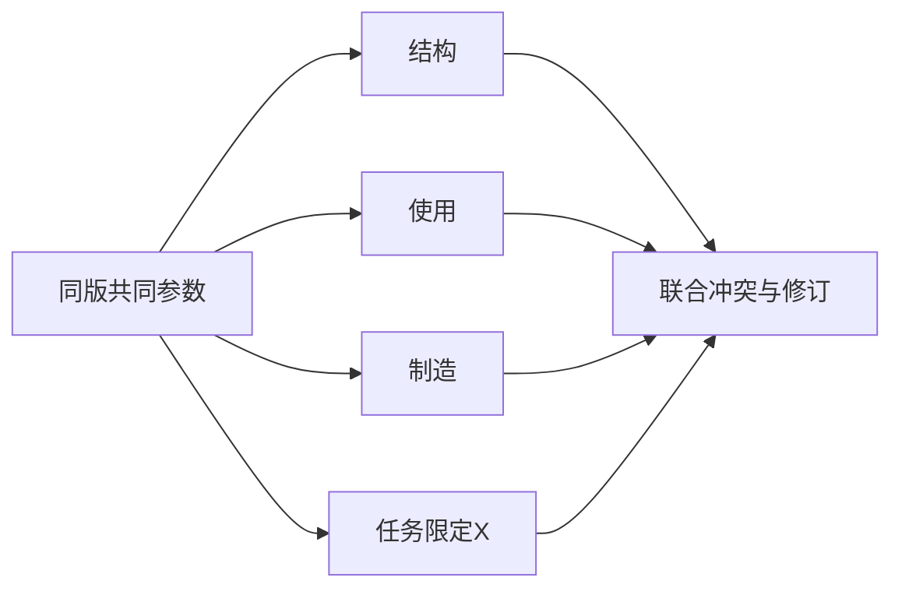

# 1+3+X综合设计：用共同参数解决跨性能冲突

2019作者自述将科学实施的优化内容概括为功能、结构、使用、制造及特殊性能，并描述1+3+X。它要求综合考虑，不是五个分数加总。2003三化设计手段与这组覆盖领域层次不同，不能把名称直接替换。[EWB4-1/2]

## 综合的实质是共同变量和不可抵消约束
每个候选要有统一版本，结构质量/刚度/阻尼、使用激励、制造连接和维护限制共享参数。不同小组分别拿不同版本算出最好结果，再相加，会形成不存在的方案。特殊性能X必须来自任务，例如清理、耐环境或可服务性，不是为凑符号随意加模块。没有专著模型时，本文采用明确署名的平台联合审查。

## 构造算例：减重后反而接近共振
独立线性单自由度代理：X=F/√[(k−mω²)²+(cω)²]。假设F=1N，ω=√1000rad/s，k=1000N/m，c=2N·s/m；研究位移上限设为.003m。候选A质量2kg；减重候选B质量1kg；修订C保持1kg、k=2000N/m。质量/刚度在本代理中允许独立调整，真实结构需要几何材料模型重新约束。

|候选|m kg|k N/m|稳态幅值m|联合判断|
|---|---:|---:|---:|---|
|A|2|1000|.000998|响应满足，质量较大|
|B|1|1000|.015811|轻量但响应超限，拒原改版|
|C|1|2000|.000998|质量较低且响应满足，待实现刚度|

C在这两个教学指标上优于A，但不能直接作为整机赢家。假设C为提高刚度把可替换密封永久粘接，而X明示要求可单独更换密封，它又被拒。C2须保留可拆密封并通过连接设计获得刚度，再交制造/公差核查。没有C2的真实结构证据时输出研究方向，不伪造它已经存在。

此例的完整选择是先淘汰B、再排除不满足服务条件的C连接方案，选择“可拆连接+高刚度”的C2课题进入结构研究；它展示综合设计怎么改变行动，不拿未知费用补零产生总分。

## 失败与迁移
以轻量分补偿超限振幅，将硬约束降成偏好，是第一种失败。制造少件却破坏可替换功能，是第二种。第三种是激励未知仍沿用旧ω计算；应回工况辨识。参数模型只是局部代理，不能被“综合”名称扩大到接触非线性/疲劳安全。

迁移到知识产品，可让同一内容版本同时接受事实完整性、可读性、生成代价和权限要求联审；不能由写作速度分抵消来源造假，机械幅值也不迁移成准确率。WB03协调规划关系，本项协调实施中的功能/性能；R33/R34/R35提供具体求解。

## 依据和交接
EWB4-1：2019自述案例三第6/8项，https://neunews.neu.edu.cn/info/1002/849441.htm 。EWB4-2：2003论文摘要及第3节，https://qikan.cmes.org/jxgcxb/CN/PDF/16926 。2017目录/2007书目只支持章节主题，尚无完整原始算法；本文方程、数值与审查表是平台适配。
交接统一参数版本、每域约束身份、冲突位置、修订传播及未证实现；不能分别最优相加。
