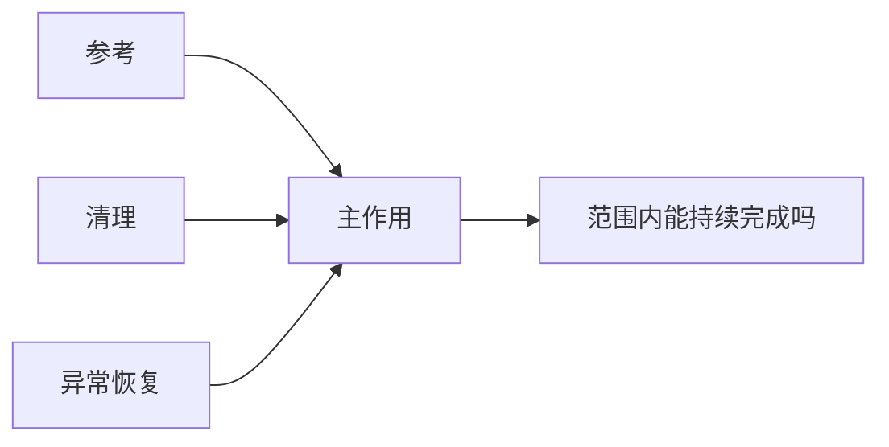

# 主辅功能与功能优化：辅助表示支撑，不表示可以删除

主功能由研究目的和系统边界决定，不由最贵零件决定；辅助功能使主作用在实际条件下能够持续、恢复或被控制。高教社第7章目录确认主辅功能、合理功能、分解及组合主题，但没有提供本轮可核的全部原作者必要性判据。因此下述操作是平台适配，不能冒充原专章算法。[EWB5-1]

## 把“必要”写成可反驳的依赖
先写目标与允许范围，再用动词—对象表达作用，记录承担者、触发条件、输出及支撑边。对辅助作用问：没有它，目标在本范围还能否完成？答案要有模型或事件，不由标签决定。优化路线包括消除真正不必要的作用、减少实现负担、改变承担者以及改善时序；不是把辅功能从清单删掉。

## 构造例：清理功能怎样决定持续工作
假设惰性试片连续推送，每次作用后接触面残留增加1单位；残留>3时无法达到所设作用边界。初始残留0，目标每批10次；每次作业1s。以上是构造状态模型，不是胶乳沉积规律。FM主作用需参考FR与清理FC支撑，异常时需恢复FS。

不清理时第1–3次后残留1/2/3，第4次后4，后续边界失效；删除FC并不能完成10次。每3次清理复位至0，可在第3、6、9次后清理，共3次，每次2s，整批10+6=16s，满足持续条件。于是保留清理必要性，选择周期清理作为基线，而非说辅功能价值低。

|改版|作用接管/模型|10次可持续吗|代价|
|---|---|---|---|
|删FC|无人去除残留|否|时间少是假节省|
|人工每3次清理|复位0|模型可以|3次人工责任，16s|
|自动每3次清理|假设机构可复位0|模型可以|机构/能耗/可靠性未知|

若将人工改自动，FC仍存在，只是载体改变。研究选择可以是保留人工基线收集清理证据，再研究自动化；不能在人工负担未知时宣称已降低全寿命成本。若真实残留并不累积，模型假设被推翻，则重新评估FC，而不是为了保框架强说它必要。

## 失败与迁移
只分析一次主作用而漏掉连续条件，会误删清理。把人工当免费接管者，会隐藏等待、暴露和组织责任。把功能“清理”与零件“刷子”混同，则删刷子后不知道清理是否还在，应回作用层追踪。

迁移到文档交付：去除旧版歧义可能支撑正确发送，删去版本核对能省一步但会破坏主目标。需定义错误状态和恢复，不搬用残留1单位模型。与R14相比，本项强调主辅目的和优化组织；R14提供通用作用图；R26核载体裁剪的接管，不能直接取消必要功能。

## 来源与交接
EWB5-1：高教社2017书页第7章7.2–7.3目录，https://xuanshu.hep.com.cn/front/book/findBookDetails?bookId=59cf87baba9eb884cf8238c4 。科学出版社2007目录第3章提供功能优化主题佐证，不支持本文状态阈值。原章正文尚缺。
交接功能身份、主辅与必要性各自依据、支撑图、状态递推、接管者及代价缺口；真实任务的必要性仍需现场/专业核查。
