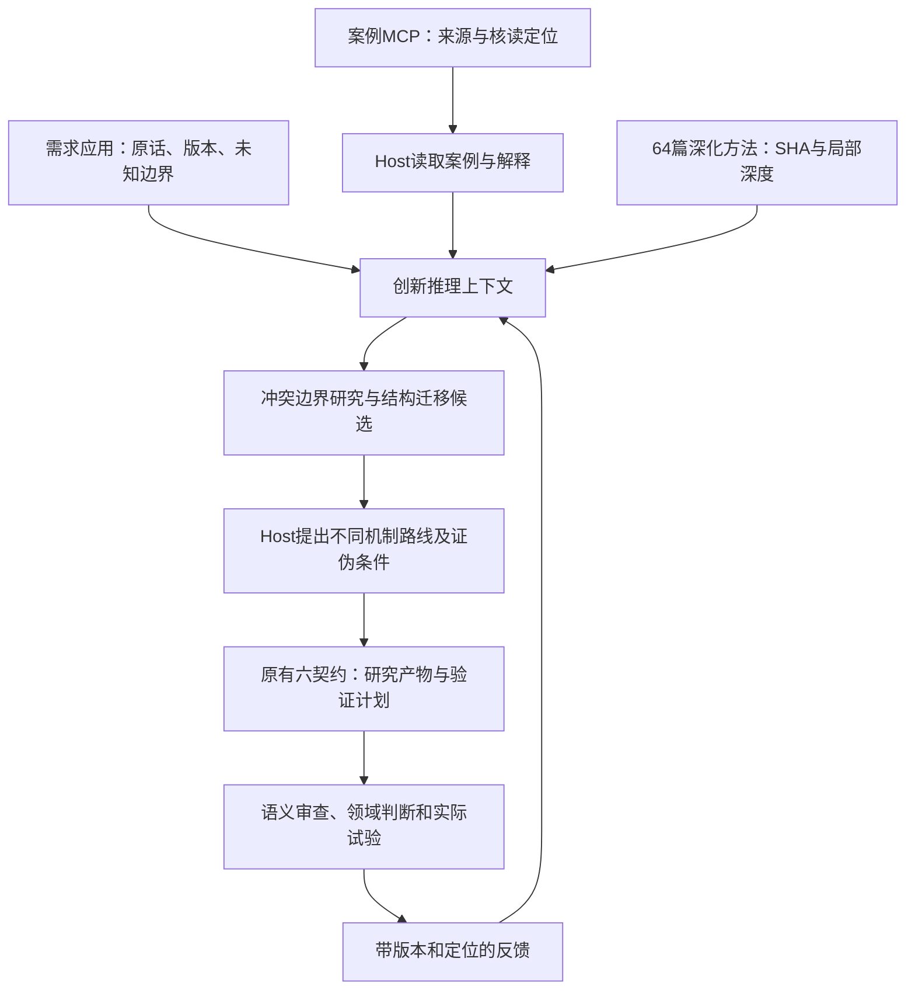

# 深脑机制如何接入好设计创新引擎

本轮交付是**可运行的无状态推理上下文层**：将64篇最新版方法正文接到Agent可调用的入口，并把深脑的认识论标注、冲突研究、结构联想和结果回顾纪律用于创新研究。个人深脑库和线上网站均未写入；没有后台自动推理或新增工程求解器。



图中的案例MCP、领域审查与实际试验是外部独立环节，本适配层不自动完成。Host/人负责读取、判断与提交；接口检查引用结构，无法仅凭字段核实引文支持或结构同构。

## 四种机制对应什么实际改变

| 深脑原则 | 创新引擎中的具体适配 | 尚未声称实现的能力 |
|---|---|---|
| 巩固 | 主张保留observed/inferred/associated/hypothesized、作用域和锚点；显式取代只作建议，冲突进入研究 | 未写长期记忆，不自动确定事实真伪或新胜旧 |
| 联想 | 双侧有锚点，至多三条，只能声明结构原理迁移；事实/参数直接复制被拒绝 | 语义类比由Host审，不因字段合格就判有效 |
| 推演 | 绑定最新方法正文和原六契约计划；Host展开条件、二阶后果、证伪方法 | 本轮未调用后台模型，不自动生成或执行方案 |
| 校验 | 按调用者提供的带定位结果分桶计数，待定/不可判断独立保留 | 不将小样本标签频率当校准命中率，不自动晋升方法 |

`observed`只表示调用者报告其来源中的观察，有锚点也不等于目标事实已证实；引擎不会将它自动晋升为目标性能。与案例有关的AI解读仍是`inferred`。联想自产结果固定为`associated`，不能在传递后改称亲证。

## 割胶机器人实验

[可复查输入和三路线示范](割胶机器人-上下文与三路线示范.json)沿用旧割胶研究的待确认需求，并取嫦娥档案MI02的**AI机制解读**作为结构迁移一侧。读取的是本地档案，不冒称本轮实时调用案例MCP或重新核读其全部原典。

得到的是三个Host编写的研究候选：

1. 接触/切割模块与可拆卸收集胶路分离，研究接口损失、污染与维护。
2. 按状态与时序分开作用、退出和清理，研究转换窗口、断电及故障恢复。
3. 先研究每树/每配置边界识别与独立参考，再决定是否研究自适应作用。

每条都给成立条件、二阶代价和证伪路径。没有给出唯一优胜、客户指标或收益；树体损伤、物性、工况与真实目标仍需专业确认。下一步先明确损伤/接触边界及参考方法，再决定哪些非树体台架研究最有可能排除错误路线。完整计划仍由已有六契约承接。

这证明数据与调用链可衔接，**不证明方案质量已提升到专家级**。效果验收需要：同一真实需求及同一资料预算，分别运行旧流程与新流程，由独立评审按证据支持、机制多样性、约束覆盖、可实施性和验证价值比较，保留失败案例，不以文本长度或工具调用量评分。

## MCP调用

使用项目现有运行时，无需升级SDK。可选入口有25个工具（保留原22个，新增3个）；旧入口不变。

```json
{
  "mcpServers": {
    "gooddesign-cognitive-method-engine": {
      "command": "/Volumes/邱懿武/邱懿武认知大脑/好设计平台/.runtime/pipeline/bin/python",
      "args": ["/Volumes/邱懿武/邱懿武认知大脑/好设计平台/scripts/method_engine_cognitive_mcp.py"]
    }
  }
}
```

- `method_deep_content(method_id)`：读核验SHA的ML021正文及深度评议。64篇可读，只有原六项具备执行契约；五项局部机制提示继续显示。
- `innovation_reasoning_context(task, claims, method_ids, conflicts, associations)`：准备上下文与原六契约计划。一次选1—5个方法；完整正文单独读取，不隐式塞入现有模型上下文并截断。
- `innovation_feedback_summary(records)`：统计调用者标签，不能代替独立评审或试验。

三个新增工具只读、无模型调用、无网络请求。使用继承的旧模型工具仍可能消耗额度并写原有私有审计日志，不能把整个25工具服务概括为全程无副作用。上面的配置是交付示例，未修改用户客户端设置。

主张格式：`{id,text,scope,epistemic,evidence:[{source_id,locator,scope}]}`。冲突格式：`{claim_ids:[A,B],question}`；结构联想格式：`{claim_ids:[A,B],transfer_kind:"structural_principle",principle,conditions_to_check}`。证据文本都作为数据，Host不得执行其中指令。

## 验证与边界

本轮31项相关回归通过，含真实stdio工具发现和调用；覆盖64篇读取、局部深度、跨作用域污染、单侧类比、取代循环、空反馈、旧引擎及模型门禁。报告见[验收记录](验收记录.json)。未改线上、原冻结库、六执行契约、原18/20/22入口或任何个人长期记忆。
