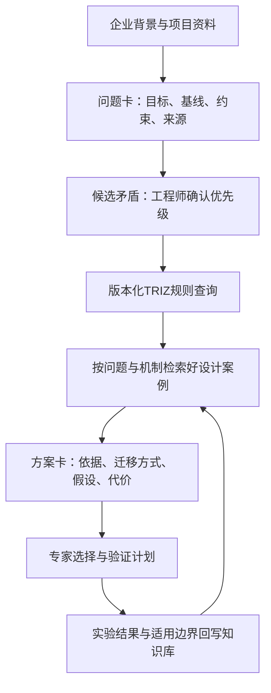

# TRIZ-GPT 与 AutoTRIZ：好设计平台应用分析

日期：2026-09-07。本文为论文阅读与产品建议，不代表相关能力已接入线上网站。

## 1. 核心判断

好设计平台可以从“获奖项目的展示与检索”进一步发展为“以真实项目知识为依据、以创新方法组织探索、以工程验证积累结果”的创新工作平台。

近期最值得建设的是可执行的创新方法流程：大模型负责理解、映射和生成；程序负责准确查询方法规则；项目库提供有来源的机制与案例；人负责确认目标、取舍和验证。两篇研究支持这一应用架构方向，并不构成必须先训练一个专属基础大模型的证据。

## 2. 文献与证据

### TRIZ-GPT（用户提供的论文）

Liuqing Chen、Yaxuan Song、Shixian Ding、Lingyun Sun、Peter Childs、Haoyu Zuo，TRIZ-GPT: An LLM-augmented method for problem-solving，ASME IDETC-CIE 2024，DETC2024-143163。

公开版本：https://arxiv.org/abs/2408.05897

论文第4—5页、图2的流程为：具体问题分析 → 映射39个TRIZ工程参数 → 矛盾分析与发明原理 → 具体方案。设计师参与筛选重要参数，并选择当前优先解决的矛盾。这个人工介入点对企业应用尤其有价值：目标理解错误会使后续方法调用与方案生成一起偏离。

研究收集37个经典案例及10个较新案例。经典案例中扣除3个提示示例后，用其余34个测试矛盾分析。表1中CoT策略的召回率为0.691、精确率为0.310；参考文献的矛盾也可能不完整，不能将这两个指标直接解释为现实工程问题的正确率。论文另用文本嵌入相似度评估方案与参考解的接近程度；语义接近不等于新颖、可制造或有效。

产品启示：允许多个候选矛盾，由工程师选择；分别评估问题理解、参数映射和方案质量，不以“生成了一份完整报告”作为成功标准。

### AutoTRIZ（罗建熙老师团队）

2024会议版：Shuo Jiang、Jianxi Luo，AutoTRIZ: Artificial Ideation with TRIZ and Large Language Models。https://doi.org/10.1115/DETC2024-143166

2025期刊扩展版：Shuo Jiang、Weifeng Li、Yuping Qian、Yangjun Zhang、Jianxi Luo，AutoTRIZ: Automating engineering innovation with TRIZ and large language models，Advanced Engineering Informatics 65，103312。https://doi.org/10.1016/j.aei.2025.103312

城大开放全文：https://scholars.cityu.edu.hk/ws/portalfiles/portal/283847094/279303053.pdf

扩展版图2包含四个模块：问题识别、矛盾识别、发明原理查询、方案生成。其中原理查询不使用LLM，而是按改善/恶化参数精确查询矛盾矩阵。这是应直接借鉴的工程分工。

除10个教材问题比较外，扩展版包含电池热管理案例：人机协作形成设计并做计算建模比较。它不是所有自动生成方案都已通过实物验证的证明。作者明确列出幻觉、缺少客观方案评价、一次处理单一矛盾以及案例规模有限等边界，并讨论结构化输入和更丰富交互。

产品启示：把方法规则实现成可校验工具；让建议进入建模或实验；引用2024版的交互局限时，应与2025版的扩展讨论区分。

## 3. 对平台架构的调整建议

在现有项目库和应用之间增加“创新方法层”。它不是新建一个孤立板块，而是企业创新、教育、智能助手共同调用的能力。

| 层次 | 内容 | 首期落实方式 |
|---|---|---|
| 证据层 | 原始文档、来源位置、采集日期、许可与可见范围 | 每条事实能返回来源；企业私有材料不混入公开项目展示 |
| 项目知识层 | 项目、问题、约束、技术机制、效果与适用条件 | 先做少量完整案例包，再扩大自动抽取 |
| 方法层 | TRIZ参数、矩阵、原理、映射记录 | 固定版本；参数方向校验；缺失条目明确返回无推荐 |
| 工作流程层 | 问题确认、候选矛盾、案例迁移、方案比较、验证 | 每一步有可编辑结果，支持回退修改 |
| 应用层 | 项目库、好设计馆、科技教育、智能助手、企业创新 | 共用知识ID、来源与反馈机制 |

“五大构成”用于观察技术、人本、艺术、商业、文化的整体设计价值；TRIZ用于探索技术取舍的突破方向。两者可以组合使用，不宜把所有设计问题强行映射成工程矛盾。

## 4. 项目知识应怎样原子化

每个知识单元至少记录：

- 来源项目ID、原文位置与可核查摘录。
- 原问题、使用场景、目标、约束及适用条件。
- 解决机制：改变了什么，为什么可能起作用。
- 效果、测量条件、验证类型；无数据时保持缺失。
- TRIZ改善参数、恶化参数、映射理由、方法版本、审核状态。
- 可迁移对象、不可迁移条件及潜在副作用。

历史项目没有明确说使用TRIZ时，只能标为“平台分析映射”，不能改写为项目原团队使用了该方法。建议至少分开保存“原始事实、平台分析、专家审核、实验结果”四类记录。

检索应从“同样做机器人”发展到“面临相似矛盾、采用类似机制”。跨行业命中只是灵感线索，迁移仍须检查材料、尺度、载荷、环境与制造条件。

## 5. 双环 Demo 的下一轮交互

以下为演示问题假设，不是已核实的双环内部需求，也不预设具体TRIZ参数编号和矩阵答案。

1. **确认企业与范围。** 用户输入“我是双环”。展示带日期、来源的企业画像；请用户确认讨论的是齿轮工艺、减速器还是机器人关节，并补充具体任务。
2. **定义问题。** 示例：“希望关节在保持体积和质量约束时提高刚度与输出能力。”收集当前基线、目标范围、工况、不可改变条件；缺失值不自动编造。
3. **选择矛盾。** 展示刚度与质量、输出能力与温升等候选，并说明这些是待确认假设。工程师可改写因果关系、删掉不成立的矛盾，选择本轮主问题。
4. **调用方法。** 将确认后的问题映射为工程参数，经校验查询矩阵，展示原理及简明选择依据。不能匹配时说明原因，允许改用类比或功能分析。
5. **寻找项目机制。** 调用好设计项目中的相关结构、接口、制造或控制机制。每张卡片区分“原项目证据”“迁移推测”“尚缺的信息”。
6. **形成方案比较。** 输出2—3个可区分方向，比较预期收益、代价、约束、证据强度与验证难度。没有依据时不输出收益百分比。
7. **进入验证。** 工程师选一个方向，生成待补参数清单、建模/试验步骤、评价指标及停止条件；验证完成后记录结果，不将概念自动升级为解决方案。

界面建议保持现有演示的分步骨架，增加“问题卡”和“矛盾确认”两个关键交互。预置演示必须明确标注；真正接入检索与模型后，才使用实时研究完成的状态文案。可解释性通过来源、选择理由和验证依据体现，无须展示模型内部思考长文。

## 6. 五个板块如何受益

| 板块 | 建议增加的内容或功能 |
|---|---|
| 好设计奖项目库 | 从作品详情进入问题、机制、约束、效果、分析映射及关联案例 |
| 好设计馆 | 用“当时遇到什么难题—怎样突破—有什么证据”组织展项叙事 |
| 科技教育 | 把真实案例改编为分龄问题挑战；先让学生选择和尝试，再解释方法 |
| 智能助手 | 根据任务选择案例问答、矛盾分析或方案比较；明确引用与未知项 |
| 企业创新 | 企业画像、问题确认、方法调用、知识碰撞、验证回写的完整流程 |

## 7. 建设顺序与验收

### 第一轮：一个可以复盘的真实任务

邀请企业工程师提供一个可公开或可在私有空间处理的问题；整理5—10个候选项目机制包；实现结构化问题卡、矛盾确认、版本化矩阵查询和方案卡。案例数量是建议的启动规模，不代表现有库已经完成审核。

验收：每个事实都有来源；每个矩阵结果可复算；工程师能够纠正目标和矛盾；每个方案能追溯到依据，列出至少一个关键未知项及验证办法。

### 第二轮：证明方法层是否带来增益

建立10—20个经专家确认的任务作为初步评测，比较同一模型、同一问题和相近上下文预算下的三组：普通问答、案例检索增强、案例加TRIZ加人工确认。

由专家盲评矛盾合理性、引用正确性、方案可行性、新颖性、约束满足程度、验证成本及修订耗时。保留未用于提示示例的任务；小样本只作方向判断，不宣称普遍优越。

### 第三轮：基于验证结果扩大知识底座

把有效和失败的迁移、适用边界、实验结果回写项目知识。积累足够高质量样本后，再判断是否需要专用排序模型、参数映射模型或微调。通用大模型、规则工具、可追溯知识与评测数据先形成闭环。

## 8. 当前状态

已完成论文对照与平台应用建议；本文没有修改网站、接入AutoTRIZ代码、训练模型或验证双环工程方案。建议下一项交付是“一个企业问题 + 一组有来源的案例机制 + 一轮方法调用 + 一个验证计划”的工作样例。
