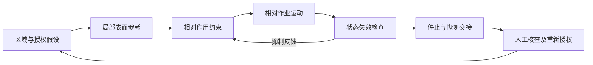

# R14 功能分解与接口分析：先把要做的事与能证明的事分开

版本0.1.0，2026-10-27。MD-003。本包是公开原典选段研究、平台构造教学与实际本地结构检查。没有访谈真实胶工、没有对树体试验，没有客户批准的目标值。独立Agent复核与领域专家复核均尚未完成。

## 方法真正改变什么

R14将“想实现的结果”转成可分配的作用、流、接口和场景。功能名称应说明对象如何变化，不能由零件清单直接替代。分解的产物也不只有树：一棵树表达包含关系，流图表达交换关系，场景表达正常与异常条件下如何协同。它们必须互相对照。

本轮新核[NASA §4.3](https://www.nasa.gov/reference/4-0-system-design-processes/)和[§6.3](https://www.nasa.gov/reference/6-3-interface-management/)选段，定位见来源与主张。原文为一般方法依据，不为本例六个功能背书；以下判断、JSON和教学模型是平台适配。NASA流程中可基线化的要求与本题未确认需求不同，所以本题始终只形成研究模型。

## 从一份不充分输入开始

共享输入TAP-TEACH-001 v0.1.0来自R48，SHA绑定在教学包中。N-T01至04全是研究需要假设，客户目标与单位均未知。任务边界限定为作业头局部作用、状态、人工异常处置；整机转场与服务只列影响和接口未知。

输入不充分并不意味着什么都不能做。可以整理功能假设并暴露缺口，不能给出“边界已经控制”“需求已经满足”或正式设备基线。这里有三种不同状态：被分配到功能、存在可描述机制、已有证据满足要求；不能依次自动升级。

## 六个派生研究作用及其责任

|作用|研究职责|不能偷渡的结论|
|---|---|---|
|F-T01 定义允许作业区域|表达区域、授权与版本|区域能识别、授权已真实取得|
|F-T02 建立局部表面参考|给出参考、坐标、测量时点及有效状态|表面位置等于内部组织边界|
|F-T03 约束相对切入作用|解释许可如何约束作用|未知的组织限值已满足|
|F-T04 产生相对作业运动|联系供能、作用、状态与反作用|载荷、功率、损伤已核定|
|F-T05 识别状态失效并抑制作用|关注陈旧状态、失效与抑制|有反馈线就能及时检测和停止|
|F-T06 停止作用并交接恢复|分开停止、退出、残能与人工交接|停止即安全、异常后可自动恢复|

N-T04在本包只体现停止后清理/维护交接，完整清洁、转场、服务并未展开。这项局部映射不能冒充完整需求覆盖。

## 四个应由人判断的关口

1. **分解到哪里停止**：以能否讨论替代原理、界定接口及提出检查为依据，而不是一律三层。若下一步仍只能说“做智能控制”，该作用尚不够具体。
2. **什么是参考，什么是目标**：局部表面参考是中间表示，内部允许作用边界是另一个需要模型或证据支持的对象。二者之间的映射未知，不能由传感器名称弥补。
3. **接口双方是否理解相同东西**：坐标、正方向、时间戳、有效性和抑制权限都需要双方定义。表示单位可以由教学协议选择，但验收阈值仍不能由Agent生成。
4. **异常怎样返回**：异常之后不沿用旧许可。停止是否完成、残能是否已处理、谁重新授权都需明确。这里采用“待人工核查”的教学选择，并未证明它本身是适合真实机械的安全方案。

这是一张研究职责图，未绘出完整生物/机械因果模型。物料和能量边界另存在JSON接口表中，不强迫每种流经过所有感知功能。

## 完整教学包与实际检查

`教学包/01-功能与接口输入-v0.1.0.json`包含6个功能、12个声明接口、正常研究路径和异常恢复路径。02保留分解选择与替代分组，03给出交给R17的子问题，04只读校验既有R14/R17升级包指纹。新模型明确允许反馈关系，不调用原R14串行情景链求值器去证明一般反馈覆盖。

`核查教学模型.py`实际运行9个检查：正常、缺恢复、错误执行模式、部件式命名、单位冲突、未知填零、缺外部对象和文档交接迁移。检查结果在05中，输入逐份留存。程序只检查显式结构和少量词首提示，不理解所有自然语言功能，也不证明流守恒、时序、安全、任务充分性或工程效果。

## 向R17交接时必须保留什么

R17接F-T02、F-T03、F-T06作为三维原理子问题；F-T01、F-T04、F-T05保留为共同职责。所有N-T需求和U-T未知仍沿原共享版本，不能因为有选项就写功能实现。交接包含问题ID、上游版本和SHA、函数ID、范围、未决项与禁止扩大的声明。

## 与已有教学升级的关系

既有R14 v0.2.2在声明的单向链/局部场景检查范围已有独立复测。其入度/出度判首尾并非所有反馈拓扑的通用语义判定；本包不覆盖或重写它，也不宣称新检查器修复了其通用能力。本轮新增的是另一个构造场景、反馈与物理边界的显式职责，以及受限结构检查。原生核心、固定契约和线上均未修改。
