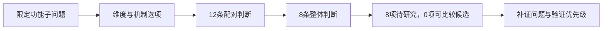

# R17 形态学分析：把组合空间与成立证据分开

版本0.1.0，2026-10-27。MD-004。本轮形成一个可复算的割胶教学子问题、两个不同范围的反例和一组跨情境检查；没有完成割胶机器人设计，没有客户批准或工程验证。

## 方法的力量与危险

形态学分析使被忽略的选择显形：哪些维度、每维有哪些选项、哪些组合被排除、为什么留下其余组合。新的信息通常来自维度定义和一致性审查，不来自枚举数量。本轮重核[Ritchey网页正文](https://swemorph.com/ma.html)的维度与CCA部分；原文主要是非量化问题建模。将其用于功能—原理空间、设置unknown和整体工程复核，是平台适配，不是原作者替本例确认兼容。

一致性不能当作因果证据；价值偏好也不能伪装成逻辑不可能。成对一致性记录对缩减形式空间有用，却不自动检查总资源、同步或其他高阶关系。一个组合“尚未被排除”，也不等于“值得采购制作”。

## 本例先限定子问题

共享TAP-TEACH-001经R14派生出六个研究作用。本例只为三项展开候选，其余作用和接口仍留在R14共同包中：

|维度|选项甲|选项乙|最重要的未知|
|---|---|---|---|
|建立局部表面参考 F-T02|接触基准|非接触表面测距|压陷、介质、污染及与内部边界关系|
|约束相对切入 F-T03|几何相对限位|感测反馈约束|组织允许限值、误差及动态响应|
|停止退出与交接 F-T06|被动储能退出概念|受控执行退出概念|失能、方向、卡阻、残能与反馈|

这些都是构造机制假设，不是已证实可行的割胶技术。尤其不能把接触参考或测距当成已知内部组织边界。停止与退出也不是同一结果，表中选项名称不保证两者已经实现。

## 从矩阵到结论的完整链

1. 输入先绑定R48共享版本和R14模型SHA；需求、组织和资源目标全部保留未知。
2. 三维各二选项产生8个形式组合。12个跨维配对均明确unknown，记录具体要查的几何、时序、供能和生物作用问题。
3. 8条整体判断也逐条unknown，不凭选项名称给兼容结论。
4. 使用已有R17 v0.2.2教学求值器，只读传入新输入并实际执行：8枚举、8 conditional_research、0排除、0 model_comparison_candidate。
5. 选择策略中的第一组只是固定展示基线，不是推荐。交给R36的TAP-C01至C08沿输出ID映射，所有硬约束状态仍未知。

结果“现在不能排名”是有信息的：指出阻止判断的是哪些材料，而不是用统一0分填平差异。R36可将其转成补证队列，R44再设计能区分关键假设的学习活动。

## 一个真正的高阶反例

另设**完全人为**的功率练习：两个参考选项为5/20 W、两个约束选项为0/25 W、两个退出选项为0/20 W，共享上限50 W。12个跨维二元求和均不超上限，但20+25+20=65 W的三元组合超出。实际程序保存12配对、8整体计算，其中1项整体超限。

这些数值不是机器人实测、客户要求或器件规格。即使其余7组合满足该虚构功率约束，物理适用性仍unknown。它说明必须在正确的模型中检查整体约束，不能用已知资源小表去补齐未知真实工程。

## 五类反例与另一情境

`反例与迁移复算.py`实际只读执行8个求值器检查：正常全未知、缺配对、不支持生产模式、缺整体判断、选择冲突组合、未知填零、跨数组ID重名、文档介质协议迁移。每次保存原始输入、输出、返回码和SHA。

文档情境包含纸本/电子形成和纸本/电子归档；教学协议禁止隐含转换。4组合中2按协议被排除、2仍待研究。禁止转换是人为协议，不是断言现实无法打印或扫描；同介质也不证明可读性或流程有效。这是不同对象的局部程序迁移，不是整个原生适配器已经通用。

## 执行能力的真实边界

现有v0.2.2教学求值器能读取本例JSON，验证记录并枚举；它不自动发现机械兼容、创建安全阈值或产生测量证据。既有固定native adapter的案例绑定仍固定，本轮没有调用它、没有提交MCP运行、没有写生产库。建议契约另列在调用说明，不能宣传为已经上线的通用R17引擎。

## 下一步的具体取证

首先判断允许组织边界如何定义、什么信号能支持它，再核相对限制和异常停止条件；该顺序是本例风险驱动的研究建议，不是源方法强制流程。缺少真实现场和专业口径时，最多交出候选机制与可回查问题，不能把“有8种组合”当8个成熟方案。
