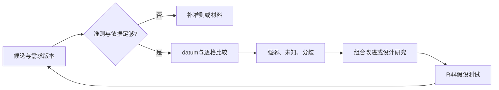

# R36 · Pugh概念筛选：从给概念打分到组织下一轮设计

版本0.1.0，2026-10-27。范围是来源选段研究与可复查的构造教学；不是Pugh原著全文重建、客户选型或工程认证。

## 承接什么，新增什么

既有R36 v0.2.1教学包已完成19项隔离测试和5项保真探针，支持限定案例比较与datum变化，不应抹去。本轮不重写它，而把R17构造割胶候选、R48需求假设和R44补证任务连起来，并增加一个独立的小型datum对照。旧包通过的测试不算本轮新增执行；对应审核文件及SHA保存在本轮版本记录。

## 原理：同一批概念，针对同一组准则作相对比较

MIT官方Concept Selection材料说明，Pugh过程还承担组合优点、改进弱点和继续发展的职责，不能将其压成“选唯一第一名”。MIT D-Lab使用datum和逐准则相对评价，同时允许加权；本平台教学包的硬门槛优先、未知显式保留与不加权，是为了本任务证据治理作的适配，不冒充作者唯一规则。[MIT Concept Selection](https://appinventor.mit.edu/explore/sites/all/files/teachingappcreation/unit4/DesignUnit4.pdf)，[MIT D-Lab](https://ocw.mit.edu/courses/ec-720j-d-lab-ii-design-spring-2010/pages/projects/ideas/)

比较关系应拆成：`对象版本 + 准则定义 + 方向 + 证据 + 相对datum判断`。其中“相同”意味着在已声明尺度上有理由认为相当；未测、未建模或不同工况，应是未知，不能写0。未知可生成下一轮研究任务，而不是偷偷参与净分。

## 什么时候值得用，什么时候应返回

适用于已经有可解释的候选、能提出共同准则、需要保留/组合/补证的阶段。不适用于还没有方案机制、准则只有“先进/智能”口号、或客户需要根本未清楚的情境。前者返回R17/R14，后者返回R48/R08。要求所有准则都先有数字也不合理：有依据的定性关系可以使用，但应保存判断者、理由和支持范围。

构造割胶输入TAP-TEACH-001只有四项研究需要，没有验收阈值。故候选可以用于研究比较，但没有任何一个可据本矩阵升级成工程方案。N-T01控制边界、N-T02停止退出、N-T03状态时效与N-T04完整作业，都需分别追踪；仅局部机制候选不覆盖整机。

## 操作过程与关键返回点

1. **冻结对象**：给需求、候选和配置稳定ID、版本及SHA。一个候选由哪些机制组成、哪些接口未解决，必须先可说明。
2. **核准则**：每项准则说明对象、比较方向、观察/计算方式及来源。性能指标、价值偏好和硬要求分开。硬要求未确认时记录未知，不能由Agent批准。
3. **检查资格**：存在明确硬失败的候选不能因偏好优势取得实施资格；硬状态未知者可以留下研究，但不得标可实施。
4. **选datum**：说明为何选该候选。基准应可解释，不一定恰是当前最佳，也不是原方法全部版本都要求同一选择。
5. **逐格比较**：填入“好/相同/差/未知”及证据。相同尺度、相同工况才可比较；一方数据缺失时不外推。
6. **看强弱和分歧**：保留不同评价者的分歧；不要只算平均。净加减数在本包仅是教学描述，不代表经校准效用或技术性能。
7. **改进和补证**：产生可组合特征、需要复查的准则、最可能改变选择的未知，再交R44/R38/R52。
8. **换datum复看**：比较依赖基准；改变基准后的净数改变不等算法坏了。若结论不稳，应解释并保留候选，不能挑最有利基准宣布胜出。

## 两个不同层次的完整教学

主链保留R17候选的“待研究”身份。工程性能未知时矩阵会产生未知和补证，而不是虚构性能排名。`教学包/`内的输入、逐格比较和补证队列给出可回查过程。

独立DATUM-TEACH-001小例只用人为设定的调整动作数/模块数和未知清洁表现，用来复算基准改变对净加减的影响。计数是假设，不是现场测量，也不证明动作越少一定更安全或更便宜。其功能是让读者看懂相对比较机制；它不被混入割胶候选事实。

## 方法边界

本包的检查程序验证引用、比较规则和不越权的状态转换，不验证候选是否物理可行。表内逻辑一致也不能替代设计分析、客户确认或现场试验。跨方法输入未齐时应输出待绑定，不应从方法名称猜补内容。
