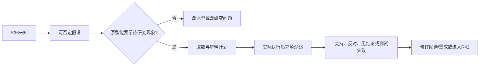

# R44 · 原型与假设测试：先决定要学什么，再决定做什么

版本0.1.0，2026-10-27。范围是原型学习机制、完整计划与桌面检查；未制造原型、招募参与者或执行现场试验。

## 承接与本轮新增

既有R44 v0.2.1固定教学计划有20项隔离测试、4项保真探针，已明确计划和实际结果不能混淆。本轮在其边界上补割胶研究中的机制学习与状态理解两条不同路线，接R36的未知项，再将需要正式确认的部分交R42；不把旧测试当本轮新用户实验。

## 原理：用外化模型制造可以区分解释的观察

原型不是缩水版最终产品，而是为某个学习问题选择的表示方式。纸面界面可以研究信息理解，通常不能研究刀具接触行为；代理材料台架可探索局部机制，但不能直接证明树体组织上的有效性。Stanford d.school的No-Build工具将轻量外化与学习联系，NASA确认章节则区分分析、模拟、演示、检查和测试的能力。[Stanford工具页](https://dschool.stanford.edu/tools/no-build-hack)，[NASA确认](https://www.nasa.gov/reference/5-4-product-validation/)

一条完整链是：`决策问题→可被推翻的假设→竞争解释→可观察变量→原型能力→取数计划→解释边界→下一动作`。如果没有竞争解释或失败判据，测试很容易变成给已有偏好找赞成意见。

## 构造割胶主链里的两个问题

- **机制问题H-R44-01**：候选所用表面参考能否支持待研究的作用边界表达？先区分表面几何与隐藏生物边界，原型若只能表示表面，就不能回答内部组织问题。代理材料只是探索手段，目标环境的材料和边界依据仍缺。
- **理解问题H-R44-03**：状态记录及其时效标记能否帮助操作者区分当前与陈旧信息？可以先设计纸面状态样例，但无真实参与者与任务数据，不能输出理解改善或完成时间。

这两个问题分别来自研究需要N-T01与N-T03，不是已确认客户要求。N-T02异常处置和N-T04清理转场仍显式未覆盖。目标值、样本数量与用户资格不能在计划编写时自动产生。

## 操作步骤：让“不知道”产生下一步

1. 由R36的未知队列选择可能改变下一决策的项，说明为什么现在研究它。不要只选容易演示的部分。
2. 把概念性主张改成能被否定的假设，并写出至少一个竞争解释。例如“表现好”可能来自被试经验或受控材料，而非所设想机制。
3. 决定需要观察的变量和拟采用单位。拟用测量单位是研究建议，不是客户批准的验收单位；阈值没有来源时保持null。
4. 选择原型表示范围。列出它能回答、不能回答及可能掩盖的现象。若能力不匹配，返回改原型，不靠更精美弥补。
5. 预先区分支持、反对、无法判定和测试失效。对于没有验收阈值的探索，可记录方向性现象，但不能写“通过工程要求”。
6. 设计取样、对照、记录和异常处理。顺序效应、操作者差异、环境改变等应留下记录；未安排实验就不编随机化已执行。
7. 执行后才生成观察、原始数据、解释与修订。计划文件中的结果区必须为空。
8. 把新发现回送需求或候选，并保留旧版本。若想形成产品符合性或真实用途声明，再进入R42。

## 固定教学包怎样使用

本轮包给出两个学习任务、原型能力映射、未知阈值与资源、空观察表、判定分支和后续动作。桌面程序实际检查计划是否把未执行写成执行、是否偷偷填阈值、是否把无能力的原型写成支持机制。

异常结果不等“方案失败”：测量系统失效、原型无法表示目标现象、参与者任务未被理解，都可能使结果无法判定。要保留这些状态，避免把无结论硬分到成功或失败。

## 与邻近方法的区别

R38关心实验设计能估计什么效应；R52关心信息是否值得取得；R44关心本次外化与观察如何降低具体设计不确定性。R42可以在开发各阶段规划验证，但不能将本包的探索性研究自动升格为客户验收或设备有效性证明。
