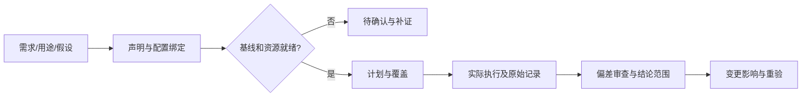

# R42 · 验证与确认：让声明、配置、工况与证据对得上

版本0.1.0，2026-10-27。范围是要求/用途区分、计划、证据覆盖和变更影响的教学。没有产品试验或客户验收结果。

## 既有基础与新增工作

既有R42 v0.2.0固定教学计划完成23项隔离测试和5项独立保真探针。其阈值null、资源未知、结果为空和not_ready边界应保留。本轮补从割胶研究假设到验证候选项的映射，明确无法基线化的原因，并设计旧配置证据不能直接沿用的反例；不改原生VerificationPlan契约。

## 原理：两类声明，两条证据链

NASA 5.3关注产品符合规定要求；5.4关注预期操作者在预期环境中的用途满足。二者相互关联，但一份部件合格记录不能自动证明整机对使用者有用。NASA还要求处理偏差并保存计划、配置、结果与纠正记录。[验证](https://www.nasa.gov/reference/5-3-product-verification/)，[确认](https://www.nasa.gov/reference/5-4-product-validation/)

平台适配的最小证据索引是：`声明ID→配置版本→工况→方法→测量/判断口径→原始记录→异常→结论范围`。客户需要、架构派生要求、研究假设分别标识；没有客户确认和目标依据时，不创造“shall”基线。

## 构造割胶题为什么现在不能说验证通过

TAP-TEACH-001的N-T01—N-T04是研究需要，没有目标值、验收阈值、真实工况或参与者。可生成“待制定的验证候选项”和“用途确认问题”，不能生成符合性通过结论。R44所列原型若未制造、测试未执行，本包的证据区必须为空。

具体示范将N-T01边界作用与N-T03状态信息分别映射到候选验证/确认活动，并将N-T02异常恢复、N-T04完整作业标为尚未覆盖。部分覆盖不能写整体通过；也不能把未覆盖项从清单删除，使表面覆盖率达到100%。

## 逐步操作和关键判断

1. **盘点声明身份**：哪些是已批准要求，哪些是研究假设或架构决定？没有基线的项先列为待确认。
2. **冻结验证对象**：记录配置、软件、材料、工装、仪器和环境版本。原型与目标产品不能只因同名而共享资格。
3. **定义目标与手段**：分析、检查、演示、测试能支持的声明不同，需逐项说明理由。计划不得用“用户喜欢”代替精度或可靠性证据。
4. **核查准备度**：阈值、方法能力、校准、资源、操作者及环境缺任一关键前提，都应列明不就绪原因。not_ready不是方法失效，而是正确保留未满足条件。
5. **形成覆盖分区**：已安排、未安排、等待基线、被变更影响的项各自列出。所有源项必须有去向，不能仅列容易验证的部分。
6. **执行与异常处理**：实际活动发生后才填原始记录。发现不符时区分产品不符合、程序缺陷和试验失效；没有分析不先归责于产品。
7. **审查结论范围**：证据只能支持相应配置和工况。重复证据不等独立复现；同一文档的不同摘录不能充作多次试验。
8. **处理变更**：需求、配置、用途或环境改变后检查依赖，并说明哪些证据仍适用、哪些需要重验。保留原记录，不覆盖历史结论。

## 旧配置反例

教学中假设未来曾有CFG-A记录，但当前要审的是CFG-B。即使报告标题相同，只要接触结构或信息处理链变更，不能直接把A的结论复制到B。程序只能发现显式配置失配；真实工程影响仍需专业判断，不得把字符串相同当物理等效。

## 引擎调用边界

本包输出“计划可追溯但未就绪”，不输出方案好坏或设备安全证明。建议接口与已实现契约分开标注；字段检查成功最多证明声明结构及引用符合本教学规则。独立专业复核、客户确认和现场验证都保留独立状态。
