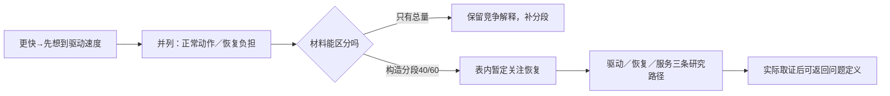

# R02 双钻：改变问题定义，而不只是扩展方案列表

0.1.0，2026-10-27。本包用构造割胶任务演示“相同总量支持多个问题解释，增加区分性材料后才能合理改变暂定范围”。共享TAP-TEACH-001 v0.1.0仅作情境；首批方法包尚待修订/复核，本包不继承其审核通过状态。

## 原典支持什么

Design Council官方[Framework for Innovation](https://www.designcouncil.org.uk/resources/framework-for-innovation/)的Process部分以两次拓展与聚焦组织设计，并明确允许新发现让人回到问题研究。官方[Double Diamond页面](https://www.designcouncil.org.uk/resources/the-double-diamond/)的How to use部分说明四类活动。它是设计过程的表达，不为所有任务规定同一种执行算法。

本文的分段表、竞争问题ID、阈值保留及程序检查是平台适配。官方图示许可标CC BY 4.0，但本包仍用原创关系图，不把视觉形状或步骤完成数量当创新质量。

## 推理机制：两个不同的收敛对象

第一钻收敛的是“值得解决的问题及其边界”，第二钻收敛的是“值得继续研究的回应路径”。若一开始就把“加快驱动”当问题，第二钻会在同一种解法内部发散，错过恢复、清理或服务组织。

同一个现象可有多个解释，关键不是谁讲得更有说服力，而是什么材料能区分它们。团队投票可决定团队先做哪项工作，不能直接确认客户需要。第一钻的暂定结论也可能在后续原型中被重新打开。

## 教学推演：一张总量表为什么还不够

输入是构造请求“工作更快”，以提高驱动速度为初始偏好。FRAME-NORMAL认为正常作业动作占主要负担；FRAME-RECOVERY认为异常恢复与清理占主要负担。总量100个**虚构计数tick，不是秒**，既可拆为90/10，也可拆为40/60，所以仅总量不能判两解释。

本轮实际运行一次桌面信息更新：加入人为编制的normal=40、recovery=60分段后，程序将“恢复负担”标作表内暂定研究重点。这里发生的是条件判断与算术复算，不是实际观察，也没有证明真实割胶恢复占60%。它更没有证明恢复原因、用户优先级或应该采用哪个方案。

暂定问题于是改为：先辨别完整作业各阶段负担与恢复需要，再决定改变驱动、恢复流程还是服务。原“更快”的愿望保留，具体改进路径重新打开。第二钻中的三条研究路径都显式保留未覆盖需要，尚无最终选择。

箭头是研究组织关系；没有表示真实原因或工程效果。

## 怎样操作和审查

1. 将委托、偏好解法与可观察现象分开，不修改客户原话来配合现有技术。
2. 为竞争问题写出能够区分它们的材料。例如总时长不足，需明确阶段定义与异常窗口；只记录顺利作业会漏掉恢复。
3. 收敛前检查证据来源、窗口和遗漏。没有材料时可以排研究优先级，但不能排真实问题的重要性。
4. 写出暂定问题、仍保留的解释及重开条件；不要给一个模糊“已定义”标签后删除竞争版本。
5. 生成不同作用路径，明确回应与未覆盖项，避免把覆盖声明当功能已实现。
6. 设计小规模学习活动，实际执行后才写观察。纸上研究计划不是Deliver阶段已经交付的产品或效果。

## 实际产物与检查

`01`保存委托与两个问题；`02`保留更新前后输入和判断；`03`保存范围修订与第二钻计划；`04`为十项实际固定检查；`05`用资料交接任务检查同一总量可来自录入或核对两种负担。

十项检查包括总量无法收敛、投票不能替证据、零窗口无结论、分段遗漏/不守恒、无限值、版本变化、客户批准伪造、tick改秒。它们是固定声明与算术边界，不会理解任意访谈，也不证明暂定问题真实成立。

## 承接与缺口

既有R02 v0.2.1展示了小车请求中的暂定问题与候选覆盖，已有固定门禁。本包不重建或覆盖它，新增的是可复算的“材料如何改变暂定定义”例子。真实委托、完整作业观察、共同定义和实际反馈仍缺；独立Agent复核与领域专家审核尚未进行。
