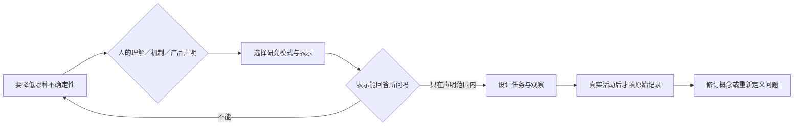

# R03 设计思维：用学习目的选择研究模式

0.1.0，2026-10-27。本文是原创教学计划与固定检查，没有真实参与者、实物原型或用户测试。TAP-TEACH-001共享输入只作情境，首批待修订包不被当作已验收流水线。

## 原典与承接

Stanford d.school的[Bootleg工具页](https://dschool.stanford.edu/tools/design-thinking-bootleg)把同理、定义、生成、原型、测试称为可切换的模式；本轮实际核读网页和2018 PDF的特定卡片，不把五模式改写为必须依次执行一次的流程。PDF页59—60（卡24）讨论明确原型所研究的变量；页55—56（卡22）讨论测试中观察使用者；页12允许测试促使问题表述返回。

该材料标注CC BY-NC-SA 4.0。原件、提取全文和核读截图仅在被gitignore排除的private-sources内，本包不复制原卡、插图或长段译文入公开正文。我们的状态标签、能力映射及检查代码都是平台适配。

已有R03 v0.2.1的零件盒固定计划检查了候选、交互与控制项一致性，本包不覆盖它。新增的是把同一割胶研究主题拆成不同学习问题，并让原型“无法回答”成为正常输出，而不是强行完成五个模式。

## 深度在于区分三种问题

**人的理解。** “继续”和“恢复”在具体任务里意味着什么？纸面状态样例可帮助组织这类研究，但在没有目标角色、任务和观察时，只能说研究表示被设计出来，不能说理解改善。

**工程机制。** 表面参考与目标组织边界之间有没有可用关系？几何代理样模或许能表现表面关系，却不包含真实组织属性。即使演示顺畅，也不能把它升级成内部边界识别精度。

**产品符合性。** 真实控制时延、安全状态或可靠性需要明确要求、配置、环境与证据。前两类探索能帮助形成问题和方案，但不能代替正式验证与确认。

## 教学包怎样展开

输入的学习对象是N-T03状态信息，选两个纸面样例，仅改变标签文字，保持卡片形状和位置相同。程序核比较是否真只改变所声明变量，并检查固定表示能力是否与所问问题一致。

这里的“只改变一个变量”是为了演示可解释比较，并非声称所有设计研究必须使用单因素实验。真实情境中的观察、共创和开放探索可以采用其他组织方式；要避免把一次固定课堂比较扩展为设计思维的唯一算法。

当问题改为N-T01真实内部边界关系时，程序查固定的研究目的—能力定义，代理几何模型不匹配，输出返回研究问题或表示选择。它不会用调用者自己填一张能力表再自证匹配；但是固定能力定义仍是作者编制假设，不是原型真实能力已测量。

## 从原始行为到修订，哪些记录不能省

将来开展真实研究时，要同时保存任务、角色、情境、原型版本、原始行为和研究者介入。参与者说喜欢并不等于完成任务；研究者不断提示后的成功，也不能无说明地当作自主理解。观察与解释分栏，异常和无法判定不被塞成通过或失败。

如果所谓失败来自任务没被理解、原型不能表达目标现象、记录缺失或环境不匹配，应先记录测试失效或无结论，不能直接否定方案。若发现问题本身定义错了，可以返回理解情境和定义模式，不以按顺序完成五阶段为目标。

## 本轮实际执行

十项固定检查覆盖正常标签计划、缺样例、动画不匹配理解、样例无差异、同时改变多个变量、代理不能回答内部边界、偷换需求对应、伪造参与者、虚构积极反馈、模式状态升格。JSON保留完整输入与实际输出。

这些都是桌面结构/声明检查，实际用户测试为0。另一情境是资料版本标记：纸面样例可组织理解研究，却不能证明后台并发一致性或权限正确。该迁移为桌面任务分类，不是跨场景实测。

下一步仍需真实目标角色、情境、材料和研究同意；独立Agent复核、领域专家审核与工程验证均待进行。
