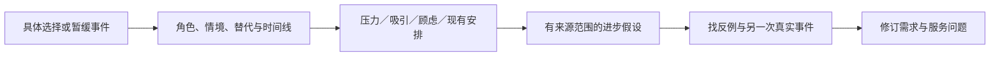

# R09 待办任务理论：解释人在什么情境下改变或维持现状

0.1.0，2026-10-27。本包含两个完全构造的选择事件与编码，不是访谈、成交记录或客户研究。共享TAP-TEACH-001仅提供研究背景，首批方法包仍待修订和独立复核。

## 理论身份与证据范围

本轮实际核读[Christensen Institute官方理论页](https://www.christenseninstitute.org/theory/jobs-to-be-done/)的Definition与Unique Insight及其案例引入。它以情境中的进步与选择来理解人如何引入产品/服务，并区分功能、社会和情绪维度，而非仅按人口特征或产品属性解释决定。

这支持研究“为何改变现状”，不能证明某个具体购买理由为真，也不提供本包可执行的标准访谈算法。我们的时间线、四类力量编码、角色闭包和程序检查是平台组织方式，不把它们宣称为所有JTBD流派共用的唯一规则。

## 深入到选择事件，而不是填写一个任务句式

“我要提高效率”不能区分人为什么选了人工、为什么暂缓购买或为什么接受短期试用。要追问具体改变：什么时候开始考虑、原方式有什么好处、接触哪些替代、谁参加决定、哪一步让人继续或退回。

购买者、使用者、维护者可能面对不同进步与后果。负责人愿意付费不能证明操作者使用轻松；操作者喜欢演示也不能证明购买者愿意承担维护责任。每个任务假设必须保留它属于谁、哪次决定和哪些材料。

任务不是产品功能的改写。可以用“在什么情境中，希望取得什么进步”组织表述，再查产品和服务如何被引入这个过程。不能为了写出句式而忽略没有被问到的替代方式、维持现状的优势和改变的代价。

## 两个构造事件怎样走到需求修订

CHOICE-A描述一位构造负责人：排班困难使其寻找替代，演示产生吸引，但故障支援没有安排，最后暂缓购买、继续原方式。CHOICE-B是另一个情境：短期租用与支援安排使另一负责人决定安排试用；试用尚未发生。所有角色、原话式笔记与决定都是作者编制，没有真实参与者。

编码把压力、吸引、顾虑与现有安排分别链接到同事件笔记。社会维度没有材料就留空；不为凑满三维编出身份认同或社会评价。两事件支持的是教学上展示不同选择解释，不能识别支援安排的真实因果效应，因为情境与角色不同，也没有控制其他条件。

原来的产品猜测“增加功能就会采用”因此变成三项研究假设：异常处置责任可能影响改变现状；可退出的试探方式可能影响决定；操作者的任务仍需要单独调查。它们不是新确认的客户事实，更不是产品路线批准。

图表达研究组织，不表示四类力量可被简单加减或计算成交概率。

## 需要专家判断的四个问题

**材料是决定还是意见？** “我喜欢机器人”不包含改变过程；可以形成下一次提问，但不能替代选择事件。

**说的是谁的任务？** 付费方的风险和使用方的操作不应混并。跨角色解释需要各自材料或明确为待研究的关系。

**解释支持到哪一层？** 一段话可以说明某人怎样描述当时的顾虑，不自动证明该顾虑决定了行为。后见理由、回忆偏差和未记录条件仍要研究。

**能否跨事件归并？** 两个故事相似不等同一细分人群，两个故事不同也不证明两个独立市场。需进一步取样、找反例，并清楚界定分群目的；市场规模、支付意愿与收益需其他证据。

## 怎样实际执行

先保存选择事件原件和定位，再建立事件/角色/笔记身份；缺实际决定过程时返回补访，不用完善故事代替资料。沿时间线查触发、寻找、比较、决定与后果，并允许暂缓、拒绝及继续旧方式作为结果。

然后逐项编码并保留不确定：哪些来自材料，哪些是研究解释，哪些尚未问过。将解释写成可被其他事件挑战的假设，给出后续访谈问题和对服务/产品研究的影响。原料到假设应可回查，跨事件引用不能因为内容相似而自动成立。

本轮`教学包/01—03`保留两个事件、角色化编码和需求修订；`04`实际执行十一项结构/声明检查；`05`用资料交接情境讨论为何保留旧文件夹方式。程序不会自动从访谈发现任务，也不判定任意原话与解释是否语义一致。

## 实际检查与缺口

十一项涵盖正常两事件、无事件、泛泛偏好、试用后果被编造、付费角色被换成操作者、跨事件来源、重复事件、故事推市场量、时间线缺段、共享问题身份和参与者状态升级。检查通过只支持固定编码闭包与状态边界。

没有真实访谈、现场验证、客户确认或独立专业审核。下一步是取得经同意且可定位的真实选择/放弃事件，独立编码并找竞争解释，再决定是否需要形成任务分群和其他研究；不是把构造故事换一个标题直接入客户需求库。
