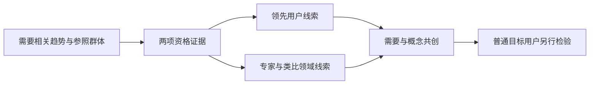

# R10 领先用户法：先证明“领先于什么”，再讨论邀请谁

MD-011，版本0.1.0，2026-10-27。交付为文献选段研究、构造资格筛选与固定检查，不是真实用户招募或需求发现。首批共享输入仍是待修订/审核的研究稿，本包只引用其冻结教学版本，不据此继承客户确认。

## 本轮取得了什么，纠正了什么

已实际取得168页《Lead User Project Handbook》，作者Joan Churchill、Eric von Hippel、Mary Sonnack。PDF第3页前言署2009，并说明主体最终修订于1998；它不同于MIT 2026年22页案例册。本轮核读定义、研究阶段、访谈与共创相关选段，并非168页逐页精读。[作者原入口](https://web.mit.edu/evhippel/www-old/tutorials.htm)

另取得作者网站24页稿件：首页标June 1986，并注明相关1988年发表论文。其PDF第18页明确说明领先用户定义不要求用户已经创新，并限制其单个PC-CAD案例未做到真实市场产品检验。这里按“作者稿选段”记录，不冒称1988期刊排版全文已核。[作者稿](https://web.mit.edu/evhippel/www-old/papers/Lead%20Users%20Eric%20von%20Hippel%20and%20Glen%20Urban%20-%201988.pdf)

核心纠偏：两项特征是相对某趋势提前经历需要，以及解决需要能带来显著收益。已经自研是有价值线索，但不是第三个必选定义门槛；早购买、名气大也不能代替两项依据。

## 为什么它能为概念研究提供不同信息

常规用户对尚未经历的情境可能只能想象，而提前经历者可能已形成具体问题、替代策略与解决经验。但这只是寻找信息的理由，不能保证其建议适合普通用户、可制造或值得购买。要把“见过问题”“有动机解决”“已经做出解法”“目标用户能采用”拆开。

尤其不能先在通讯录中找到几个知名人士，再给他们贴领先用户标签。趋势不明确时，“领先”没有参照；收益主体也必须明确：操作者少劳动与经营者少停机未必由同一人享有。

## 可操作的研究次序

1. 限定研究领域、相关角色及组织决策，不先承诺某设备或创新方向。
2. 明确需要相关趋势，保存其证据、比较群体及不确定性。真趋势尚未核实，便只能形成寻找线索的研究计划。
3. 按两项特征筛选候选，分别保留支持、反证与未知；自研经验另列，不强行作为资格开关。
4. 扩展推荐网络和类比领域。专家可以提供线索或知识，不因此自动成为领先用户；类比领域经验仍须经过迁移核查。
5. 将需要、既有尝试、概念贡献、权利与使用范围分别记录，不能把共创会议等同客户需求批准。
6. 概念形成后转向普通目标人群的使用、维护和采纳检验，不用领先用户的兴趣代替市场确认。

这些操作将原典组织原则适配为本平台的研究材料，不是一条保证创新成功的算法。

## 五个构造候选，暴露三个常见错误

本例假定一个“变化条件下持续作业”的趋势，仅为教学，没有真实市场证据或人员。

|候选|趋势领先|显著收益|已自研|本包结论|
|---|---|---|---|---|
|LU-A，名气大且购买早|否|否|否|在所选假定趋势上不匹配|
|LU-B，提前经历需要|是|是|否|构造定义匹配，不能因未自研排除|
|LU-C，做过改装|未知|是|是|资格依据不足|
|LU-D，类比领域经历者|是|是|是|还需目标情境迁移核查|
|LU-E，收益高且有作品|否|是|是|不匹配本趋势；不等于此人永远不能是其他趋势的领先用户|

程序只处理这些已声明字段及来源引用，不能从人物简介自动判断领先，也没有实际联系任何人。趋势本身也是假设，所以“构造定义匹配”不是确认一个真实领先用户。

## 共创产物与权利如何交接

推荐链、访谈计划、既有方案与新增概念、贡献人、许可/保密/权属待协商事项均有独立字段。旧手册的组织经验不应直接当作今天的通用合同条款；本包没有签协议或取得任何人的权利。实际合作安排由真实各方和适当专业人员确认。

## 实际检查、迁移和边界

构建脚本实际运行7项检查，覆盖正常、缺收益依据、错误现场认证模式、未知暗填、上游版本冲突、无自研仍可匹配、重复ID。结果与每份输入SHA留存。另有文档交接的两特征桌面示例，不冒称同一求值器已对真实新领域验证。

尚缺真实趋势、候选访谈、需要经历/收益证据、材料权利及目标用户检验。当前可交给R19/R17的是机制线索与待验证问题，不是用户排名、客户指标或收益预测。前置审查另列首批R14保真门禁的修订计划，未修改原包。
