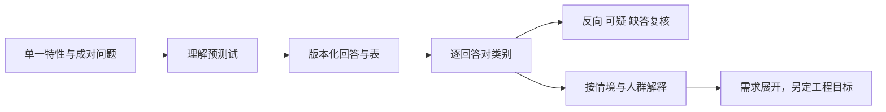

# R11 Kano：先确认题目和表版本，再谈分类

MD-012，版本0.1.0，2026-10-27。这里交付版本化矩阵及完整回答对检查，不是割胶用户问卷结果。无真实受访者、预测试或客户类别判断。

## 原典和本次采用版本分开

1984年Kano等人的[原论文机构页](https://www.jstage.jst.go.jp/article/quality/14/2/14_KJ00002952366/_article)为受限全文，本文只核题录与摘要，不能由此复刻其完整规则。

本轮实际取得Hwang、Tsai、Mitsuhashi、Miyazaki的2014年[原实证论文](https://www.jstage.jst.go.jp/article/jssdj/61/1/61_1_27/_article/-char/en)，10页，视觉核对PDF第4页/刊页30的表2。程序采用该**具体表版本**，命名为JSSD2014-table2-transcription-v1；不是声称取得1984原表。原件、渲染图只留private-sources。

有一项必须保留的来源内部差异：邻近正文称五种组合为questionable，但表2实际只显示两个Q格。本包明确按已视觉核对的表2执行，保留差异，不替作者消除矛盾，也不将其扩大为所有Kano流派的唯一规则。

## 方法真正区分什么

特性实现程度与满意反应不是同一条轴。成对问题提供一种对照：提供该特性怎样，不提供该特性怎样。但这只有在受访者理解同一个单一特性、同一情境及答案含义时才有价值。Kano类别不是产品性能、市场规模或安全底线的数值。

实际提问时最容易丢失的是“没有自动清洁”不等于“完全无法清洁”，以及自动切割和自动收集是两件不同的事。若正反两问暗含不同任务条件，再准确的查表也只会稳定地产生错误解释。

## 两条材料链，不把测试夹具当人群

第一条是割胶研究问卷草案K-T01：研究作业状态信息可见性，对应N-T03。措辞为平台草稿，尚未真实预测试，没有受访者回答，所以不给客户类别。

第二条是矩阵规则覆盖：五种答案×五种答案，共25个**构造回答对**。行固定为functional/presence，列固定为dysfunctional/absence。程序逐格输出A/O/M/I/R/Q，并记录反向、可疑或缺答应怎么继续。25个回答对不是25个人，类别计数也不是满意度分布。

- A/O/M/I只是本表映射结果，不能自动成为优先级或需求必要性。
- R需要核题意、个体偏好与分群，不是自动把设计反过来。
- Q保留并复核，不能当无差异，更不能删除后宣称所有答案一致。
- 缺答继续为null，不补成neutral或某种类别。

## 从输入到输出的完整操作

1. 固定特性与问卷版本，检查是否复合、正反问是否同一对象。
2. 对真实人群先预测试理解，再定样本与场景；本包未开展这些活动。
3. 记录分类表版本、原文定位、转录方向与SHA。
4. 保存逐回答对映射和不能分类的记录，不先合成一个“整体最优类别”。
5. 比较细分人群时保留原样本、题目与情境；本包无真实分群结论。
6. 给R12的是客户研究材料及其边界，不是将A/M等类别自动换成权重，更不能覆盖安全要求。

## 实际执行了什么

完整25格映射产生Q=2、A=3、O=1、R=7、I=9、M=3，数字只描述表覆盖。另实际运行10项固定检查，包括缺答不补值、复合特性、错误模式、行列互换、错误版本、非法答案、安全覆盖请求、重复ID及文档特性情境。文档情境独立绑定DOC-KANO-TEACH-001，不冒用割胶problem身份。

这些检查读取预编码字段，并不理解任意题干或保证预测试通过。2014原研究的文化产品样本也不能代表胶工或机械客户。原研究还使用回归分析，本包只采用表2的分类切片，未复现其回归或实证结论。

## 入库与调用边界

来源身份、矩阵方向及完整格值要共同绑定，不能只在页面写“参考Kano”。建议调用先返回就绪程度和缺口；真正问卷尚未预测试时，正确输出是“需要研究”，而不是给一项功能拍一个魅力型标签。原1984全文、真实样本和独立复核仍未完成。
