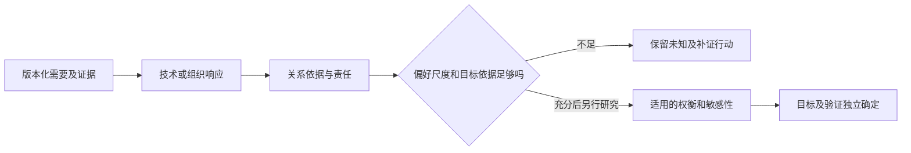

# R12 QFD：让需要持续影响决策，而不是填满一张表

MD-013，版本0.1.0，2026-10-27。本包包含割胶教学研究展开、公开组织案例的局部权重复算与固定反例。不是客户需求确认、完整质量屋、ISO实施或工程目标生成器。

## 方法与来源的层次

[QFD Institute公开说明](https://www.qfdi.org/qfd-quick-facts)强调QFD不仅是一张House of Quality。其现代QFD与AHP页面是该机构的方法立场，不能据宣传页推断所有经典做法被法律或行业一概禁止。本轮只核[ISO 16355-1:2021官方题录/摘要](https://www.iso.org/standard/74103.html)，没有取得61页标准全文，更不宣称按标准实施。

另实际取得Glenn Mazur的2013年12页[组织案例论文](https://static1.squarespace.com/static/5eb315d2b0e6914ba0419e47/t/5eb87c450e4d61663a0a7eb6/1589148741728/mazur_2013_qfd_for_membership_organizations.pdf)，选读需要翻译、分层、优先级与活动展开，并视觉核PDF第10页/刊页9图2。其调查和组织情境不能迁为割胶客户事实。

## 为什么“关联矩阵”容易造成精确幻觉

需要、技术响应、关系强度、客户偏好、目标阈值和验证方法属于不同类型。一个关系格填9，不意味着偏差小于9毫米；满意偏好也不能豁免危险的硬要求。排序数字的小数位增加，不会让缺少依据的关系变可信。

还需核层级和重复计量：若一项需要是另一项的上位概念，直接并列加权可能重复计算。偏好量表是否支持相加相乘，应先说明采用的模型，而不是假定所有1—5等级都有比例含义。本文不把一种机构立场当所有评价研究的终结结论。

## 割胶教学：输入不足时仍能交出有用结构

共享TAP-TEACH-001四个需要全部是研究假设。我们提出四项**研究响应**：组织边界与可观测信号关系、异常各段事件定义、操作所需状态及理解、维护转场责任。它们是后续调查/设计行动，不是已冻结的四个工程参数。

四需要×四响应共16个关系全部unknown。每个需要的权重、每个技术目标与单位都缺依据，因而输出priority_scores=null、ranking=null，不以空白为0，不造9/3/1，也不把责任角色写成真实人员已任命。

完整展开记录了问题、责任角色、需要补什么证据、哪些结果可交给R14/R42。N-T04并未因表格有一行便完成服务设计；对应响应只是安排研究，未证明已满足需要。

## 公开案例局部复算：不用编造客户分数

采用2013论文图2显示的三个组织需要比较比值，按图示“列归一化→行平均”的计算切片复算，得到约0.420459、0.217087、0.362454。原图显示0.421、0.216、0.363；最大差约0.001087。图中比较分数与小计有显示精度差异，原参与者判断矩阵未提供，因此这里明确是**显示值局部复算**，不是精确重建原调查或全部AHP过程。

进一步在其余显示比较值固定时，把第一项对第三项的比值写成变量t：t=1是二者平齐边界；原图显示t=1.25时第一项在前，作为对照把它倒置为0.8则第三项在前。这个代数敏感性检查没有创造新的客户分数，1和0.8不是抽样置信范围，也不是预测未来偏好。

该例只说明排序依赖偏好假设，不能用低一致性指标自动证明偏好真实，更不能把原组织权重搬给机器人。未重算特征向量法或CR，也未复制整项QFD成效。

## 实际检查与停止条件

本地实际运行10项检查：正常全未知、缺关系格、错误排序模式、未知填0、由关系分数注入目标、凭空权重、删共享未知、源版本错、偏好豁免硬要求、合法缩小响应研究范围。输入、输出及SHA均留存。此检查器只验证当前受限研究契约，不理解自然语言关系是否真实。

## 何时继续，何时不能算

当关系、偏好尺度、硬要求及目标来源未取得，只允许研究性展开。真实输入充分后，才选择适合的量化模型、处理相关指标、检验排序变化；目标阈值仍由性能模型、风险、成本与客户/专业确认共同形成，不由权重反推。

另有资料交接情境的桌面映射，保留关系、重要性和目标未知；它不是同一检查器已通用验证，也不是跨行业有效性研究。本包未注册MCP工具、未改生产引擎或线上。
