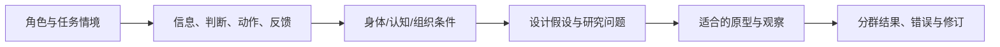

# R13 人机工程与人本设计：从“人能不能操作”到“整个工作系统怎样支持人”

0.1.0 · 2026-10-27。本轮是公开指南选段研究、完整构造任务模型和实际表征/记录检查，没有目标人群调查、人体尺寸数据或真实用户测试。

## 核心原理与来源范围

HSE把人因放在任务、个体、组织及环境共同作用中；工作负荷过高或过低都可能损害表现，正常、维护和异常阶段须分别考虑。经验丰富者的应对策略也不能被直接推广给新手。这些指南提供研究视角，不为某个按钮尺寸、操作时限或目标人群分位数背书。[HSE人因介绍](https://www.hse.gov.uk/humanfactors/introduction.htm)，[工作负荷](https://www.hse.gov.uk/humanfactors/topics/workload.htm)

方法改变的是问题表示：把“设备易用”拆成谁、在何任务和环境下，需要看见什么、判断什么、采取什么动作，组织上谁支持、谁接管、哪些能力和资源未知。人体尺寸只是其中一部分，界面美观和动作数量也不是充分的评价指标。

## 本题输入和边界

承接TAP-TEACH-001 v0.1.0共享构造背景，源SHA固定。首批R36/R44/R42存在待修订保真缺口，本包只保存其只读状态和指纹供追溯，不把它们当已通过审核的前置能力。

目标操作者、班次、能力、身体特征、任务强度、现场环境均没有真实材料。新手/熟练者只是建议研究的差异维度，没有实际招募人群。不能填“平均臂长”、反应时或满意度，也不能将技术人员一次演示成功泛化为正常使用。

## 四个具体任务：包含正常、异常和维护

|任务|使用者需要做什么|不能丢的信息|仍缺什么|
|---|---|---|---|
|HF-T01 正常监视|理解当前作业状态|状态、测量时效|注意分配和实际负荷|
|HF-T02 异常接管|识别陈旧信息并请求抑制|有效性、时效、请求回执|谁负责、如何发现、真实时间窗口|
|HF-T03 恢复核查|区分请求停止和实际停止|实际状态、残能、重新授权|可观测性、责任与恢复条件|
|HF-T04 清理更换|完成维护后交接|隔离状态、维护范围、授权|姿态、力、可达性、工具与组织支持|

关键不只是减少手部动作。自动化可能让人在正常阶段少操作，却要求其在异常时突然理解复杂状态。维护任务也不能因不在自动作业主链而被删掉。

## 完整操作过程

1. 先确定任务和角色边界，区分正常、异常、维护、交接。把未知现场条件明确列出。
2. 将任务拆成信息接收、理解判断、决策、动作和反馈，不先把错误归为“人不细心”。
3. 对每步核可用信息、信息时效、控制权、动作要求和错误后果；与身体、认知及组织条件对照。
4. 识别设计是否依赖熟练者补偿，或将原机械问题转成记忆/监视负担。
5. 生成修改假设，例如区分请求与实际状态、显示测量时效；同时写明它不能解决哪些问题。
6. 选择适合的研究：状态理解用任务观察，身体适配需要目标人群及工况数据，异常接管需研究准备度和情境，而非只问喜好。
7. 实际观察后才能评价；保留错误、策略、无结论和不同角色差异，不只报告平均完成时间。

## 本轮实际完成的表征对照

设定两个构造状态：“当前信息”和“陈旧信息”。A只显示绿灯，两状态编码相同；B加一段时效说明，编码不同。程序实际计算A发生表征碰撞、B不发生碰撞。

这只证明在本字段映射中可否区分，不证明人实际看得见、读得懂、相信或及时行动；其他上下文线索也可能改变真实表现。故输出human_understanding/workload仍unknown，reaction_time为null，没有给B更易用的结论。

## 与引擎的交接

R13将研究问题和信息/动作缺口交给R44，把危险情境交给R41/R51，把要求口径返回R48。它不能凭通用人体常识给产品尺寸、替代目标人群数据或自动生成安全结论。当前脚本仅检查固定教学模型和编码映射，不是人因评价器。
