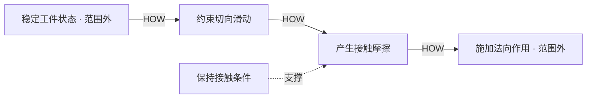

# R15 FAST功能逻辑：用HOW/WHY检查目的与手段，而不是把流程图横过来

0.1.0 · 2026-10-27。本包采用**简化的经典HOW/WHY局部教学视图**，只研究一个假定接触摩擦原理；不是完整技术型FAST或顾客型FAST实施，也不代表所有夹持方案的正确图。

## 原理与新取得的依据

VA Canada官方公开页面把FAST作为功能间的逻辑表示：沿HOW向右展开，沿WHY向左检验，WHEN表达同时或伴随关系，不是时钟时间先后；图的有效性与研究范围及参与者知识有关，没有脱离情境的唯一正确图。[VA Canada FAST](https://analysedelavaleur.ca/fast.php?lang=en)

FHWA公开说明支持用动词和被作用对象表达功能。[FHWA方法说明](https://www.fhwa.dot.gov/ve/veproc.cfm) 这些是本轮实际可读的一手机构材料。几个旧政府PDF入口失效或返回维护页；另取得的EPA扫描PDF文字提取为空，未冒称正文已精读。来源记录保留这些受阻情况。

本方法不是从部件清单反推合法性，而是问：这个作用为何必要，怎样实现，还有哪些不同原理？具体手段一旦被选入图，就应暴露它的前提，而不是伪装成所有产品共有的逻辑。

## 一个可跟随的局部例子

设定研究目的为工件状态稳定，只选摩擦式约束切向滑动的原理。图分为：

- 高阶范围外H0：稳定工件状态。
- 基本功能B1：约束切向滑动。
- 次级功能S1：产生接触摩擦。
- 低阶范围外L0：施加法向作用。
- 支撑SUP1：保持接触条件。

WHY沿相反方向逐边问。比如为何研究接触摩擦？为了约束切向滑动。为何施加法向作用？为所选接触原理提供条件。这是局部目的—手段的教学解释，不是摩擦作用充分、允许载荷已知或夹持成功的工程证明。

形状嵌合是另一原理，不会因不在当前图中而被排除；若研究它，应另画路径并重核条件。摩擦、载荷和损伤未知仍保留。支撑功能也不能因不在主线而随便删掉。

## 操作步骤与判断点

1. 声明研究范围和图型，辨别是在研究一个系统、某个候选原理还是用户价值。
2. 用作用表达基本功能，避免直接写“安装传感器”或某具体零件。
3. 向HOW方向提出手段，并说明这条边是在什么条件下被认为合理。
4. 反向用WHY逐边解释。若只能回答“它发生在下一步”，应转回流程/时序图，而非当FAST逻辑。
5. 标出高阶目的和范围外手段，防止问题抽象得过高或锁死在现有部件。
6. 单列支撑、同时或伴随作用，检查遗漏、重复和隐含前提。WHEN不等于给每框加时间戳。
7. 引入替代原理，观察需要修改哪些功能关系；不要把当前解法形成的关系说成唯一结构。
8. 将功能逻辑交给R14或R45进一步检查、展开和评价；是否物理成立仍需设计及实验。

## 本轮实际产物与检查范围

固定包保存每条边的HOW/WHY问答、范围标记和支撑理由，并实际运行7类状态/映射检查。程序检查的是本固定教学图的引用、方向和关系保真，不能自动判断任意自然语言问答是否正确。改写为另一个有效FAST需要新版本及人工复核，不能因为不匹配此夹具就判它在理论上错误。

另一情境用“文档特定版本回查”检查目的—手段表达和反向路径。只有“先扫描再上传”的描述被明确识别为时序叙述，不直接当HOW/WHY。桌面推演并非真实团队工作坊或项目价值提升证据。
