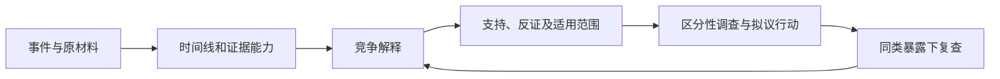

# R16 根因分析：保留竞争解释，直到证据足以改变行动

0.1.0 · 2026-10-27。本轮使用构造工件偏移事件，不是客户事故；没有真实损伤、调查或措施成效记录。

## 原理：由事件到原因不是同义改写

HSE区分直接原因与允许事件发生的潜在/组织条件，强调调查要形成可负责实施的行动。HSG245将信息收集、分析、风险控制与行动闭环连接起来。这里用其选段作为调查组织依据，不把其全部原文或英国执法程序当本项目规则。[HSE原因说明](https://www.hse.gov.uk/foi/internalops/og/ogprocedures/investigation/coreobjectives.htm)，[HSG245](https://www.hse.gov.uk/pubns/hsg245.pdf)

根因分析是方法族，不只是连续追问五次为什么。时间线帮助确认先后，变更/屏障分析帮助形成解释，支持与反证帮助区分解释；没有哪个图会自动证明因果。解释可行动，也不等于已得到证实。

## 构造事件的完整证据链

教学事件：工件出现一次相对偏移。五条构造材料保留不同证据能力：

|材料|能够提供的线索|不能证明|
|---|---|---|
|ER1 角色事后说认为已夹紧|一种参与者解释|当时实际夹持力或完整决策过程|
|ER2 控制日志写请求已发送|请求发出的记录|夹持已完成|
|ER3 事后相对滑移痕迹|发生相对运动的线索|唯一的机械/人为根因|
|ER4 界面规范写绿灯表示请求发出|状态表征语义|用户当时必定误解|
|ER5 另一个对象、无作业载荷检查未偏移|非常受限的反向线索|事件工况下保持作用充足或措施有效|

三种竞争解释保留：实际保持作用不足、请求指示被理解为完成、对象状态变化。第一种有ER3支持和ER5的有限反向线索；第二种联系ER1/2/4但还缺当时决策材料；第三种没有直接支持，只是待查的替代解释。三者全部unconfirmed，没有计算虚构概率或确定单一根因。

ER5与事件条件不同，不可直接算作同类暴露，不能用来排除机械问题。主观表达与日志冲突也不能简单挑一个“更真实”的版本删除另一个。

## 操作与关键判断

1. 明确事件和调查边界，区分事实、解释、来源能力与未知，必要时先保存原件和条件。
2. 重建时间线，不把请求、实际动作、观察与事后陈述混成一条已确认因果链。
3. 从机械作用、信息/任务和组织条件提出竞争解释。不能因为“操作员做了最后一个动作”就停止分析。
4. 对每个解释列支持、反证、反证适用范围和仍需材料。反例条件不等同，不能直接证伪。
5. 选择能区分解释的下一观察，例如实际接触记录、状态编码理解、对象与载荷变化；避免泛泛增加培训替代调查。
6. 把拟议措施与其作用点连接，记录负责人角色、完成证据及可能引入的新问题。没实施就不写完成。
7. 在可比暴露下复查。没有再发生可能只是没有再次执行同类任务，而非因措施解决原因。
8. 保存原解释、修订及被撤回的判断，不用更新后的故事覆盖调查历史。

## 本轮实际演算的边界

后续可比暴露为0、事件为0。程序返回event_rate=null，而不是0%或100%改善；若以后输入人为设定的正暴露计数，也只能描述该计数比率，不能自动支持因果成效。

7项固定检查实际覆盖正常竞争解释、证据缺失、构造事故冒充客户事件、零暴露声称根治、过早确认单一根因、原因—证据错配和措施假完成。它们是记录保真检查，不是能理解任意事故的因果推断器。

## 迁移与交接

另一桌面情境是“导出文件无法打开”，保留格式生成、传输和阅读环境三种解释；只有现象不能选唯一原因。主链可将信息/任务解释交R13、失效链交R40，系统交互问题交R51，措施检验交R42。不能从一次构造事件推真实故障率或把所有原因收敛为人的过错。
