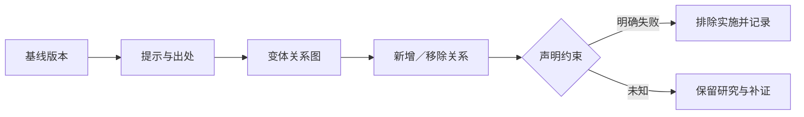

# R19 设计启发式：保存概念究竟怎样被改变

0.1.0，2026-10-27。范围为概念变换链、声明图差异和约束处置的原创教学，未复制完整77卡组，未开展真实设计师实验或产品验证。

## 实际核读与方法身份

本轮取得官方DH Idea Development Protocol 11页，选读PDF页1—2的概念变换与逐轮独立记录安排；另取得作者团队的2016年论文Evidence-based design heuristics for idea generation，选读题名/摘要及引入段落。论文以经验材料归纳启发模式，不能据此保证某次提示必然生成优秀方案。

本包只参考“有意识地引入变体并记录”这一用途。提示OWN-H1—H3均为平台自写一般操作，不是官方卡号、卡文或完整工具授权副本。论文与原卡的图像、全文、工作表只留private-sources，不再发布。

## 推理机制与关键判断

启发式给出改变关系的入口，不能替代设计依据。研究者要说清原概念、提示、改动及新增问题；若同时叠加多个提示而不保留过程，就难判断哪一步引入了有用变化或副作用。

这里分开三种判断：是否改变已声明关系、是否产生值得研究的不同路径、是否工程成立。前一项可以在明确表示下计算，后两项还需要问题价值、约束与证据。关系图有差异不等新颖性高，也不等具备实际可行性。

## 完整教学链

输入是参考、结构与作用执行之间的三条构造关系。OWN-H1将参考放进可替换模块，改变支撑接口；OWN-H2把作用展开到两个接触节点；OWN-H3只改外观颜色，关系图不变。程序逐条计算新增/移除边，而不是仅比较方案名字。

两种图关系变化被保留继续研究，颜色变体不计作本任务的机制多样性。这不表示外观改变没有设计价值：它可能影响理解、情绪或识别，只是这些关系没有被当前图表达，应另用适合的人因/体验研究，而非强行算进机械机制变化。

每个变体仍保留物理可行性unknown，工程候选为空。若输入声明某项教学硬条件失败，程序将其排除实施，不能靠其他亮点抵消；这只是声明规则，不是程序发现了真实物理冲突。

## 操作步骤

1. 固定基线版本，说明本轮研究要改变哪个作用/关系和什么价值问题。
2. 选择可合法使用的提示并记出处。先单提示形成变体，后续组合也保留父子链，不把继承结果当独立产生。
3. 描述新的作用关系、接口及资源。只有名字变化时要求补机制，而不自动认作创新。
4. 比较差异与遗漏。必要功能仍需有去向；新增零件、信息或人工负担应显式记录。
5. 将可行性筛除与创意生成分开。硬失败、未知和偏好各自处理，不用点子数量抵消硬约束。
6. 按机制族组织候选，再交R17展开组合、R36比较、R44验证危险假设。

## 本轮执行与边界

十项实际固定检查包括无基线、身份/来源、颜色无机制变化、声明硬失败、悬空提示/父项、重复变体、未知升pass和无依据推荐。程序不解析任意草图，也不评价创造力。

资料交接迁移例用直接传递与增加版本索引的两套图，实际比较关系差异；不证明版本管理实际有效。当前输入均构造，来源、客户、制造和安全材料仍待补，独立Agent复核及领域专家审核未进行。
