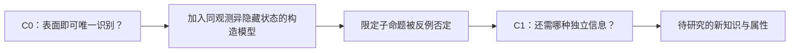

# R20 C-K设计理论：局部知识不能替整个概念成立

0.1.0，2026-10-27。本包是概念/知识状态与有限反模型的教学，不是通用C-K形式证明器，也没有取得真实树体数据。

## 原典核读范围

本轮取得Hatchuel与Weil在ICED 2003的15页论文，实际选读PDF页5的3.1定义、页8的3.3连接/分离、页9四操作段。原文将概念相对知识空间讨论：概念在相应K中尚不能获得确定逻辑状态；进入K则有相应逻辑评价，文中为方便采用经典两值讨论。

这里不能把任何数据库里的unknown字段自动称为C空间，也不能将所有已收集文本当知识。本文的ID、JSON、有限模型与门禁是平台适配，不声称覆盖后续理论全部发展或原文形式体系。

## 真正的机制：同时改变可想象的属性与可判定的命题

C空间可通过增加、移除或重组属性打开新的方向；K空间的扩展会改变哪些子命题有依据。一次知识增加可能支持某属性，也可能否定旧方向，不能只保留“新知识证明了方案”的正面叙事。

设计判断必须保留K的范围。代理模型中的结论只能说明该模型，不能直接迁移到目标材料、传感与安全情境。一个概念需要多个属性共同成立，一条表面测量依据不能填满隐藏边界和操作安全两项未知。

## 本轮实际推演

初始C0想仅由表面观测识别隐藏状态并满足完整用途；K0只有一个代理对象的局部记录。加入两个构造对象后，二者表面符号相同，隐藏符号不同。程序对表面符号分组，实际发现一对多关系。

这形成一个有限反模型：在该表述下，表面信号不足以唯一确定隐藏状态。它给子命题增加限定的否定依据，不是证明真实树体不可测。原方向需要重构，C1增加独立信息这一新属性，但其取得方式与真实效力仍未知。安全属性从未因局部测量而通过。

对应四种操作的教学记录分别是：C→C分割仅表面/增加独立信息的方向；K→K由记录推导观测歧义；C→K使限定子命题获得否定状态；K→C据此产生仍未确定的C1。它们是可跟随的具体推演，不是一棵贴了C/K标签就算完成的概念树。

## 操作与判断

先明确概念在什么K下未决，并将属性拆开；为知识记录来源、逻辑状态与适用条件。每次扩展都说明改变了哪个属性/命题，而非笼统“增加知识”。检查知识实际支持的范围，防止将局部测试升级为完整产品。

若新材料给出反例，保留原概念和原K版本，再记录何处被否定及重构理由。若没有足够知识，不硬把C转成已完成设计；输出下一项可区分的研究问题。R27可扩展知识来源，R49可组织行为/结构表示，R44可设计研究活动。

## 实际检查与迁移

十项固定检查包括缺模型对象、代理冒充树体、局部支持升级全设计、重复对象、没有反例也不宣布真实成立、安全未知删除、未来校准结果编造、问题身份及K0逻辑状态改变。两对象表面信号不同的边界例仍不产生完整设计确认。

资料版本迁移例实际检查同名异内容，说明显示名不足以唯一识别版本；增加指纹也不能直接证明权限、长期保存与可靠交接。全部为构造桌面推演，目标研究、独立Agent复核和领域专家审核尚待开展。
