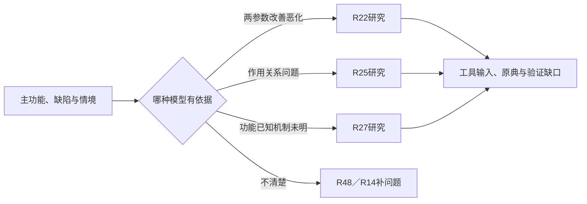

# R21 TRIZ体系：先选择问题模型，再选择工具

0.1.0，2026-10-27。本包交付有理由的研究路由，不是数值评分算法、完整TRIZ求解器或已执行的ARIZ。

## 来源与范围

实际核读MATRIZ TRIZ Knowledge Base的Problem-solving tools公开短页，重点是问题→模型→工具→解模型→具体概念的关系，以及矛盾与非矛盾工具的区分。它说明工具与问题表示有关，不支持把所有任务先转成同一对参数。

我们的字段、就绪检查、拒绝原因和R编号映射是平台适配。原典角色是方法说明，不能替代本题具体模型的证据；本包没有执行矩阵、标准解、科学效应可行性或ARIZ。

## 方法深度：保留为什么不调用

“减少残留”可能涉及机制未知、有用作用不足、有害作用或服务任务。名称相同不意味着模型相同。若主功能、关键缺陷和情境不清，硬选一套工具只会把模糊问题包装得像有结构。

因此路由产物应包括选中项、拒绝项、所需材料和下一动作，不只给推荐方法列表。多种模型可能同时合理，路线不必唯一；更不能用无依据的0.9匹配分掩盖表示的不确定性。

## 同题四种构造视图

1. 只有功能/目标且机制未定：建议R27功能/效应检索，不编矛盾。
2. 有同一条件下明确IF措施、THEN改善与BUT恶化：可进入R22研究，但矩阵版本和映射仍缺。
3. 有明确作用物、场和作用问题：可进入R25研究，但具体标准的前提及合法文本还要核。
4. 两种模型都有：并列研究路径并说明区别，不宣称哪个原理已命中。

这四视图是人为编制。程序核声明的必要字段和条件一致性，不能从任意工程描述自动认定真实矛盾或物场。即使结构就绪也仅为研究模型，不是其因果关系已实证。

## 怎样使用

先从要求和功能明确对象/边界与缺陷，再选择能够表达它的模型。对技术矛盾核两参数及同工况，对单属性相反要求另研究R23的条件；对作用模型核相互作用与问题种类。材料不足返回R48/R14，不能为了调用而补造模型。

进入具体工具前再检查其原典、版本、权限与输入。解模型最后还须转成具体机制，列迁移条件和验证，而不把通用原理词当成工程方案。

## 实际执行与迁移

十项固定检查验证缺主功能返回、无矛盾不强分、同/异工况、作用模型缺项、同属性不当两参数、数值评分、虚构原理命中与工具执行。输出工具实际执行列表始终为空。

资料交接例只声明正确版本传递的功能和未知机制，不编速度/准确性矛盾。迁移的是模型选择纪律，不是新技术可行性。独立Agent复核、客户事实与领域专家审核尚未完成。
