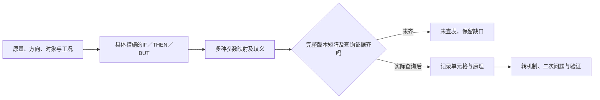

# R22 技术矛盾与发明原理：先把矛盾建对，未查表就不填命中

0.1.0，2026-10-27。**本包只推进到条件性问题模型与参数映射缺口，未完成矩阵查表部分。**没有取得完整、版本化且可用的矛盾矩阵，原理命中列表为空表示未查询，不表示单元格为空或问题无解。

## 实际核读

本轮核读MATRIZ的Engineering contradiction公开页面，范围为定义、Formulating及Alternative小节。页面以某措施改善一个参数却使另一参数恶化来表达技术矛盾，并说明每种措施可形成不同矛盾。

本包的构造接触原理、原量纲字段、映射搜索词和程序检查是平台适配。公开定义页不是完整矩阵；未用它补出单元格或原理编号。

## 推理机制：参数冲突属于一个具体措施版本

先明确THEN想改善什么，再找IF中拟采用的措施及BUT代价，三者都应放在同一对象与条件下。若两侧来自不同材料或不同工况，句式即使完整也可能是拼接出来的假冲突。

改IF可能产生另一组恶化项，因此不能只保存一对脱离措施的通用参数。原始量、方向、单位与环境先保留，再研究抽象参数映射。相同单位也不意味着同一属性：相对滑移与接触压痕都可用长度表达，工程含义却不同。

## 教学链的具体产物

构造代理接触模型假定：增加法向作用，滑移减小而压痕增加。法向力以N、滑移量和压痕深度以mm组织字段，但没有任何测量值；这些是原量纲表达建议，不是客户目标，也不是证明实际关系成立。

COND-PROXY-A只是声明共用的条件标签，材料、几何、环境仍null。相同标签不能替代同工况证据。程序可拦显式条件不一致，却不能判断真实实验是否可比。

参数映射保留为unresolved，搜索词是平台描述，不冒充某矩阵的正式参数。随后应核定版本、参数原定义和多种映射理由，再实际查询、记录单元格与解模型，并转成机制及新问题。

`教学包/03`另保存一条Host机制提议，其source明确不是矩阵命中，不给编号、不声称解决矛盾。创意可以在资料受阻时继续，但出处不能被追认成查表结果。

## 怎样判断方法用错了

如果改善/恶化的对象被换、原量纲被抹去、IF措施不明确或两侧条件不同，先返回问题模型。若同一属性在不同条件需要相反取值，应再研究物理矛盾的条件，而非为了填表当两个参数。

即使将来查到原理，原理也是启发方向，不是构造尺寸、控制参数或安全结论。反向矛盾需保留自己的含义，不能假定矩阵对称；更不能把未查询的空列表写成“TRIZ无解”。

## 本轮执行与未决

十项实际固定检查覆盖正常条件模型、缺IF、伪造查表、未知填0、混工况、错单位、虚构映射ID、编原理命中、假设改实测和改善/恶化调换。实际矩阵查询及工程试验均为0。

资料交接迁移例假定多核对可能减少误发却增加动作，仍要求核同流程、同资料量和真实代价；句式本身不确认因果。后续必须补完整矩阵与使用范围、真实参数映射、实际查询和机制验证。因此本项只能作为受限研究教学稿，不能勾选完整原法可执行；独立Agent与领域专家审核仍待。
