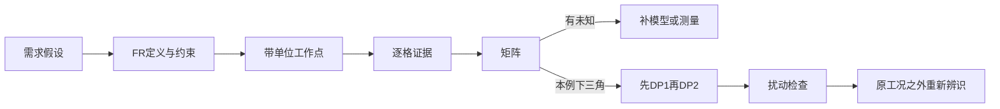

# 公理化设计：让“独立”成为可以追问的关系

这是 MIT 公理化设计组入门选段的受限研究，承接 ML-017/R30 与既有教学，不替代 Suh 1990/2001 两部专著。包0.1.0待独立复核；没有客户、样机或领域专家确认。

## 先分清想实现什么与选择了什么

MIT页面的四域、FR/DP定义、矩阵行列和独立公理见来源与主张。对本教学，我们自行把“保持”和“释放”拆成两个待研究的功能响应，而不把“采用弹簧”写成需求。这里的 FR1/FR2 是构造研究变量，尚非确认的真实割胶需求；约束另列，不能藏进矩阵非对角项。上游仅借用 TAP-TEACH-001 的问题身份，不声称这些系数由割胶调查得到。

## 深度在于矩阵每一格的来历

本平台自行设定局部模型 ΔF1=2Δp1，ΔF2=0.5Δp1+3Δp2；F1单位N，F2与参数单位mm，各行导数单位分别N/mm与mm/mm。工作点参数增量为0，负载只声明理想模型。矩阵是 [[2,0],[0.5,3]]：零来自已明写的理想方程，不是“没有研究”。代码用小扰动复算雅可比，但它只校验方程实现，不证明真实接触无耦合。真实物理矩阵必须来自有条件的测量或经审核模型。

## 为什么调整顺序有意义

构造目标增量[2N,4mm]，先p1=1mm产生[2,0.5]，再p2=7/6mm产生[2,4]。后一步不破坏前一响应，因此在本局部模型里可顺序解耦。若反过来先按p1=0设p2=4/3mm，再改变p1，则第二响应变4.5mm，需要返工。下三角外观本身不是产品永久独立；FR定义、工作点、非线性、滞回和约束改变都可能使判断失效。

教学检查保存unknown分支：将未得项设null立即返回unknown，不输出调整顺序。把0.5偷改成零则因不符本例方程而拒绝。这里拒的是“证据与矩阵不一致”，不是宣称所有真实产品都有该耦合。没有成功概率、设计范围和系统分布，信息量保持null，不用主观评分代算。

## 从教学进入实际项目还缺什么

需补真实FR量测定义与可接受范围、参数行程、负载/材料/环境条件、局部辨识的不确定度及更换工作点后的复测。将带证据的关系交给R31做依赖整理，交给R38研究扰动；不能把图重排当作物理优化完成。建议调用契约仅描述输入输出，本包脚本为固定线性教学计算，不是通用公理化设计MCP。
