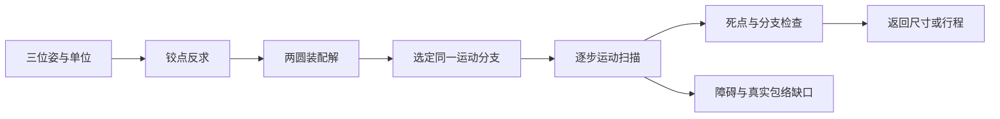

# 机构综合：从三个姿态到仍需验证的运动

核读MIT 2.007 2009年 Dan Frey 机构课的自由度、冗余和三位姿综合选段。它是入门课程，不覆盖全部拓扑与尺寸综合算法。本包承接ML-017/R32，自行构造平面刚性四杆例；不是割胶机器人定型结构、原课程案例复刻或工程安全确认。

## 把运动任务写成可算的几何对象

坐标单位mm、角度degree，构造三个姿态：输入角30/90/150度；A=(40cosθ,40sinθ)，B=A+(100,0)，连接AB方向为0度。两附件点轨迹分别有三个非共线点，脚本用三点外接圆的线性方程反求固定铰点，得到O1≈(0,0)、O2≈(100,0)；连杆长约为地杆100、曲柄40、连杆100、摇杆40。该选择刻意形成平行四边形；没有声称求出任意三刚体位姿的所有四杆解。

候选拓扑只保留平面4R。滑块曲柄可作为其他任务候选，但本包不假装已为它求解；空间机构和柔顺机构需另建模型。一般自由度计数3(4−1)−2×4=1，只是非退化通用计数。冗余约束或奇异状态必须回到约束秩与实际几何，不能靠这个整数跳过检查。

## 两个位置解不等于两个可任意切换的姿态

每一步由以A为心半径100、O2为心半径40的圆求两个交点。输出保留两装配解，选与理想平行四边形支路对应的一支。三点满足只证明插值几何；正常30至150度以1度步长扫描121点，保存端点、交点、归一化闭环雅可比绝对值及锐传动角。此结构理想分支的奇异指标为|sinθ|，180度共线死点不是“误差略大”。

关键反例保留同一组三姿态合成尺寸，把运行范围改150至210度，扫描会捕捉180度死点而拒绝可用路径声明；再人为要求90度换到另一装配解也返回分支切换拒绝。不能把交点函数返回的列表索引当作全程同一支路，必须用几何关系或连续追踪。

## 碰撞检查到底查了什么

仅给一个构造圆障碍(0,80)、半径5mm，对四条零厚度线段求距离，保存最小几何间隙。它不是树干、人员或真实连杆厚度。真实包络、轴承间隙、变形、线缆、载荷、驱动力和夹伤范围均未知，所以 real_collision_clearance=unknown、engineering_pass=false。扫描漏检的可能与步长有关；本例解析奇异指标能解释共线点，但脚本明确不把有限样本宣称连续无奇异证明。

如果真实任务要求整个区间恒定姿态或安全避障，必须补路径容差、转动范围、驱动力、动力学和三维厚度模型，交给R35/R38/R41开展相应验证。迁移到折叠展示托盘只借用运动性质，不转移承载或安全结论。建议调用JSON不是现成MCP求解器。
