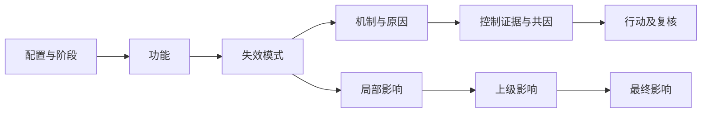

# FMEA：沿失效链找证据，不靠写措施降风险

承接ML-017/R40。实际取得并选读GSFC-HDBK-8004 Baseline 2024-08-20的适用性、因果识别、表1及单点/共因选段；PDF共55页，没有宣称全文逐页审阅。表1与PDF23页图已核。它面向GSFC任务的量表，不能直接成为割胶设备行业通用评分。本包不提供安全或合规认证。

## 先固定配置，再讨论模式

教学配置TAP-FMEA-DRAFT-001、异常运动抑制阶段。功能是及时提供边界相关观察，失效模式为陈旧输出被当当前；机制是假设时效门禁未区分，原因候选包括时钟不一致或共享供电扰动。局部影响是无效观察持续，上级可能不请求抑制，最终接触影响仍待评估。这些都是构造研究假设，没有客户事故证据。原因、模式、影响不能用一句“传感器坏了”代替。

## 为什么两个传感器不自动更安全

构造S1/S2/CTRL共用PWR-A，脚本按供电身份分组，保留共因待调查。两通道名称不同不证明独立，软件门禁与备用观察都仅planned，效果证据为空。不能因为写了“超时停止”就降低探测评分，也不能把故障被检测与实际停止/残余能量安全混为一事。

量表引用锁定文件、版本和页，但适用性未获目标项目批准，严重度/发生/探测预防都null，残余风险亦null，不计算RPN。GSFC表1不是常见汽车1—10量表；跨表乘分或用未知填最低值会产生虚假精度。真正适用评分应有任务成功/伤害后果定义、暴露周期和证据，再由负责人员决定。

## 行动闭环如何成立

CT1对应时钟/时效故障注入研究，CT2对应供电独立性、共因和潜在故障调查；行动只给角色，不捏造真实责任人或完成日。只有有配置绑定的控制试验、适用边界、失败分支和复核证据后，才讨论剩余风险；仍应把风险接受与分析结果分开。失效模式清单也不能替代R41/R51系统危险研究。

当前8项检查验证引用、固定配置和状态门禁，不是控制有效性试验。单点失效只返回requires_system_model，未完整识别所有单点或证明无单点。迁移到同一硬盘两目录备份，说明名字不同不等于失效域不同；没有实际恢复测试。本包为研究教学待审，非现成FMEA MCP。
