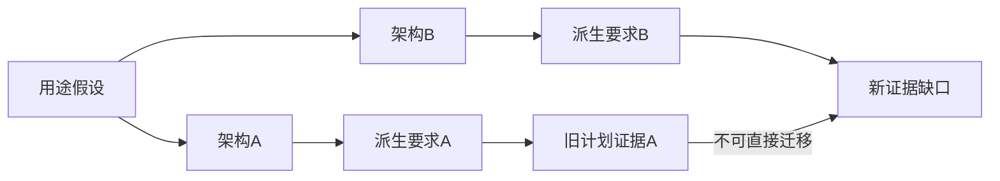

# 系统工程：架构一改，哪些要求和证据要跟着改

本包承接055的R04-v0.2.1-proposal并冻结其case/verification/manifest身份：原教学分拣线包含运行概念、要求分配、接口和点时延，32次软件检查不是产线试验。本轮不重建这些内容，而补“架构派生要求”的失效传播。

核读NASA系统设计4.0、4.3选段：利益相关者期望、技术要求、逻辑分解、解方案之间迭代，架构、运行概念、派生要求需一致。未取得完整ISO15288正文，不把本例等同标准认证或完整生命周期工程实施。

## 原始需要和派生约束不要混写

构造用途NEED-OBSERVE是及时获得相关观察，尚未客户批准。架构A采用SENSOR-A，派生DR-A-LATENCY预算300ms；架构B改SENSOR-B，派生DR-B-LATENCY预算100ms。数值都是本轮作者构造，不是传感器规格或实际系统时限。它们只展示不同技术解可带来不同派生约束；客户不曾直接要求“100ms”。

当前选B，脚本要求激活DR-B，旧DR-A进入撤回/重评清单。旧EV-A绑定架构A/SENSOR-A，且只是未执行计划，所以既不能证明A通过，也不能“沿用”到B。将旧派生要求留下、声称旧证据复用或把接口标closed都会被拒绝。这里并未证明新架构更好，也未给实际延迟分布。

## 双向追溯的用途

从用途可查架构、传感器和派生预算；从某预算回查它依赖的架构选择。架构撤回时，原始需要可继续存在，但派生限制必须重审。证据还需包含配置、时间、测量方法和适用工况；仅有文件名相同不足。新架构的时间戳、身份、时基、控制权与延迟分布继续开放，交R05/R42补定义和验证。

完整系统还涉及人、维护、供能、异常与生命周期，不可因本例集中传感接口就视为全部覆盖。迁移到文档导出引擎更换时，旧截图也不自动验证新渲染器。7项新增检查为结构闭包，不是系统行为或工程符合性试验；建议接口不是新MCP实现。
