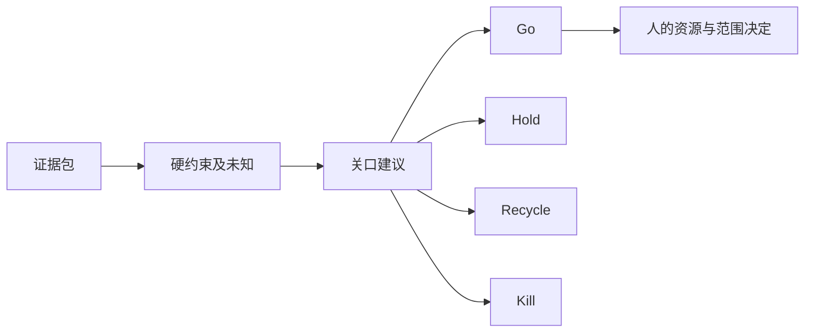

# 阶段门：批准的是下一笔承诺

实际核读Stage-Gate International的Discovery-to-Launch页面Stages/Gates选段，来源描述阶段学习、关口交付/准则/决策与下一阶段资源。它是方法持有方实践说明，不是本平台业绩提升证据，也不当作对加权分数的认证。

## 关口材料不是分数表

应先说明要做什么决定、依据哪版证据、哪个风险尚未解决、谁能承诺资源。构造G-RESEARCH-001有收益吸引假设，却有未知硬性安全条件，申请实体原型。因此输出Hold建议，实际组织决定始终null。高收益不能抵消未解决的危险；同理，“资料齐全”不代表证据充分。

本例资源只有提议上限24个构造人时单位，研究负责角色未任命，复审触发为任何实物驱动前或新证据出现时。这不是用户真实预算、任命或授权。脚本不会因产生Go文字而给资源、执行权限或市场放行。

## 四种结果要有可追查理由

同一固定例分支展示：未知安全请求实体原型→Hold；需要修改模型/存在构造安全冲突→Recycle；构造价值理由消失→Kill建议；仅在声明的构造条件充分且硬条件假设通过时→Go建议。最后一种也不是现实批准。组织可能基于额外信息采取不同决定，应保存真正决策主体、限定范围、条件、资源与复审，而不是修改历史建议。

如果只有纸面研究可继续，应单独限定任务，不能把研究继续偷换成物理试验继续。本包不自动给“受限继续”的真实权力。接R37保留偏好/价值尺度，接R52可评研究信息，但在硬约束未明时不能凭期望收益放行。

8项实际固定检查覆盖缺材料、边界、冲突和不适用；另一文档发布情境仍把发布权限未知视为Hold。没有召开真实关口、指派真实负责人或进行商业效果验证。原法实现和专业治理审核尚未完整，建议调用为契约草案。
