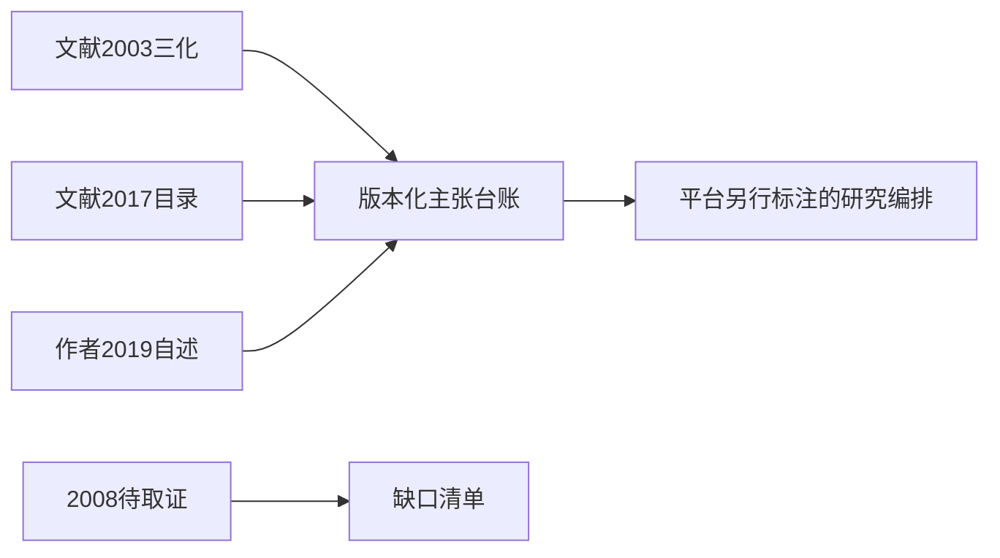

# 闻邦椿体系：把文献层与平台编排层分开

本轮选读既有合法2003论文原件的摘要、3.1及高层次三化选段，重新核高教社2017目录和东北大学2019本人署名文章。三化手段、全功能性能综合设计、项目阶段不能拼成一条作者从未发布的软件算法。本文为受限谱系研究，未替代专著全文和领域史审核。

## 四个版本节点如何保存

- 2003：《现代机械产品设计在新产品开发中的重要作用——兼论面向产品总体质量的动态优化、智能化和可视化三化综合设计法》。原件10页；摘要与第3节支持三化手段及面向不同性能的结合。它不是3I/7D/5A四阶段的当年原文出处。
- 2008：任务卡提出的专著节点保留为待取证目标。搜索能找到相近书名与年份，但本轮未获可核的一手版次/版权页及正文，不能将2007/2008候选书名混同。节点year=null、source=null，不伪造已核版本。
- 2017：高教社ISBN9787040481778的出版信息与目录支持四阶段章节组织，不能由目录推定已读章节、全部方程或作者细则。
- 2019：本人署名回顾明确说四阶段并列3I、7D、1+3+X、5A。它可作为作者当时表述的证据，不把其中效果叙述当独立对照评估。

## 为什么版本差别会影响引擎

用户问“综合设计”时，应先返回使用哪份文献、哪种层级。2003三化是选择和结合设计手段，2017/2019的阶段组织是另一层；它们相关但不能仅凭时间先后画成已证因果演化。平台若调WB02做调研、WB03规划、WB04等实施、WB10检查，应明确为平台的建议编排，各工具仍保留来源与就绪度。上层框架不替代机构、动力学或试验求解。

教学包固定四节点与定位，不画无依据的演化边；平台计划逐项标未在此执行。7项实际检查拒2003塞入3I、目录升全文、2008虚构全文、时间先后升已证演化、合并单一算法及自述升独立效果。它测的是文献身份闭包，不是作者体系实际效果。

新发现：高教社2017简介写7P，目录6.2.1写7D，2019自述写7D。保留三个来源位置，不自动认定改名、笔误或同义；未来应核正文/版次。不同资料平台场景的四段编排仅是原创迁移，不署名原作者具体操作流程。
