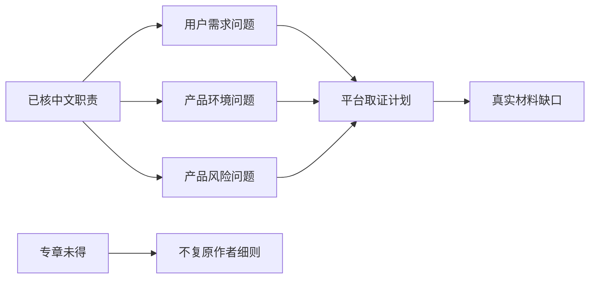

# 3I调研：已能核定中文职责，细则仍待专章

承接ML-017/WB02的缺章边界。本轮取得高教社2017《系统化设计的理论和方法》正式简介和目录。简介明确3I包括用户需求、产品环境、产品风险调研，目录第5章5.2/5.3/5.4对应这三类。由此可核定中文职责，但没有取得章节正文，不能猜三个英文I、原作者工具步骤、问卷、权重、评分或选题算法。

## 从缩写标签变成可用的研究覆盖

三个职责的价值是避免把调研等同“问用户想要什么”。本平台构造割胶研究问题：谁在什么异常/选择事件中需要帮助；树体、天气、作业组织与维护支持怎样影响使用；作用越界、恢复与隔离有哪些待查风险。问题与记录表是本平台适配，不是作者原文逐步复现。

用户需求可借R08/R09的事件/选择研究；环境可做有条件的对象与组织清单；风险可交R40/R51等方法进一步分析。每一条都单列方法归属和证据状态，不能把其他方法拼接后署名为3I原始步骤。三种调研相互影响，但本轮没有据正文定义其具体因果顺序。

## 什么情况下还不能选题

当前三类问题都没有真实事件、现场条件或风险证据，evidence_ledger为空。因此输出not_ready_no_customer_material，不能因三个栏目已填就说完成调研、客户选题或风险已控制。所需正文第5章5.2/5.3/5.4列为独立取证任务，取得后才能比较作者的材料类型、技术与选题依据。

7项实际检查拒猜英文词、冒充已读专章、将R08步骤当作者原步骤、删风险职责、伪造客户选题和未知排名填0。正常分支允许职责覆盖与平台研究计划继续，原3I算法执行状态始终false。换成文档交付场景，问题仍可按三类组织，但同样是桌面适配，没有访谈或用户结果。

这是有明确出处的受限可用范围，而非空壳，也非完整原法复刻。出版简介的7P与目录7D差别属于WB01谱系待核，不以猜测补进本项。
