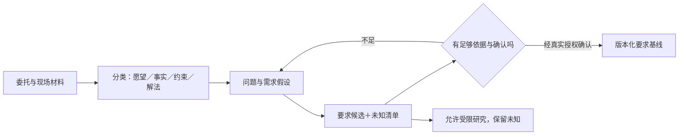

# R48 问题定义与要求管理：先形成可以被质疑的研究草案

本包版本0.1.1，2026-10-27。对象是方法教学与交接，不是客户项目要求基线。`TAP-TEACH-001`及全部事件均为平台构造，未访谈任何实际用户。本文重点补强“从模糊愿望到要求候选时，哪些东西不能由Agent替用户决定”。

## 方法身份与原典范围

R48是平台组织的问题定义与要求管理方法档案，不是NASA为好设计发布的一套独立算法。本文以NASA系统工程手册公开网页为参考，实际核读附录C的要求写作检查与第6.2节的追溯/变更活动，未称实施NASA全手册或任何行业认证。

[NASA附录C](https://www.nasa.gov/reference/appendix-c-how-to-write-a-good-requirement/)帮助区分要求表达、假设、可追溯性与可检验性。特别需要纠正一种过度简化：原文建议尽量减少TBD，并在有依据时使用附解释与消除行动的TBR估计；它并非要求所有未知永远留空。本构造任务没有合理估计依据，所以保留null并写明问题、责任角色及应解决阶段，这是平台保守适配。

[NASA要求管理第6.2节](https://www.nasa.gov/reference/6-2-requirements-management/)支持维护来源和上下游关联、评估变更影响并保留批准。本文的JSON字段、教学ID、检查器和拒绝规则是我们为Agent交接设计的适配，不由NASA背书。来源定位与主张边界见`来源与主张.json`。

## 真正的机制：逐级改变承诺强度

一句“更快、更智能”最多表达期望。把它写成“系统必须自动清洁”同时做了两次未获授权的决定：选择了解法，并把偏好升级为强制要求。R48先分类陈述、找来源与作用对象，再讨论是否足以成为可检验要求。

这里最重要的不是语言是否像规范，而是每一次状态升级是否有依据：愿望可以启发研究；有事件支持的问题可以形成需求假设；经相关方确认、表达完整的要求才可进入基线；需求确认与工程验证又是两件事。文字写得严谨不能替代这些活动。

图表示平台建议的状态变化，不表示本包已走到基线。

## 六个需要判断的地方

1. **对象是否一致。** 经营者重视收益、操作者面对恢复劳动，不能把两人的话无说明地合成同一用户要求。本包只有构造角色，真实身份与责任范围仍缺。
2. **问题是否被解法替代。** “采用某传感器”需要查其上游目的。若只是设计者设想，应放架构候选，不能伪装成原始需要。
3. **需要是否真实成立。** 我们保留N-T01至N-T04为研究假设，即使表达合理，也不标客户必要性或优先级。
4. **量能否被观测。** 在不知道树体组织及测量关系时，给切割边界一个数值不等于建立指标。先查被测对象、工况、量纲、可观测性和误差来源。
5. **估计有没有理由。** 有实证或模型可形成待解决估计；完全没有依据时，不为满足表格而补数。本包同时保留消除未知的行动，避免null变成永久搁置。
6. **变更影响到哪里。** R08构造反例只推翻“暂停是残留的必要条件”在教学集中的成立，不能反过来证明另一个现场原因。若下游按旧解释生成概念，应列影响后重建，不能悄改源文件。

## 一个完整教学包怎样操作

先读`教学包/00-共享教学输入-v0.1.0.json`，核对problem_id、版本和SHA。然后逐项完成：

- `01-问题拆解与待确认.json`：把模糊成功、缺工况、解法偏置和因果过度分开，列四个待确认问题。
- `02-要求候选与双向追溯.json`：四项源需求分别对应四个不完整要求候选，保留所有target/unit/direction/acceptance为null；候选不是可验收要求。
- `03-交接与变更影响.json`：记录R08解释修订与潜在受影响产物，不声称实际修改了别组或生产文件。
- `04-实际检查结果.json`：实际执行十项固定输入检查，覆盖正常、缺材料、不适用、边界及冲突。
- `05-另场景迁移检查.json`：把同样的分层用于资料交接教学，检查“可靠”“指定数据库”“核对版本”不能直接归成同一种要求。

运行`python3 构建教学包.py`可重建上述固定教学产物。程序检查来源闭包、版本、未知与状态，没有理解任意自然语言、确认客户事实或证明指标测量可行的能力。

## 与已有教学成果的衔接

现有`three-method-chain-v1`已在试样夹持固定场景核过R48→R14→R17的结构保真。本包换成割胶教学，不覆盖旧件。此前R48局部审核曾发现指标方向与actor来源闭包的问题；已有三方法链复制层补过固定输入探针，这不等于旧R48核心被修复。本包在独立目录检查类似错误，但没有改生产R48或注册新MCP工具。

## 何时可交给下一方法

四项假设可以交给R14形成研究性作用分解，但下游必须继续标“未客户批准、阈值未知”。不能据本包执行危险动作、比较工程达标率或宣布方案最优。若真实现场材料补入，需建立新的有来源版本，重审假设、要求及变更影响；不能只把constructed标志改为false。

待完成的真实工作包括目标用户/工况调查、指标定义与测量研究、需求必要性及目标确认、领域专业评审和产品验证。独立Agent复核另行记录，不能替代这些工作。

## 0.1.1闭包修订

本修订保留原0.1.0包及共享问题输入v0.1.0。R08新增原件→编码→解释文件的路径与SHA绑定；R48读取时核跨problem/version/sharedSHA、允许共享路径、包版本、记录与编码一致性、假设ID和反例引用闭包，并在固定H-T01上核反例满足必要条件的否定。它不是任意自然语言因果判断，也不修旧核心。R08原11项与R48原10项继续通过，另19项跨包正负探针通过；其中原先可接受的跨problem、缺失/悬空撤回情形现被拒绝。独立Agent复核仍待进行。
