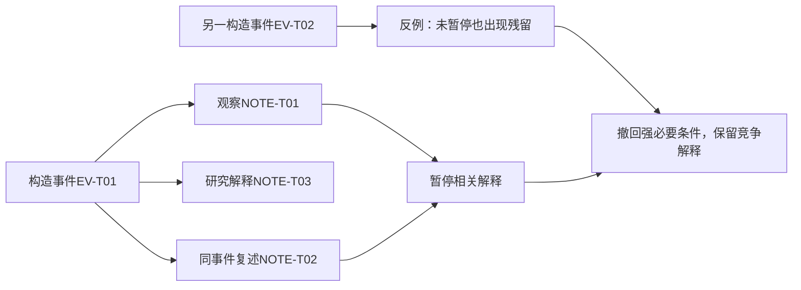

# R08 用户观察与需求证据化：保留“看到了什么”和“据此认为了什么”

本包版本0.1.1，2026-10-27。它是一套固定构造事件、编码与反例检查的教学包，没有真实录像、访谈参与者或现场调查。价值在于把从事件到需求的判断过程展开，而不是假装生成了一份真实用户研究。

## 来源与方法边界

[IDEO.org的Interview](https://www.designkit.org/methods/interview.html)强调在情境中听取参与者表达并保留原话；[Immersion](https://www.designkit.org/methods/immersion.html)提醒将具体所见所闻与研究印象区分。本轮核读这两个短网页的操作部分，不把它们解释为保证样本代表性或因果发现的统计方法。

[GOV.UK的研究分析指南](https://www.gov.uk/service-manual/user-research/analyse-a-research-session)将观察、归组、发现和行动分开，有助于防止研究结论直接冒充原记录。本包进一步加入事件去重、竞争解释、反证和版本约束，是平台适配；没有把我们的编码JSON称为原机构标准。

## 真正的推理单位是事件，不是文本条数

同一次卡滞可能出现在观察笔记、操作者复述和研究者总结里。三份表示让我们从不同角度理解同一事件，并不自动增加独立发生次数。反过来，两次看似相同的事件可能处于不同材料或操作条件，也不能无条件聚成“普遍规律”。

这要求保留三个层次：原记录与定位、事件及其上下文、解释与需要假设。研究发现需要能沿链接返回材料；反证导致解释修订时，旧解释也应保留，避免下一Agent只看到一个没有来历的新结论。

箭头表示记录/判断关系，不表示暂停造成残留。

## 怎样从模糊描述形成可研究的问题

本包六条笔记涉及三个可定位构造事件和一条泛泛意见。EV-T01有三个表示，但只计一次；EV-T02未暂停也出现残留，EV-T03暂停后未见明显残留。材料与表面状态没有记录，不能把三事件当控制实验。

先编码原话、观察、复述和解释，再对照两个不同强度的命题：

- H-T01“残留只在暂停后出现”包含强必要条件，EV-T02使它在构造集内不成立。
- H-T02“暂停可能增加现场残留概率”不能由这个极小构造集证实或证伪，继续unknown。
- H-T03“材料/表面条件可能影响残留与恢复”没有观察支持，只能进入下一轮研究问题，不能被替补成新根因。

需求修订因此不是“证明应该增加某部件”，而是撤回“消除所有暂停即可解决”的过强设想，改问哪些条件影响残留与恢复负担。N-T02/N-T04仍是研究假设，不是客户批准要求。

## 编码分歧怎样处理

`03-竞争解释与修订.json`保存两种**人为编制**的编码观点：一种把三条同事件笔记当三次独立支持，另一种按事件去重并保留反例。二者用于展示分歧处理，不冒称真实双人编码实验或已测评审一致率。后续独立Agent可复核本包判断，但要取得真实编码一致性，仍需对真实材料、代码本及独立编码者另做研究。

## 完整操作与停止点

1. 明确要观察哪个角色、任务和边界，先确认材料权限。真实研究需另行取得同意与去敏记录，本包无真实参与者。
2. 按时间/事件保存具体所见所闻，注明哪些内容没观察到。没有录到停放阶段，不能据作业段推断停放影响。
3. 建立事件与记录的多对一映射；未知事件身份时保守保留关联不确定，不能自动当新增事件。
4. 将描述、解释、需求假设分层。聚类可以帮助发现模式，但聚类大小不直接代表频率或重要性。
5. 用反例和竞争解释提出下一次最能区分的问题。缺材料时输出问题与取样计划，不用补造故事维持完整。
6. 交给R48时同时带版本、来源性质、反证和未知；后者不得把构造材料转为客户事实。

## 本轮实际检查与迁移

`构建教学包.py`执行十一项固定检查，包含三表示一事件的边界、来源绑定缺失、构造升级为现场、同事件矛盾、泛泛意见误计、重复ID、未知条件、空记录、未知角色和版本冲突。输出保留每项输入指纹及实际结果。它检查已编码字段，**不会自动从任意文本识别事件或判定原因**。

另用资料交接构造情境检查三条表示实际对应两个事件。可迁移的是证据层次、事件去重与解释修订；不可迁移的是割胶原因、频率和阈值。该检查为桌面结构推演，不是跨行业用户试验。

## 还缺什么

缺真实事件原件、目标工况与参与者、取样设计和同意/材料权利范围，也没有现场观察者之间的真实编码一致性。因此不能宣称已发现割胶客户隐性需求、估计其普遍程度或验证了新方案。当前交付的是可跟随、可质疑的研究方法教学包，等待独立Agent复核及后续真实材料。

## 0.1.1闭包修订

本修订保留原0.1.0包及共享问题输入v0.1.0。R08新增原件→编码→解释文件的路径与SHA绑定；R48读取时核跨problem/version/sharedSHA、允许共享路径、包版本、记录与编码一致性、假设ID和反例引用闭包，并在固定H-T01上核反例满足必要条件的否定。它不是任意自然语言因果判断，也不修旧核心。R08原11项与R48原10项继续通过，另19项跨包正负探针通过；其中原先可接受的跨problem、缺失/悬空撤回情形现被拒绝。独立Agent复核仍待进行。
