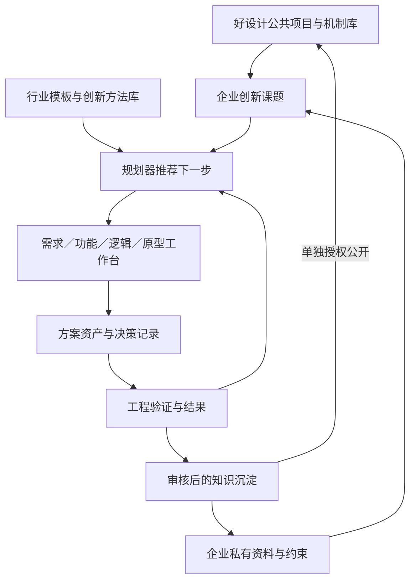

# 概念创新系统资产盘点与好设计整合建议

2026-09-07｜研究与产品整合建议；未修改线上系统。

## 判断

已有概念创新系统可以作为好设计企业创新应用的工作台候选基础。好设计贡献真实项目与创新机制，概念创新系统贡献过程组织、方法编排、模板和多模态资产管理，企业提供任务、约束及验证反馈。优先检验三者能否交换结构化数据，而不是立即复制全部界面或重写工作台。

## 本轮证据与范围

1. 用户提供《系统设计文档1202.docx》，标题“智能化计算机辅助产品概念创新设计软件V2.0”，版本V2.0.0.251202_beta_b。阅读了概念定义、总体架构、过程与资产管理、算法方法、接口描述等重点内容。文档中的预期功能、性能目标不等于当前部署验收结果。
2. 用户提供四张界面截图及对应界面文字：项目、模板、创新方法目录。
3. 浙江大学人工智能设计全链路解决方案目录为Keynote网页导出，演示清单251项，另有额外PDF资产。已提取清单对应PDF的可读文本并重点阅读平台、概念创新和规划器部分，视觉核对第117、173页。部分PDF含过渡页/相邻页文本及字体乱码，因此页码和图形判断以渲染页为准。未逐页精读全部案例。
4. 陈柳青相关公开研究：优先采用作者论文、学会论文库、arXiv及浙江大学个人主页。
5. 在线系统访问尝试超时，未完成登录与工作流实跑；未使用团队邀请链接改变成员关系，未保存提供的账号凭据。

## 已有资产如何理解

| 资产 | 本轮证据 | 整合价值 | 尚需核验 |
|---|---|---|---|
| 设计项目 | 截图“全部88”，存在同名项目和测试项目 | 保存企业课题与分支方案 | 去重、归属、真实完成状态；88不是88个验证案例 |
| 设计模板 | 截图“全部17”，包括采摘机器人、工程机械驾驶舱、康复外骨骼等 | 行业课题的启动流程 | 导出后是否带参数、关系与资产依赖 |
| 创新方法 | 截图需求9、功能8、逻辑9、原型15，合计41个目录入口 | 可选方法目录与阶段推荐 | 入口不等于41种已验证算法；部分说明带驾驶舱案例语境 |
| 多模态资产 | 文档定义文本、图像、图示、视频、3D等输入输出 | 模型结果可保存、复用、继续编辑 | 格式、对象ID、存储位置与访问控制 |
| 过程画布 | 截图项目缩略图与文档树图、分支、剪贴等设计 | 研究过程和方案分支可追溯 | 修改上游后，下游如何标记过期或重新执行 |
| 接口与工程包 | 文档资产接口、流程/模板管理、导入导出 | 适配现有平台的潜在入口 | 当前部署是否与文档一致、运行记录是否可导出 |
| 评价与工程功能 | 文档一致性、新颖性评价；截图有限元分析“示例” | 辅助比较和检查的候选能力 | 是否接真实求解器、单位/材料/边界条件是否齐全；不可认定已具备工程验证 |

文档曾写15个模板，当前截图显示17个。记录不同版本，不将两者强行改成同一个数量。

## 应继承的概念结构

文档定义的主结构是“设计资产—创新方法—设计步骤—设计流程—设计模板”。每一步是输入资产经方法处理成为新资产。对好设计，建议增加企业课题和验证记录：

企业课题 → 模板实例 → 方法步骤 → 输入/输出资产 → 人工决策与验证 → 可复用知识。

要区分三种项目：获奖项目是知识来源；企业研发课题是正在推进的任务；设计模板是可复用的过程。三者建立关联，不混为同一张作品列表。

## 浙大全链路方案的关联

第64/111页描述算力、模型、引擎、交互、应用的分层；第117页呈现设计开发者、应用商店、应用者和反馈循环；第173页明确：领域知识库、设计模板库、创新方法库，经背景信息、总体规划、方法描述支撑Planner，产出下一步规划，再经工具调用与用户确认生成设计资产，进入下一轮迭代。

对好设计的直接启示：项目案例库应成为规划器的知识来源之一；历史记录应进入下一步决策；方法输出要成为可引用资产。资料中的企业模型建设、算力和后训练内容属于整体方案背景，不意味着首期好设计必须自行训练全套模型。

## 陈柳青研究与产品能力的对应

以下为选定研究的能力映射，并非完整文献综述，也不证明线上系统已实现相应论文。

| 研究 | 论文支持的方向 | 对好设计的建议 |
|---|---|---|
| WikiLink（2022公开稿） | 基于百科语义网络，以概念关系辅助创新联想 | 建立有解释路径的跨行业机制检索；语义关系只是线索，不能当作物理因果 |
| DesignFusion（2024） | 5W1H、FBS和感性工学组织多步概念生成，思维导图支持逐步控制 | 保留可编辑的中间结果、方案分支与回退；企业看任务成果，专家可展开画布 |
| LLM增强形态分析（DRS2024） | 分解、生成、组合，加入反馈 | 做功能—候选机制矩阵，并先排除不兼容组合 |
| TRIZ-GPT（2024，前轮已读） | 参数映射、矛盾分析与人机选择 | 用于目标存在冲突的具体子问题，避免所有任务统一套TRIZ |
| Understanding Design Fixation in Generative AI（2025公开稿） | 研究生成模型的设计固着及其表现 | 检查方案是否只是外观变化；增加不同机制、来源和反例 |

DesignFusion作者包括陈柳青与罗建熙，可以作为两条研究线的交集；但作者关联不等于工程系统共享代码或接口。

文档另外描述FBS驱动的任务分解和CombinatorX。FBS可把功能逐步落实为行为和结构；CombinatorX围绕基础对象与附加特征进行组合及视觉表达。对工业应用，应将结构机理与视觉隐喻区分，不能用漂亮的概念图代替技术论证。

## 建议的整合形态

企业首页建议三个任务入口：“解决一个技术难题”“探索一个新产品方向”“评审一个现有方案”。创建课题后，再按需展开RFLP过程和方法目录。研究人员可以使用完整画布，企业业务人员可以使用步骤与结果视图，两者操作同一份课题数据。

RFLP阶段不必硬性线性执行。发现原型问题可以回到功能或需求；修改上游后保留旧版本，并标记依赖结果需要复核。

## 双环首个整合样例

以“机器人关节相关设计课题”为演示假设，先由企业确认具体产品和真实目标：

1. 需求：确认使用场景、基线指标、目标及不可改变的条件。
2. 功能：分解传递运动、承载、感知、散热、维护等候选功能，由工程师修订。
3. 逻辑：对明确冲突调用TRIZ；对系统构型调用形态分析；对跨域机制调用类比检索。
4. 知识：从好设计选择有来源的项目机制，说明可迁移处与不适用条件。
5. 原型：输出结构示意、接口说明或概念图；这些产物保持概念状态。
6. 评审：按同一组指标比较2—3个方向，形成计算/试验任务，记录接受和拒绝理由。

首个交付物应该是一份可以继续编辑、重跑和验证的课题工程包，而不只是导出的报告。

## 最小整合数据契约（建议）

- 课题：企业/团队ID、课题ID、问题版本、阶段、目标、约束、负责人。
- 知识：来源项目ID、机制ID、原文位置、事实/分析区分、审核状态、使用范围。
- 方法：方法ID、版本、输入要求、输出结构、适用条件、运行类型（规则/模型/人工/仿真）。
- 运行：运行ID、输入资产ID、方法版本、输出资产ID、执行状态、失败原因、模型及工具版本。
- 决策：选择方案、依据、修改记录、人工确认时间。
- 验证：指标与单位、工况、验证办法、结果、失败原因、结论范围。

对接从标准工程包或服务端API适配开始；具体选哪一种，取决于现有部署支持情况。避免将两套系统数据库直接合并。企业私有任务和公开项目只通过带权限的引用关联。

## 下一步工作与完成判据

1. 选择一份质量较高的现有模板及完整项目，检查导出内容与依赖，建立可复现样本。优先从截图已有的机器人或工程机械模板选取；不以名称判断其质量。
2. 盘点41个入口：可运行、预置演示、失效、待接服务四种状态；记录输入输出、成本、来源能力。此为后续验收任务，本轮未执行。
3. 挑选5—10个好设计案例机制包，建立和工作台资产ID的映射。
4. 在一个课题上贯通“引用案例—执行方法—保留输出—工程师决策—反馈回写”。
5. 检查上游改动后的结果更新、权限隔离、引用可追溯、失败可恢复、概念与验证状态区分，再决定扩大范围。

## 来源

- 用户系统设计文档：第1.2—1.3节、2.1—2.2节、第3章、第4.2章、第4.3章。
- 用户截图：2026-09-07，设计项目、设计模板、创新方法。
- 本地Keynote网页导出：浙江大学人工智能设计全链路解决方案，第64/111、117、173页等。
- 陈柳青浙大主页：https://person.zju.edu.cn/chenlq
- WikiLink：https://arxiv.org/abs/2208.14349
- DesignFusion作者提供论文：https://www.researchgate.net/profile/Liuqing-Chen/publication/380453455_DesignFusion_Integrating_Generative_Models_for_Conceptual_Design_Enrichment/links/66558a68bc86444c72075a42/DesignFusion-Integrating-Generative-Models-for-Conceptual-Design-Enrichment.pdf
- LLM增强形态分析：https://dl.designresearchsociety.org/drs-conference-papers/drs2024/researchpapers/152/
- TRIZ-GPT：https://arxiv.org/abs/2408.05897
- 设计固着：https://arxiv.org/abs/2502.05870
