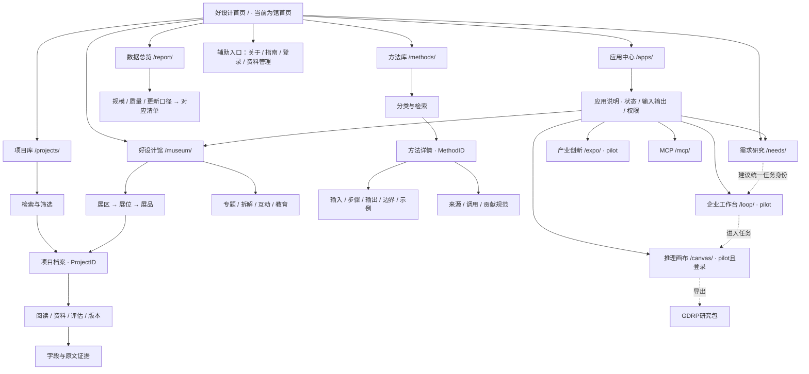
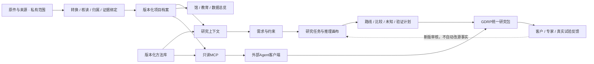

# GoodDesign 网站结构图与用户路径
2026-11-15。依据共享导航、应用注册表及本轮线上检查。实线表示结构/使用关系，虚线表示建议串联，不等功能已端到端验收。当前公开短路径已复测，旧/inno前缀为兼容与运行时路径，legacy不作为产品栏目。

## 用户可见结构

## 共享底座与研究逻辑

## 三类身份，不混用
- ProjectID：历史案例与事实档案；证据、版本归属于它。
- MethodID：方法的输入步骤输出与边界；引用明确方法版本。
- TaskID：用户当前要解决的问题；关联多个ProjectID/MethodID，不复制它们为新事实。
展品是项目的主题叙事视图；应用是对底座能力的任务化组合；研究包是任务输出。它们均不另建互相矛盾的事实源。

## 主要用户路径
| 人群 | 入口与步骤 | 应获得结果 |
|---|---|---|
| 公众 | 首页→展区→展品→档案 | 看懂设计价值并能核依据 |
| 教师与学生 | 馆→教育/互动→项目 | 学习活动及其来源边界 |
| 设计师与研究者 | 项目/方法检索→详情→需求 | 参考材料与明确研究问题 |
| 企业 | 需求→工作台→画布→报告→验证 | 有依据、有未知、有放弃条件的研究包 |
| 外部Agent | MCP说明→能力→检索→精读→组包 | 带版本和证据的研究上下文 |
| 资料维护者 | 登录→资料管理→审核→新版本 | 可追溯增量，不覆盖旧版本 |

## 状态与下一步
馆/教育/需求/MCP在注册表为live，企业/画布/产业为pilot；配置状态不替代实测。教育当前为馆内入口。画布匿名跳登录，登录后端到端本轮未验。研究图谱后台是固定嫦娥样例，不代表全项目图谱；公开入口待修。优先完善同任务串联、返回筛选、权限提示和单一规范路由，保留别名兼容。此图不宣称当前全链自动执行，虚线连接须逐项验收。
