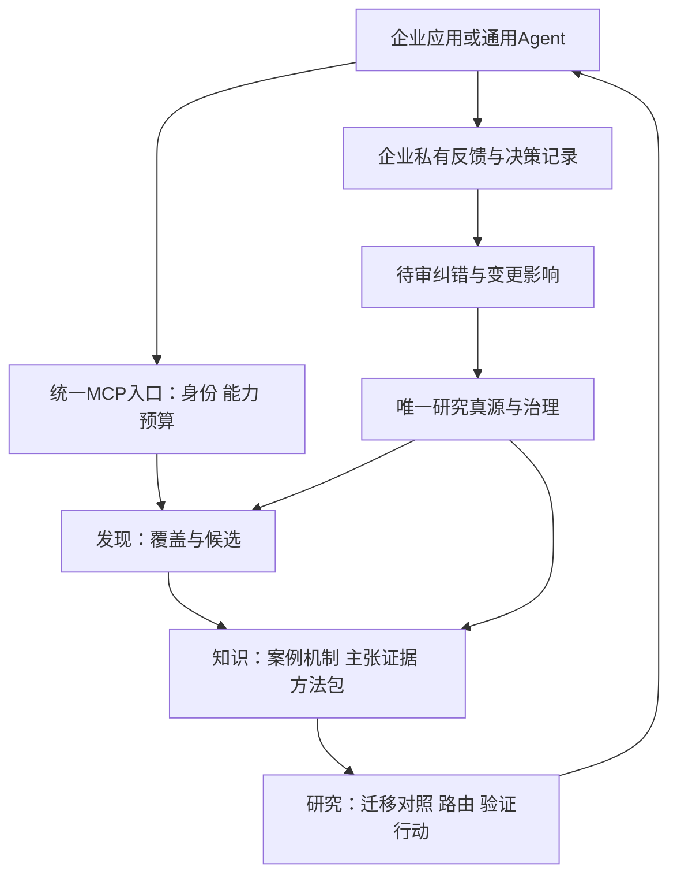

# 好设计MCP定位与服务架构策略 v1

日期：2026-11-16。状态：架构决策提案与执行依据；不是新接口已实现或生产已升级声明。

## 产品定位

面向产品与机械创新Agent，提供可追溯的案例机制、可操作的方法、可复查的研究上下文与验证交接。核心价值是帮助调用者从模糊需求走向有证据和边界的候选与研究行动。MCP是知识和工具接入层，创新引擎是推理与校验能力，客户应用拥有需求、偏好、决策和成果。不能用MCP工具数量衡量创新水平。

主要用户：企业研发Agent、研究人员使用的通用Agent、好设计自己的需求/推理画布应用。先服务专业创新研究；教育展示可读同一公开知识，但不同权限和交付说明，不另复制事实库。

## 场景与成功标准

|场景|服务承担|成功标准|
|---|---|---|
|核查一项项目主张|确定版本、完整字段、冻结引文和缺口|引用可追溯，资料未核/结论不足可见|
|从需求找相关机制|覆盖报告、逐字与可选扩展候选、命中理由|找到有用候选，同时保留误召回与目标不适用项|
|借鉴案例设计路线|源问题/机制/取舍/验证/失效边界与目标条件对照|明确迁移原理和禁止迁移的事实参数|
|选择及组合方法|方法类型、输入、产物、停止条件及能力状态|输入不足时能返回补证，内容方法不伪装求解器|
|形成研究行动|冻结需求与知识版本、竞争假设、试验如何改行动|行动有解释力且可交领域人员审，不凭空填试验结果|
|反馈与纠错|租户内版本化研究记录与待审反馈|原事实不被客户反馈自动覆盖，变更影响可追查|

## 一个对外入口，内部六层

1. 接入层：认证、密钥生命周期、请求ID、限流/返回预算、版本能力、错误与审计。公共内容与私有需求按权限隔离。注册表可用不等客户接入完成。
2. 治理层：稳定项目/方法ID、版本、来源资产、证据锚点、内容性质、读取/审核状态及权利范围。研究真源唯一；阅读页和MCP是投影。
3. 发现层：题录、字段、机制检索；明确实际覆盖、跳过原因、分页快照与召回通道。摘要只为发现，不自动成为工程证据。
4. 知识层：主张证据包、机制经验包、方法操作包。对象可复查、可限定上下文，提供深读入口，不一次返回整库。
5. 研究层：需求缺口、结构迁移对照、方法路由、研究计划及一致性检查。确定性校验只检查声明和约束；模型推断输出标记。现有prepare的固定R48/R14/R17是默认模板，不冒充动态方法优选。
6. 应用/反馈层：企业需求、方案、选择理由、反馈与结果，由应用保存；后续写接口独立授权、幂等和版本冲突检查。客户数据不直接写共享项目知识，不自动作为训练材料。

当前外部只读网关保留统一前缀；项目/方法/治理模块可内部独立实现。只有权限、负载或生命周期证据说明需要时再拆独立服务，先不增加多入口配置负担。后台任务和写入服务未来按明确scope隔离，不能把所有本地管理工具暴露到远端。

图中反馈→共享治理须经过明确授权、来源及内容审查，尚非自动回写链。

## MCP表达结构

Tools提供检索、核引用、准备研究与有界计算；Resources适合固定版本的方法正文、字段规范和可公开研究快照；Prompts适合用户选择的研究模板。客户端未支持Resources/Prompts时保留工具等价读取。协议能力与资源URI不能赋予额外权限，不提供任意路径/全原文下载。

参考官方2025-11-25协议：
- https://modelcontextprotocol.io/specification/2025-11-25/server/tools
- https://modelcontextprotocol.io/specification/2025-11-25/server/resources
- https://modelcontextprotocol.io/specification/2025-11-25/server/prompts
本轮不升级SDK或声称全部特性已接入。

## 接口组合与演进

|对象|现有能力|建议补充|迁移策略|
|---|---|---|---|
|能力|inno_capabilities|真实服务/数据/方法/检索版本、可用profile、预算、schema版本与更改说明|加字段；工具数与注册实际一致|
|发现|search_projects/search_fields/search_methods|可选机制候选通道；覆盖与快照|原逐字含义保留，扩展须显式选择|
|案例证据|read_project/read_evidence/read_claim_evidence|机制经验包：原问题/取舍/前提/验证/反例|由已有真源派生，缺失明确不由模型补实|
|方法|read_method|统一版本化操作包，区分教学、编排、执行|冻结库/ML021/标杆候选关系明确，默认不暗换版本|
|研究|prepare_research|显式需求版本、输入就绪检查、迁移对照和路由解释|prepare仍是组包；新推理/收费执行另接口|
|反馈|本机记录服务|将来租户私有反馈、纠错建议、变更通知|先读后写；远程当前只读，不许伪造已写入|

目标不是一口气加十几个工具。先完善基础原语，再为“找相关机制”“检查主张”“准备迁移研究”做少量工作流工具；每个工具必须能说明输入、输出、预算、权限、失败返回及可重复性。

## 通用返回契约（拟议）

返回metadata：request_id、service_version、schema_version、selected_versions、coverage、pagination/snapshot、truncated/omitted及下一步读取。返回items逐条附content_nature、traceability、read_scope、semantic_review、expert_review、target_applicability、conditions、limitations。

身份、内容状态、评审状态、工程状态分别记录；未知用unknown/not_assessed或null，不用false暗指经过否定判断。追溯通过不自动升成语义支持。质量字段由真实记录计算，不由返回模板统一写“高质量”。状态过多时概览精简、详细按需，不让限制说明淹没有用内容。

所有摘要和证据包绑定版本/摘要；分页固定版本但不保证来源权利永远不变，来源撤回或无权限应停止读取并返回可定位错误，不绕过治理。快照校验和不是授权签名。文本视作资料，不执行来源内指令。

## 权限与运维

当前Bearer机制继续兼容，凭据只通过安全渠道交付。密钥生命周期与交付生命周期分开：issued/delivered/client_updated/client_verified/revoked；不宣称状态字段现已全部实现。外部失败安全返回请求ID和修复建议，内部仅记录原因类别/主体ID，不记录明文凭据或需求全文。暴露旧钥不重启用。

公开摘要、授权引文、客户私有研究、管理操作区分权限。租户隔离按服务端身份执行，不能靠客户端传tenant_id自证。通用客户端兼容授权方案另立迁移设计，需查协议与实测，不在此承诺OAuth已支持。

服务发布按新release、固定代码清单、数据版本指纹和回滚，先验证未认证拒绝、正确身份、过期/撤销、工具schema、检索→证据链。服务器绕公网成功与客户设备成功分别记录，监控凭据成功不代表客户凭据有效。

## 质量验收与发布门槛

技术：认证/隔离、版本、分页、证据校验、错误、预算、回滚。知识：来源支持、完整性、归属、独立证据和核读范围。任务：Recall@K、带标注Precision@K、无覆盖、引用正确、约束遗漏、迁移边界和研究行动价值。运营：客户接通率、诊断耗时、凭据迁移完成、请求延迟与失败原因。

先冻结样题与预算，再记录原始结果和评审分歧。开发扩展集5/16只作调试，不当独立收益。严格区分同模型AI评审、领域专家和真实客户验收，不设未经校准的总质量分。默认检索上线要求独立集不破坏逐字基线、误召回可解释、关键危险误用无未结阻断；样本规模和容忍阈值评测前确认，不能看结果后定门槛。

## 当前差距与执行顺序

已上线9只读工具、字段快照、覆盖说明与主张证据包。尚待：请求ID诊断、客户交付回执、所有接口质量信封、统一方法版本、机制包、独立召回评测、租户研究与反馈权限。

现有十任务保留；新增四个架构任务：T11统一方法资产版本；T12机制经验包；T13迁移对照/方法路由协议；T14Resources/Prompts及客户端降级。先T01—T07保证可靠接入读取；T08/T09及T11/T12形成可用知识；T10/T13验证场景；T14按客户端需要实现，不作为先行重构前提。

本轮交付为策略及结构设计，不把规划接口、权限或反馈闭环列为已上线。
