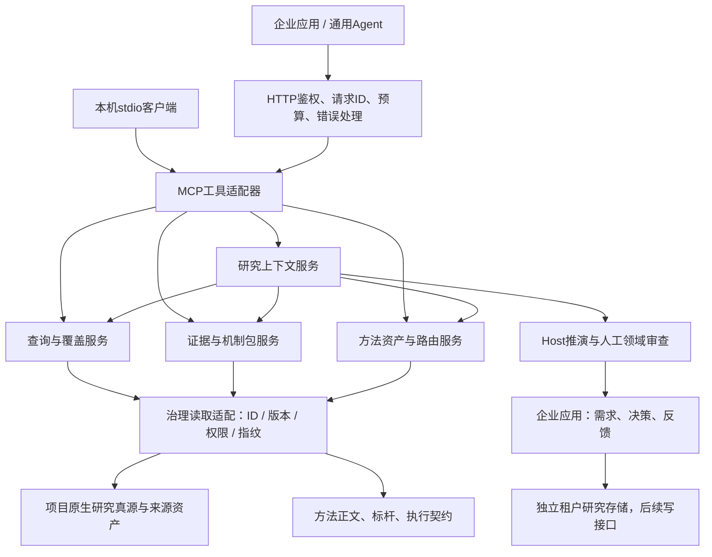

# 好设计MCP开发架构与实施计划 v1

2026-11-16。设计与开发排期，未实施模块不得视为已上线。承接《MCP定位与服务架构策略-v1》及14项任务，本文作为本轮开发验收依据。

## 架构决策

采用Python现有SDK与模块化单服务，远程Streamable HTTP、开发stdio共用业务服务。保留现有9只读工具和客户端参数，新增能力按可选接口/可选字段引入。不先拆微服务、不升级生产SDK、不引入向量数据库作为前提。需要时在实测基础上另作ADR。

服务端负责可信来源访问、版本、权限、检索与确定性检查；Host负责模型编排与解释；专业人员/客户负责适用性与验收。未来收费推理必须独立显式入口和预算，不藏在只读工具中。

## 代码模块与职责

|模块|复用/新增|责任|禁止混入|
|---|---|---|---|
|innovation_gateway_http.py|保留薄适配|HTTP认证、请求编号、安全错误、日志及预算|字段解释、隐式模型调用|
|innovation_gateway_mcp.py|保留薄适配|工具schema与本地/远程共用服务调用|重复业务规则、直接任意文件读取|
|mcp_access_diagnostics.py|拟新增|内部原因码、request_id、脱敏事件|明文token、完整Authorization、客户正文|
|mcp_quality_envelope.py|拟新增|返回统一metadata与逐项质量描述|把缺状态自动写成已审或高分|
|archive_knowledge_search.py|复用|源陈述检索、覆盖、版本分页|把AI候选当事实、隐式替换检索模式|
|claim_evidence_packet.py|复用强化|单字段与冻结引文的核验与组包|完整原件下载、语义自动认证|
|case_mechanism_packet.py|拟新增|从真源投影问题/机制/取舍/验证/边界|凭空重建作者设计史|
|method_asset_service.py|拟新增适配|统一方法正文/标杆/契约的版本映射与能力状态|无声明暗换冻结库|
|innovation_query_expansion.py|已有开发候选|显式规则扩展与命中依据|视作通用语义等价或自动推荐|
|innovation_research_service.py|拟新增渐进适配|需求就绪、迁移对照、方法路由解释及行动协议|替客户批准、替专业人员放行|
|innovation_loop_store.py|复用评估后接入|私有不可变研究记录、幂等、乐观并发|写共享项目事实、仅靠客户端tenant声明隔离|

先抽业务服务再渐进迁移现有函数；不同时重写所有接口。旧模块保兼容调用，避免HTTP和stdio各自长出规则。

## 四类核心对象

1. EvidenceRef：project_id/research_revision/record_id/field/source_id/source_sha256/chunks_sha256/chunk_id/quote_sha256/read_scope，公开返回只含授权引文与定位，内部路径不出网关。
2. MechanismPacket：原问题、作用机制、备选与取舍、效果证据、失败条件、所缺材料，每项各自挂EvidenceRef或AI解释身份，不能只在包尾挂一个总引用。
3. MethodAsset：method_id、正文版本/摘要、原典范围、资产类型、输入/输出、停止条件、reference_run、contract_ref。类型区分教学/框架编排/有界执行；正文已深化不自动生成执行契约。
4. ResearchContext：tenant内request_id/revision、原话/研究解释/确认状态、源版本集合、候选及条件对照、路由理由、待补证与研究行动。研究记录和事实库分开。

共用envelope：request_id/service_version/schema_version/data_versions/coverage/page/status/warnings/next_actions。items保留content_nature/traceability/read_scope/semantic_review/expert_review/target_applicability及定位。未知用unknown/not_assessed，状态来自真实数据；原有字段保留。

快照包含查询绑定和版本集合；当前客户端校验和只作完整性提示，不作认证。服务端仍按每次调用身份检查可读范围。版本撤回、证据缺失、权限变化必须失败或明确重新发现，不能返回缩水页假装稳定。后续有签名cursor需求时另加密钥管理与过期策略，不复用访问token签名。

## 场景调用流程

发现：capabilities→search_projects/search_fields（读取coverage）→锁定snapshot/revision。
核查：read_claim_evidence→读取关键来源与缺口→辨别source_statement与AI解释。
迁移：读取mechanism packet→目标原话/约束/未知→逐项同/异/未知→保留适用条件及反例。
选法：读取MethodAsset→检查输入→返回推荐用途、不能解决什么、产物交接与停止点；无充足依据时输出候选，不自动排序最优。
研究：冻结ResearchContext→Host生成不同机制路线→一致性检查→领域审查→实际研究→私有反馈。当前远端只读服务不会自动执行这条全链。

新机制/方法/研究接口在schema和内容验收后才命名注册；不提前宣布生产工具数量。Resources为固定版本正文/规范，Prompts为用户选择模板，均继承权限且保留工具降级读取。

## 认证、发布与数据迁移

认证阶段无凭据/未知/撤销/过期/注册表不可用内部区别，外部安全通用错误附request_id。日志不保留凭据或客户问题文本。密钥发放与交付状态分开；客户工具链真实成功才登记client_verified。测试钥独立、最短用途、结束撤销。

发布采用线上已知release基底及明确文件清单；当前基线20261115-evidence-packet-v1，回滚20261115-reliable-read-v1。新代码从明确提交构建，基底差异先收编，不能混入本地大量并行未提交内容。数据不随代码发布偷偷升级；独立迁移先备份、dry-run、样例复核。统一质量字段是投影，不回填原项目判断。

公开与租户私有空间由服务端授权划界。写研究/反馈需要单独scope、输入版本、idempotency_key和expected_revision。共享纠错必须走待审队列；反馈不自动进入训练/公共知识。权限不足不借另一个工具读取相同原件。

## 开发阶段与出口

|阶段|任务|工作量估算（专注开发日）|出口|
|---|---|---|---|
|S0基线|T01|1|线上/本地指纹清单、可重建来源、数据/代码版本、可回滚|
|S1接入|T02—T05|2—3|内部原因/request_id、脱敏客户端检查、密钥交付回执、隔离回滚演练|
|S2可靠读取|T06/T07/T11|3—4|九工具质量契约、真实损坏/跨版本负例、方法版本映射兼容|
|S3知识与发现|T08/T09/T12|3—5|独立标注集、机制包样板、扩展误召回报告、决定是否可选上线|
|S4研究与场景|T10/T13|3—5|三任务完整链、版本化迁移对照与行动、领域待核清单|
|S5客户端增强|T14|1—2|实际客户端Resources/Prompts或工具降级验证|

合计约13—20专注开发日，不是连续运行承诺；客户、领域评审及材料等待不包含在内。先做S0/S1小发布；后续每阶段独立验收，不等所有完成才交付，也不以排期倒逼放行。原9工具读取可用性优先。

执行角色：主Agent负责架构/集成/发布；接入开发负责T02—T05；知识开发负责T06/T07/T11/T12；评测负责T08/T09；研究应用负责T10/T13；独立复核者审接口负例与结果。此为角色分工，尚非已启动或委派的多Agent。

## 验收规则

技术测试覆盖正确/未知/撤销/过期/故障注册表、来源移交、篡改引用、空证据、交叉租户、并发发布、快照坏/过期/超预算；真实SDK验证stdio与公网HTTP；客户设备另验。所有错误不泄路径或明文密钥。

内容检验覆盖问题/机制/取舍/验证/边界，存在与被支持分别判断。至少先做三种案例内容状态：证据较全、只有摘要、存在冲突；不得只选成功样例。

召回评估冻结开发与独立集，明确K、正负/歧义/否定、相关性标注、未能判断及覆盖统计。没有精确率标签就不声称误召回可控；待定项不算正确。看题后改规则须新版本，不能重用为独立验证。

场景验收固定同需求/资料预算，评需求遗漏、引用正确、机制差异、适用边界及验证行动价值；保留AI分歧和真实专业结论，不把AI评审叫专家。尚未取得真实需求则只验研究流程，不宣称企业效果。

## 第一批开发交付清单

先完成T01基线收编及差异清单；随后T02请求ID与原因码、T04脱敏诊断脚本、T03客户交付状态；T05只部署有真实验收的检查。交付包含代码、schema、正反例、SDK日志摘要、版本/回滚记录、未结项。接入完成后，T06/T07/T11与T08可分文件推进，避免同时改网关核心。

决策记录：选择模块化单服务、原接口兼容、显式召回通道、知识资产单真源、私有研究独立、语义与工程审核分层。需要扩大工具数、收费执行、OAuth迁移、向量后端或拆服务时另立ADR和效果/权限验收。
