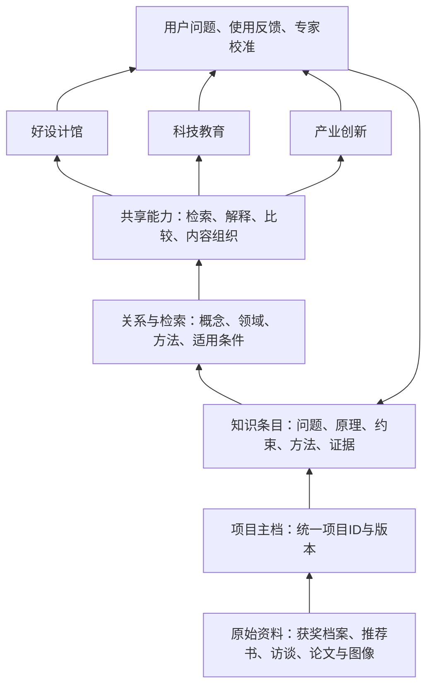

# 好设计平台策略定位 v0.2

2026-09-05 · 讨论稿。基于本次用户方向、现有文件盘点、历史会议与首轮调研。网站先发布现有成果，以下为下一阶段建议，尚未实施。

## 1. 一句话定位

**以真实创新项目为核心，把科技成果转化为可理解、可学习、可迁移的设计知识，支撑场馆、教育与产业创新应用。**

对外可以使用“好设计｜创新设计知识平台”。“好设计奖”是起步资源与价值筛选入口，“项目库”是长期组织核心，“好设计馆”是场景品牌。专业模型是后台能力，随着证据、数据和评测成熟逐步建设。

平台要回答三个递进的问题：这个项目做出了什么？它怎样解决问题？这些知识如何帮助我学习或创造？第三个问题决定长期价值。

## 2. 现有成果到底到了哪一步

本轮直接检查导入数据和文件，未重新核验所有官网条目，未将文件存在视为业务验收。

| 资产 | 实际盘点 | 当前成熟度 |
|---|---|---|
| 奖项项目 | awards.json 560条；金98、银199、创意190、提名70、菁英3 | 可浏览档案，仍需字段级证据复核 |
| 项目详情 | 560个HTML + 560份详情JSON | 已有成果与设计阐述，可作为结构化原料 |
| 金奖精选 | cases.json 98条 | 可做首批重点项目，不代表98份完整知识包 |
| 知识页 | 560个项目知识HTML | 已有知识视图和占位结构 |
| 独立原子数据 | .build/atoms/ 下2份JSON | 两份均为ai_draft；未达到专家校准完成 |
| 教育 | 8份项目课例、3个学科单元、备课页面 | 内容及交互原型，未完成教学效果验证 |
| 拆解 | 8份dismantle JSON，加拆解页面和交互资源 | 可体验原型，非工程仿真工具 |
| 场馆 | 数字馆、分类展区、展厅模拟和大屏页面 | 数字应用基础；不能代表实体馆已落地 |
| 产业与助手 | 旧问答/需求表单代码、迁移报告页面 | 有原型，生产能力与服务闭环未验证 |
| 运营 | 专家校准、素材和协作方案 | 文件中有方案，实际工作流待建立 |

关键结论：**我们已经有较丰富的内容和展示层，最薄弱的是可复用知识、校准流程和应用成效。** 继续复制页面可以增加展示量，但知识能力的增长要靠结构与证据。

## 3. 推荐的平台结构

用户界面简单分成“项目库、知识库、应用、关于平台”。后台保留更细的原料、项目、知识、能力、运营分层。前台不要求公众先理解技术架构。

### 项目库：每一个项目有一个长期身份

项目是知识连接点。档案包含名称、团队、成果、时间、原始资料、奖项记录和可用应用。将来同一项目可能获得多个奖项，不应复制成多份项目。

现有slug可以保留为页面地址；下一阶段增加稳定project_id。Award和AwardRecord独立保存，明确项目参加哪届、获得何种等级。项目技术版本也要独立表达，避免把不同型号的参数混在一起。

### 知识库：从整篇介绍走向可引用的知识条目

“原子化”不是把文章每500字切一块。文本切块服务检索；知识原子要承载一个完整、可审查的意义单元，例如：

- 一个问题：为什么现有方法在某种工况下失效？
- 一个原理：某种结构怎样实现某个功能？
- 一个取舍：为何牺牲某项性能换取可靠性？
- 一个方法：从问题到方案经历了哪些步骤？
- 一条证据：某个结论在哪个条件下被验证？
- 一个迁移假设：哪些条件相似，哪些差异会导致失效？

每个原子必须关联项目、原文定位、证据类型、适用条件、版本和校准状态。文字、图像和视频可以对应同一知识点；应用只读取适合自身受众与可信等级的表达。

### 共享能力：让不同应用用同一套知识

优先做项目检索、带来源解释、跨项目比较、按受众组织内容，再做复杂任务。设计五大构成作为分析框架和标签体系，保留专家判断的依据，不把主观评分当工程事实。

当老师生成课程、策展人生成展项时，产物都保存其引用的知识ID和版本。知识被校正后，能查到哪些课程和展项受影响，提示更新。这样一次整理才可以被多个应用使用。

## 4. 三个应用如何分工

| 应用 | 核心用户与任务 | 首先交付什么 | 成功如何判断 |
|---|---|---|---|
| 好设计馆 | 策展与运营团队向观众讲清作品 | 可持续更新的展项包：故事、图像、互动、讲解与来源 | 内容更新成本、现场完成体验比例、真实运营反馈 |
| 科技教育 | 教师备课，学生理解并尝试设计 | 项目课包：科学原理、讨论问题、实验/模拟、创作任务与评价量规 | 教师采用与复用、备课耗时、学生作品和解释质量 |
| 产业创新 | 企业研发与设计人员寻找对标 | 问题澄清、案例对标、迁移假设、专家复核与验证建议 | 是否进入真实研发决策、继续服务意愿、交付成本 |

好设计助手是跨应用的交互入口。同一项目面向学生讲原理、面向企业讲约束、面向策展讲故事；这些表达从共同证据生成。

**推荐优先顺序：场馆提供现实合作场景，教育承担快速可重复的知识验证，产业用少量人工陪同样本探索。** 不同时启动三个完整业务系统。

教育更容易观察“一份知识能否被理解和复用”；场馆能够形成主题内容交付；产业的迁移判断需要更严谨的证据、专家投入和业务验证。三者的验证周期不同，不能使用同一个“页面上线”标准验收。

## 5. 数据模型最小版本

| 对象 | 核心字段 | 关系 |
|---|---|---|
| Project | project_id、标准名称、版本、领域、摘要、组织 | 一项目多奖项、多资料、多知识 |
| AwardRecord | 项目ID、奖项ID、届次、等级、原始出处 | 一个项目可有多条记录 |
| Source | 来源ID、类型、时间、原件路径、授权范围、版本 | 支持多个知识条目 |
| Claim/KnowledgeAtom | 条目ID、类型、内容、工况、限制、证据状态 | 引用项目和来源定位 |
| Concept | 术语ID、定义、别名、上位概念 | 统一技术名称与检索词 |
| Relation | 起点、关系类型、终点、依据、事实或假设 | 如采用、解决、受限于、可借鉴 |
| Review | 对象ID、校准人、结论、日期、变更说明 | 形成专家复核历史 |
| ApplicationAsset | 课例/展项ID、受众、引用知识及版本 | 一套知识对应多种应用资产 |
| Feedback | 任务、匿名反馈、问题分类、待处理项 | 触发知识修订与新资料采集 |

初期结构化表与文件足以起步，先统一语义和标识。关系规模与查询需要成熟后再选择图数据库，向量索引按检索任务增加。不要为了“知识图谱”这个名称先做一套无法维护的复杂系统。

## 6. 知识加工管线

原件登记 → 项目匹配/去重 → 机器抽取 → 字段校验 → 人工审读 → 专家校准 → 发布索引 → 应用调用 → 反馈修订。

建议把进度分开记录：档案完整度、来源可定位度、原子化覆盖度、专家校准率、应用复用率。不要把有页面、字数多、图多直接折算为知识可信度。

首批选10个项目建立基准：2个已有样本，若干教育表达清晰的项目，若干与玉环产业问题相关的项目。选择依据应包括原始资料可得性、专家可联络性、需求相关性和跨应用复用价值。没有材料和校准条件的项目暂不做深。

每个样本先解决5—10个真实问题，再决定需要哪些原子。先明确问题，能避免把大量无使用价值的字段填满。

## 7. 专业模型路线

建议先把“大模型”解释为一套专业智能能力：基础模型 + 可检索知识 + 专家方法 + 工具与评测。

知识入库后，先评测检索与引用，再评测解释和比较。若问题主要来自数据缺失，就补资料；来自检索失败，就调整索引；来自流程不稳定，就约束任务；只有当高质量训练样本和明确效果需求出现，再评估微调。

RAG与训练是两种不同机制。微软文档将RAG描述为用自有内容支撑模型回答，并强调来源治理和相关内容检索。本项目借鉴这一机制，不在此阶段绑定某一家云产品。[技术参考](https://learn.microsoft.com/en-us/azure/search/retrieval-augmented-generation-overview)

已有浙大数智平台与原知识服务系统有直接承接关系，应优先核实可用资源、词典、接口和团队分工。官网描述了建设方向，不能据此认定所有能力已建成或授权可用。[机构参考](https://yrd.zju.edu.cn/wlsjsys_74965/list.htm)

## 8. 商业与运营策略

公共项目库承担发现与传播；收入可以围绕专业内容交付和持续服务探索。

- 场馆：主题展项内容、应用配置、持续更新与运营支持。
- 教育：经过教学验证的课包、教师工具、学校/机构服务。
- 产业：问题诊断、对标研究、专家协作和项目服务。

这些是待验证的模式，不应先假设订阅收入。尤其要把场馆硬装、内容制作、平台研发和日常运营分开核算，避免某个项目的一次性经费隐含承担整个平台的长期成本。

平台的差异化资产是“可追溯的项目过程知识 + 专家方法与校准 + 被应用验证的知识关系”。通用聊天界面与公开介绍容易复刻；持续把真实过程整理成可复用知识，需要团队长期投入。

## 9. 下一步的三次迭代

| 阶段 | 工作 | 可检查交付 | 暂不扩展 |
|---|---|---|---|
| 首发 | 整理与上架现有成果 | 独立站、完整内容索引、状态边界 | 账户、付费、模型训练 |
| 知识打样 | 10个项目，统一ID、来源与原子结构，建立校准流程 | 可审查知识包、至少30道带参考依据的问题；同一知识支持1个展项包和1组课例 | 全量自动生成数千原子 |
| 应用验证 | 真实教师/场馆团队使用，少量企业问题陪同探索 | 使用记录、修改反馈、交付耗时、继续采用意愿 | 多地建馆、全行业扩张 |

建议进入下一阶段的门槛：关键事实均有出处；未解决的争议不进入事实答案；同一知识包确实被两个应用使用；获得至少一个真实使用者的具体改进反馈。具体周期与人数结合团队资源再定。

## 10. 接下来最值得共同决定的三件事

1. **平台品牌的边界**：是否认可“好设计”为总平台、“好设计馆”为应用？
2. **第一批知识样本与验证场景**：是否用“2个现有样本 + 8个精选项目”，同时做馆内展项与教育课例？
3. **知识生产的责任机制**：谁提供原件，谁整理，谁校准，谁维护；这些工作如何获得持续预算？

方向确定后，再写下一轮开发规格。当前首发的任务是把已有东西完整放到一个清楚的位置，让后续讨论面对真实内容和成熟度。
