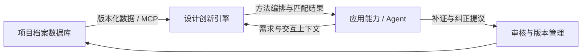

# 底座架构与数据库建设主线

2026-10-19｜依据用户会后澄清确定的方向。取代把“项目档案、设计知识、应用研究”当作平台三个板块的表述；这三类内容仍可在相应模块内部使用。

## 三个板块

1. **项目档案数据库**：深入研究真实项目，保留完整上下文、结构化值、证据、设计过程、质量评估和增删改版本。未来通过数据服务与MCP被调用。
2. **设计创新引擎**：理解行业、企业与用户需求，选择和组合方法，调度项目与知识内容，完成供需匹配及研究推理。企业与项目的关联需经过条件、差异及验证判断。
3. **应用能力**：通过Agent、交互与具体应用完成用户任务，承载企业创新、展馆、教育等不同体验。使用相同项目ID、证据和内容版本，应用各自闭环。

## 当前只聚焦第一板块

以嫦娥为核心样本：定义深研框架→按框架研究→按量规评估→冻结版本→继续补证并比较差异→用同样方法处理其他项目→接入引擎及第三方Agent。

当前实物基础：八板块、17类记录/233字段规范；本轮实际补证后有21来源、22关键陈述、75原子记录/974个单元值。仍缺原始工程材料、成果清单、直接设计决策记录和专业审核，不以记录数量宣称完整。

当前研究内容版本0.1.0为治理基线，0.1.1为一次真实补证更新；前者不是还原此前全部历史。质量量规是六维100分试行平台自评，尚未校准为S/A/B等级。数据登记覆盖与研究质量分开展示。

## 执行文档

- [深研、质量与版本规范](../04-知识库/项目档案标准-v1/深研作业质量与版本规范-v4.md)
- [可分发的研究任务模板](../04-知识库/项目档案标准-v1/深研任务模板-v4.md)
- [MCP只读调用契约草案](../04-知识库/项目档案标准-v1/MCP只读调用契约-v0.1.json)
- [嫦娥本例说明](../04-知识库/标杆案例/2025-00-嫦娥钻取采样/README.md)

MCP目前是接口设计目标与契约，尚无本轮交付的在线MCP服务。后续先将既有文件治理迁到可维护的数据服务，再完成协议接入、权限过滤与真实Agent调用验收。方法引擎和应用的开发不是本轮优先任务。
