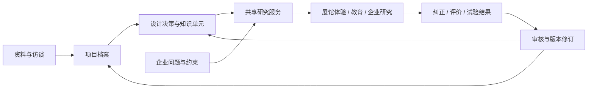

# 好设计数据库深化方案｜从项目档案到创新设计知识底座

2026-10-19｜讨论稿。依据[本次会议](../00-项目管理/会议记录/2026-10-19-创新设计大模型项目推进讨论.md)、既有平台规划及当前本地数据检查；以下为AI建议，不是已确认决策或已建设能力。

> 会后澄清：平台三个板块已由用户明确为“项目档案数据库、设计创新引擎、应用能力”。下文“项目档案、设计知识、应用研究”是此前提出的内容组织建议，不是平台三板块；当前执行主线以[底座架构](底座架构与数据库建设主线-v1.md)及档案标准v4为准。

## 一、核心判断

下一步应围绕“一个项目的知识，能否支持另一个真实问题的研究”深化数据库。现有233个字段可以作为调查清单，下一阶段的重点应放在设计过程、证据关系、知识复用和使用后的反馈，不把字段越来越多当成研究越来越深。

外部仍维持容易理解的项目档案与应用入口。底座用三个主要内容对象来解释：**项目档案、设计知识、应用研究**，三者共用证据、版本和权限。

箭头表示建议的数据处理与引用关系，不表示这些模块已经连通。应用私有反馈进入审核区，不能直接写成公开项目事实。

## 二、当前基础与真实缺口

| 现有内容 | 本次核对 | 下一步缺口 |
|---|---|---|
| 全量项目索引 | 本地project-index.json有560条、560个唯一ID；96项缺描述；索引仍标为历史未核验 | 名录逐条校准、跨来源身份去重、资料盘点 |
| 原子机制样本 | 旧索引3条，专业审核数0 | 与深度项目档案对齐，避免同一机制多套真源 |
| 嫦娥深度样本 | 17类记录、233字段字典；72条记录、939个单元值；4条平台机制分析 | 完成人/成果清单确认、工程资料、决策过程、访谈与专业审核 |
| 页面与文件结构 | 八板块、完整正文、逐值出处、字段字典、JSON/CSV、自检 | 数据维护仍依赖文件及显式脚本映射，不是在线数据库与后台 |
| 企业及展馆应用 | 已有演示、工作台和馆/教育扩展 | 按应用分别验收实时能力与预置内容；不能以页面存在代替实际有效 |

核对来源：`original-app/public/knowledge-data/project-index.json`、`04-知识库/标杆案例/2025-00-嫦娥钻取采样/原子字段档案.json`。这里的数量是本地文件状态，不是对全部获奖及技术事实的独立复核。

## 三、项目档案：由“资料多”深化到“对象和过程清楚”

### 1. 把项目边界、系统层级与版本补出来

一个获奖项目可能包含多个设备、子系统和技术；一项技术也可能用于多个项目。建议逐渐建立：

- 项目：平台内部稳定ID、正式名称/别名、项目范围、来源名录ID。
- 系统/部件：对象ID、父对象、承担功能、接口与约束。
- 版本/任务：型号、适用期间、变化点、对应试验与应用。
- 关系：项目获某奖、某机构以某角色参与、专利与技术候选相关、技术在某版本采用。关系自身有证据与状态。

获奖记录独立于项目，专利申请独立于项目，机构独立于项目角色。旧slug保留为别名引用，未来不要求内部ID编码年份或奖项。新增其他奖项、实验室项目时，不另建平行项目库。

### 2. 设计决策是优先新增的研究对象

已有问题、技术、机制、事件和故事，但仍缺一个可明确查询的“设计决策记录”。建议记录：

`decision_id / project_id / object_id / version_id / 当时问题 / 已知条件 / 硬约束 / 备选路径 / 最终选择 / 取舍理由 / 放弃原因 / 验证结果 / 尚未解决问题 / 原文位置 / 发言或记录主体 / 记录时间 / 内容性质与审核状态`。

这不要求每条记录都知道设计者动机。专利描述方案、论文说明方法、访谈解释个人选择，各自能支撑的范围不同。缺少直接证据时只能写“平台重构的可能解释”，不能写成设计者当时真实想法。事件先后也不能证明因果。

原始资料与长叙事继续保留，原子字段提供索引与比较能力；两者相互引用，避免切碎后丢失上下文。

## 四、设计知识：形成可以带条件复用的知识单元

一个知识单元应能回答：**遇到什么问题，在什么条件下，采取什么设计变化，为什么可能有效，凭什么相信，有哪些代价，哪些情况不能用？**

| 字段组 | 建议内容 | 作用 |
|---|---|---|
| 身份与类型 | knowledge_id、版本、关联项目/决策、原理/策略/方法/经验等类型 | 区分知识与项目资料 |
| 原问题 | 对象、功能、现象、目标、基线、硬约束 | 支持企业问题检索 |
| 设计动作 | 改变了什么关系、结构、材料、流程或控制方式 | 使抽象方法落到真实设计 |
| 机制解释 | 因果解释、必要条件、与原文的区别 | 支持跨行业类比 |
| 证据与结果 | 来源片段、关联指标、实验条件、实际观察 | 限制结论范围 |
| 适用边界 | 前提、尺度、环境、代价、失败条件、反例 | 避免只有正向故事 |
| 方法关系 | 使用何种方法、版本、选择理由、输入和产物 | 让推理步骤可复核 |
| 治理 | 来源陈述/平台分析/专家判断、审核、授权与版本 | 控制复用范围 |

**与现有记录的关系**：把已有innovation/knowledge记录逐步升级成上述知识单元，不平行复制一套新内容。设计决策提供上下文；知识单元是对该上下文的有条件概括。同一机制可关联多个项目，不必每个项目生成一套同名知识。

检索维度先用少量通用语义：对象、功能、问题、约束、设计动作、作用机制、环境、验证、代价。行业/奖项/年份继续作筛选；五大构成用于解释与评价，不必成为唯一分类树。专业术语保留原词、规范词和同义关系，未确认的同义词不要自动合并。

### 用嫦娥已有K03做一次结构示范

- **已有平台分析**：用分层证据逼近难以完全复现的环境。
- **来源路径**：K03→C10/C13→S07/S03/S14，证据仍按来源原有核读状态；该机制不是项目方或专家已确认的结论。
- **可抽象的问题**：现实工作环境无法一次在试验中完整复现，怎样说明每项验证覆盖了哪些条件？
- **拟复用的方法**：把工况、试验、指标与未覆盖风险组织成矩阵。
- **企业侧假设**：若某装备企业确有类似验证问题，可讨论借鉴这种验证组织方式。尚未取得企业需求，不能认定适用双环或某具体产品。
- **边界**：单项模拟误差不能替代真实环境可靠性；跨场景的指标、工况和通过门槛须重新确定。
- **尚缺**：实际试验决策记录、工程师解释、适用案例与失败反例。

这份知识的价值取决于能否帮助研究者设计更可靠的验证，而不取决于能否生成一段听起来专业的迁移文案。

## 五、应用研究：把匹配、建议与验证留下来

建议每次企业研究建立独立研究空间，保存企业主体、问题版本、约束、已尝试方案、证据快照、候选集、采用/排除理由、方法版本、假设、验证计划、报告版本及真实反馈。

流程：

**企业名称/产品方向→公开画像与主体确认→问题假设→企业修订→候选知识及证据→迁移假设→专业筛选→验证计划→实际结果→审核回流**。

只输入企业名字时，交付物应称“基于公开资料的初步机会研究”，不能称已确诊问题或成熟解决方案。用户补充痛点后，重新关联需求版本；旧报告保留但标记待复核。

每条迁移假设至少保存：

`源知识ID及版本 / 目标问题ID及版本 / 相似之处 / 不同之处 / 需要满足的条件 / 预期收益假设 / 代价与风险 / 排除条件 / 证据与缺口 / 验证步骤 / 观察指标 / 通过与停止门槛 / 结果与审核`。

不匹配的结果同样保存：企业已在使用、约束冲突、成本不可接受、证据不足、方向无关，应能区别。失败试验只否定其实际覆盖的工况和假设，不能直接判某个原理普遍无效。

企业研究报告是有版本的产物，引用当时的知识与证据快照；更新知识不能静默改写已经交付的报告。

## 六、证据与版本：支撑三个内容对象的共同基础

### 来源、主张与当前采用值分开

当前cell保存一个值及来源，能满足首轮档案展示；来源冲突、版本变化和历史追踪需要进一步拆成：

- **资料 source_document**：来源URL、允许保存的文件、哈希、发布/取得时间、原始/转载关系、读取范围及权利。
- **片段 source_fragment**：页码/段落/时间码、摘录、上下文与所属资料版本。
- **主张 assertion**：谁在何处对哪个对象、哪个属性提出什么值或解释；适用期间、条件、性质。
- **采用与审核 review_decision**：采用、暂缓、驳回的主张及理由、审核人和时间；生成对外使用的当前视图。
- **修订 revision**：改了什么、为什么、影响哪些知识、报告和应用；记录事实有效时间与系统记录时间。

多个网站转载同一原文只算一条来源链，不能充当多源交叉验证。事实与分析冲突应保留来龙去脉。

来源—抽取/整理过程—责任人或系统的关系，可参考[W3C PROV](https://www.w3.org/TR/prov-overview/)的来源追踪思路；这只是治理设计依据，不要求首期实现整套标准。

### 两种生命周期分别管理

- **项目自身**：需求/研发、试验、发布、获奖、应用、迭代/退役等实际阶段；不是每个项目都经历所有阶段。
- **档案与研究**：待研究、已采集、待复核、已审核、可发布、需更新；研究计划和项目实际进展分开。

企业研究还有自己的问题确认—假设—验证—结案状态，与上述两者关联。审核状态不能随页面生成自动升级。

## 七、数据质量：按维度评估，再按用途放行

会议提出的S/A/B先作为等级设想。建议先固定可核对的质量面板，再讨论整体等级：

| 维度 | 看什么 | 不能怎么代替 |
|---|---|---|
| 身份可信度 | 项目边界、获奖与完成单位依据、实体消歧 | 条目存在不等于核验通过 |
| 资料覆盖 | 适用P0已调查比例；待研究/未取得/冲突情况 | 已调查与有证据填值分别统计 |
| 证据可靠性 | 原始性、精确定位、独立来源、交叉核对 | 不按URL数量累加可信度 |
| 设计过程深度 | 有依据的备选、取舍、决策、失败记录 | 不用AI补全故事获得高分 |
| 复用准备度 | 机制、条件、边界、验证建议是否齐备且经审核 | 文案丰富不等于可迁移 |
| 时效与使用权 | 核验时间、失效提醒、公开/授权/企业私有边界 | 来源公开不等于可再发布全文 |

不适用项有依据后从对应分母中排除；未取得资料仍是缺口。任一关键身份冲突、缺少引用或无使用权的材料，不能因平均分较高而进入公开或企业建议。

用途门槛也应分开：可作查找线索、可作展馆/教育解释、可作企业研究候选、经实际验证的特定应用，不是一个“完整”标签覆盖全部用途。

## 八、技术实现与给应用团队的稳定契约（建议，未实施）

1. **主数据**：优先采用一个关系主库，稳定实体、关系、权限与修订放明确表中，领域专用字段用带schema_version的JSON扩展。PostgreSQL的关系结构与JSON可以共存，jsonb可建索引；见[官方JSON文档](https://www.postgresql.org/docs/current/datatype-json.html)。选型仍需与现有Node服务及实际部署环境核对。
2. **材料**：允许保存的原件、图片、图纸、音视频独立存放，库中登记版本、权利和片段定位；不把所有大文件塞进一行项目JSON。
3. **搜索**：身份/编号精确查询、结构筛选、关键词与语义召回结合。向量索引是可重建的检索视图，事实值、专利号、权属和审核以主数据为准。PostgreSQL也提供[全文检索能力](https://www.postgresql.org/docs/current/textsearch-intro.html)，中文分词、专利号召回和重排需用自己的问题集验证，不能直接假定效果。
4. **关系**：先用带类型与证据的关系表表达“组成、采用、支持、反驳、启发”；以真实查询压力决定是否需要独立图数据库。
5. **模型**：共享的知识检索和研究服务可连接不同模型及应用，不因“创新设计大模型”之名提前锁定从零训练或微调。模型能力依靠可复现任务评测决定，当前不据本方案实施训练。
6. **授权**：公开项目与企业私有研究分区，检索及取原文都做权限过滤，缓存也按企业和权限隔离；企业纠正不自动成为公开项目事实。

首批只需要少量稳定能力：

| 拟提供的调用 | 返回内容 | 最小约定 |
|---|---|---|
| search_projects | 项目摘要与筛选结果 | 稳定ID、来源名录、审核状态 |
| get_project | 指定版本的项目档案 | schema_version、revision、缺项和引用 |
| search_knowledge | 问题/功能/约束下的知识候选 | 条件、边界、引用、候选排序理由摘要 |
| get_evidence | 授权范围内的原文片段 | 来源、精确位置、读取范围与权利 |
| submit_research / get_research | 任务进度与有版本的研究产物 | 可见执行步骤、错误/取消、引用快照、演示/实时标识 |
| submit_feedback | 纠正、评价或试验反馈 | 内容性质、问题/报告版本、隐私与审核状态 |

这些是候选接口名，不是已经提供的API/MCP工具。先定义JSON响应与固定fixture，应用团队可独立开发；再以同一服务封装API或MCP。不得返回只含长文本、没有ID、来源和版本的“万能问答接口”。

展厅可读取审核过的案例包或报告快照，企业研究调用相同ID和知识版本。预置演示、人工整理、实时研究明确标识；展示实际执行步骤及证据摘要，不依赖模拟的实时思考动画来证明能力。

## 九、下一阶段的最小验证闭环

建议规模：**先3个深度项目、1个企业问题、10道固定研究题**。这是讨论起点，不是会议批准的数量或项目排期。

1. 继续嫦娥补证与设计决策研究；另选2个不同领域、能获得资料及审核支持的项目，检验标准适用性。
2. 每项目先形成少量有依据、带边界的知识单元；没有依据就登记缺口，不强求固定数量。
3. 选一个企业愿意确认的问题。双环沿用另一对话的研究成果及企业确认状态，不重复编造需求；未获得真实反馈时，只能做内部试验。
4. 用同一问题比较“原有浅档案”“深档案”“深档案加条件化知识”三种输入。模型与版本、输出模板和预算记录一致，展示顺序打乱，研究者审阅。
5. 评估：引用是否支持结论、是否混淆版本/子系统、是否识别硬约束、建议是否具体、有哪些不适用条件、是否能形成可执行验证、企业是否愿意继续研究。另记录耗时、成本及维护工时。
6. 试验前确定严重错误的门槛：伪造项目事实、违反企业硬约束、暴露私有内容任何一项都不能进入对外交付。专业价值及可执行性由指定审核者逐题判断；意见分歧保存理由，不以模型自评分代替。
7. 如果只提升报告长度或语言流畅度，先修知识结构/检索/方法，不扩到全量；若确有可解释增益，再扩到10个项目并估算全库整理成本。

研究耗时应按试点实际记录：资料查找、去重、核读、抽取、人工复核、访谈、更新各耗多少时间。只有测到这些，才能确定560项目的真实工作量与资源安排。

## 十、实施优先级与待讨论问题

**先做**：设计决策模板、证据主张与修订模型、知识单元升级、首批接口fixture、数据质量面板、一次研究对照。保持现有档案页，逐步增加内容。

**随后做**：数据库导入和维护后台、共享检索服务、跨应用版本与权限、批量补证流水线。先跑通审核再提规模，不先让自动采集覆盖全部项目。

需由项目方讨论：首批3项目及审核资源、首个企业问题、应用团队最先需要的接口、资料授权、分维度质量门槛、约11月15日前阶段交付的具体范围。本文未替他人接受任务或冻结排期。

---

分析档案：2026-10-19；对象为好设计数据库深化；采用InnoLab S11（数据与场景相互验证，adapted）和P05（MVP，classic）。核心判断是让项目知识在真实问题中被检验后回流。待验证假设：条件化知识相较浅档案能改善研究准确性和可执行性；初期以API及知识服务能支持多应用复用，不必先训练专用模型。资料和应用反馈回流以审核及授权为前提。
