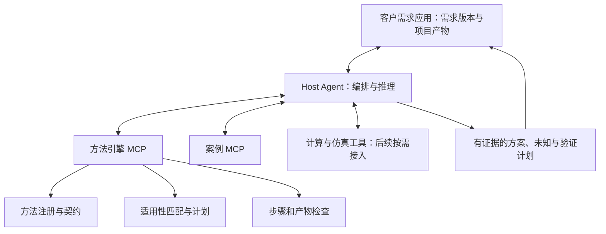

# 方法调用引擎与MCP架构 v1

状态：架构提案，未实现新服务。依据现有60档案及其调用深度解读；不修改冻结内容版。采用mcp-builder技能规划工具边界。

## 目标与职责

客户应用保存需求、项目权限和产物；Host Agent负责跨服务推理与交互；方法引擎提供可解释匹配、步骤计划、输入检查和产物检查；案例MCP提供可定位的事实与证据。方法引擎核心独立于MCP，MCP只是对外适配层，便于同一核心同时被应用API和Agent调用。

默认由Host传递案例证据给方法引擎，不要求两个MCP服务器自行互调，也不让服务假定能读取完整对话。MCP官方架构把跨服务协调放在Host，并保持服务连接隔离：[架构依据](https://modelcontextprotocol.io/specification/2025-11-25/architecture)。

## 方法深度的架构解释

深度不能用字数代表，应按独立能力记录：解释是否充分、输入是否明确、关键判断是否可检查、案例是否能跟随、来源支持到哪层、是否具备真实工具、产物是否能交接。禁止用一个总分把缺数据或缺算法掩盖。

流程框架如双钻、系统工程、7D负责组织任务；具体方法如形态学、FAST负责转换问题表达；工具族如TRIZ下的矛盾矩阵需特定版本及检索数据；计算方法如拓扑优化、DOE还需模型和求解器。WB体系专题提供组织与解释，不全部作为互相独立的可执行节点。

现有库已经有输入、步骤、产物和来源，但relations.binding多为说明文字，知识查询不是可验证证据契约，输入类型object不足以判定工程语义。因此不能直接把目录包一层MCP就宣称获得调用引擎。

## 核心数据对象

- TaskContext：task_id、revision、tenant/project、对象、使用场景、阶段、目标、硬约束、偏好、已知事实、假设、未知、可用数据/工具、预算；量值带单位、工况与出处。
- MethodCapability：method_id+version+内容hash、角色、适用条件、排除条件、输入Schema、产物Schema、工具依赖、证据要求、原典核读范围；独立保存内容/专家审核/工程验证/运行适配状态。
- EvidenceRef：server、case_id、case_revision、record/asset_id、locator、claim_id、摘录或释义、证据状态、工况与可用权限。不得只存案例名称或URL。
- Artifact：artifact_id、revision、schema_version、内容、单位、证据绑定、假设、unknowns、产生它的method/step/run、检查状态。
- Run/Plan：输入快照、方法版本、步骤DAG、字段绑定、分支与停止条件、执行者、证据查询、事件日志和产物引用。

首批类型建议为ProblemBrief、RequirementSet、FunctionModel、ConceptSet、ComparisonRecord、VerificationPlan。方法转换必须显式映射字段及语义；同叫“功能”不代表边界与粒度一致。

## 匹配与推理流程

1. 解析客户需求，保留原话出处，区分事实、偏好、解法假设和未知；影响路线的缺口先澄清。
2. 检索候选：术语、任务标签与语义召回并行，返回候选而非最终结论。语义模型和向量索引可替换，模型版本需记录。
3. 规则过滤：对象/阶段/硬约束/执行资源不适用的排除；缺输入分为可补齐、仅概念、必须停止。缺输入不等同方法永远不适用。
4. 可解释排序：依据任务契合、输入就绪、来源支持、资源代价与预期学习价值。初版不用未经标定的百分比置信度或固定万能权重；列理由、缺口、替代及未选原因。
5. 编制步骤DAG：先检查现有产物是否已满足前置，避免每次从头调用所有框架；标明人工、Agent、检索与专业工具各做什么。
6. 按步骤生成案例证据请求；Host从案例MCP取回具体记录，再核对功能、原理、工况、尺度、材料、制造与证据强度。相似案例只是线索，不能证明可迁移。
7. Agent依据方法与证据加工产物；确定性规则检查Schema/单位/必填/来源，语义检查指出矛盾与推断。两类检查分别返回，不能把LLM认可当工程通过。
8. 检查产物能否交给下一方法，处理回返；有新需求或新证据时标记受影响节点过期，只重跑相关部分。冻结设计的接受由应用责任流程决定。

## MCP工具提案

下表均为拟新增接口，不是现有已上线工具名。每个工具需JSON Schema输入输出、分页/大小限制、机器可读错误与下一步建议。依据：[MCP工具规范](https://modelcontextprotocol.io/specification/2025-11-25/server/tools)。

| 工具 | 输入 | 输出与边界 |
|---|---|---|
| method_search | query、filters、cursor | 分页候选、角色、版本、适用摘要；只检索 |
| method_get | method_id、version、view、step_id | 深度说明/契约/步骤/来源，按需读取 |
| method_match | task_context、artifact_refs、capability_refs | 推荐、排除、缺口、理由与替代；不自动执行 |
| method_plan | task_revision、selected_methods、available_artifacts | DAG、绑定、查询与停止条件；不写客户项目 |
| method_check_inputs | method_version、step_id、inputs | ready/conditional/blocked、字段问题与补证动作 |
| method_build_evidence_requests | plan、step_id | 给案例MCP的结构查询及必须返回的证据字段 |
| method_check_artifact | step_contract、artifact、evidence | 结构结果、语义疑点、未覆盖项；不工程认证 |
| method_check_handoff | output_artifact、next_input_contract | 字段兼容、量纲/边界差异、缺失映射 |

首版上述工具按无持久副作用设计，计划由调用方提交或保存。第二阶段再加run_create、run_submit_artifact、run_get、run_resume；这些是有状态写入，需要项目权限、输入revision与幂等键，不把它们标为只读。客户端断连、模型失败和工具超时必须能恢复，不能重复登记产物。

稳定方法正文可作为版本化Resources；工具返回摘要与资源定位，避免每次倾倒60篇全文。不同Host可采用不同提示词，但产物契约不随提示词悄然变化。

## 跨案例加工的具体示例

客户说“夹具夹得牢但损伤工件”。先记录夹持力、损伤形态、接触材料和节拍等未知。调用问题定义/功能分析，取得施力与接触关系；若存在改善保持作用却加剧损伤的关系，匹配技术矛盾，必要时再考虑物理矛盾或效应检索，不能见到两个冲突词就强制TRIZ。

案例查询应找“保持物体位置的作用机制、接触压力分布与释放条件”，而非只找同外形夹具。取回某案例的缓冲接触机制后，Agent说明哪些原理可能迁移、哪些载荷材料条件未知，形成候选组合与差异表，再设计接触/保持/释放验证。案例中的成功不直接成为客户方案的成功。

每个输出判断需能追到：客户需求片段→方法版本与步骤→案例记录定位→推断/计算→验证问题；没有来源的想法明确记为新假设。

## 服务与治理

初期复用现有Python知识库读取能力，核心分为registry、contracts、matcher、planner、evidence、validator；MCP adapter不承载领域逻辑。本机验证先用stdio，远程部署的传输、认证和SDK版本在实施时按官方文档及现有平台环境确认，不在此提前锁死。

客户应用控制项目数据；案例、方法和运行产物分开存储。缓存键必须包含租户权限范围、输入revision、内容/模型版本。外部案例文本作为数据处理，不能成为覆盖系统指令的指令。持久运行保存事件、请求hash与产物revision，拒绝旧版本提交覆盖新结果。

## 分阶段建设与验收

一期：只读注册与契约升级，优先问题定义、功能分析、形态学、概念筛选、原型/验证路线；实现检索、匹配、规划与检查，接案例读取适配器。验收需测试推荐理由、错误排除、缺输入停止、证据定位及字段交接，不用方法命中率单指标。

二期：客户应用与持久Run接入，验证版本变更、租户隔离、幂等、超时恢复、局部失效和可追溯产物。

三期：按方法逐项接求解器、物性库或试验数据；用已知答案/可信基准及工程人员审查验证，不因MCP调用成功就宣布算法正确。

测试集应覆盖正常任务、信息不足、相似外形不同机理、案例结论与原文矛盾、单位不兼容、方法误选、硬约束冲突、工具不可用和恶意外部指令。最终评价包括专家判适用、证据支撑、产物可用及实际学习效果；阈值由试点校准。

## 待实施确认

本轮未探测当前案例MCP的实时工具Schema，案例EvidenceRef需与其真实版本对接；未调用模型或求解器进行真实匹配评测。客户应用的租户权限与产物存储接口尚需实施勘查。以上是明确的下一阶段任务，不视为架构已经运行。
