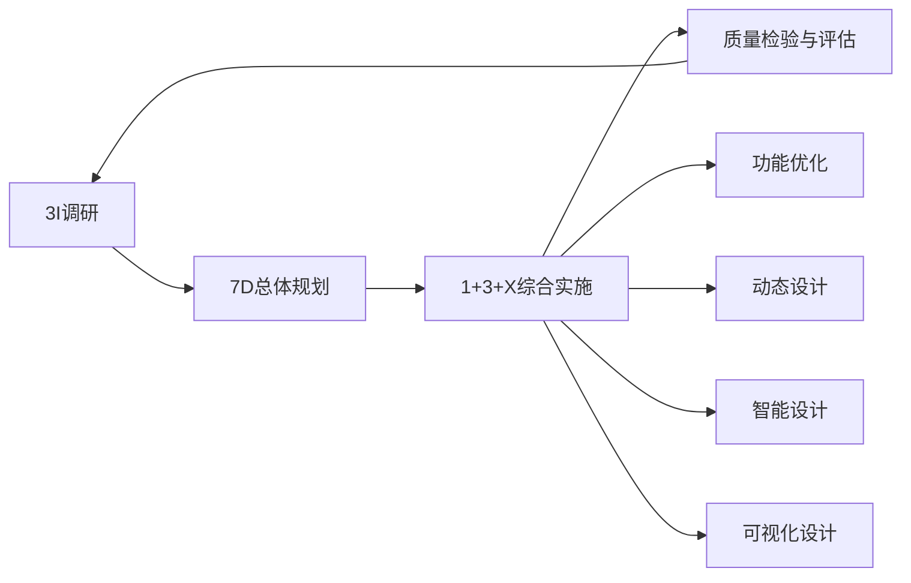

# 闻邦椿体系导览

12个专题用于呈现体系及其方法族，不等于12个互不相关的独创算法。本文是平台导览，具体概念与原典核读范围以各档案为准。

## 总体路线

2013作者摘要的四阶段为3I调研→7D规划→1+3+X实施→3A检验，执行中允许返回。2016学校报道有5A用语，本版保留差异；未取得的全文不会靠名称补齐。

结构性能、使用性能、制造性能是2013摘要中的主要性能分类；动态、智能、可视化属于设计方法方向，两者不混为同一层。当前智能设计专题主要讨论原体系中的工作参数、过程控制与监测，不自动等同今天的LLM。

## 专题入口

- [WB01 产品系统化与综合设计体系](档案/WB01/深度说明.md)：将调研、规划、实施与检验组织成可回返的产品设计体系，使功能与多类性能一起受到约束。
- [WB02 3I调研](档案/WB02/深度说明.md)：在设计规划前分别核查用户需求、产品环境与产品风险，形成有证据边界的选题和调研缺口；本卡为谱系专题与平台适配。
- [WB03 7D总体规划](档案/WB03/深度说明.md)：在具体求解前联结目标、思想、环境、过程、内容、方法和质量检验，使规划可追溯、可检查和可更新。
- [WB04 1+3+X综合设计](档案/WB04/深度说明.md)：以功能为核心，协同动态、智能、可视化及任务所需的其他设计方法，检查局部优化对整体目标的影响。
- [WB05 主辅功能与功能优化](档案/WB05/深度说明.md)：依据系统化设计的功能层研究线索，组织主辅功能、方案分解组合和功能实现的核查；原书规则未全得。
- [WB06 面向结构性能的动态设计](档案/WB06/深度说明.md)：在系统化设计中围绕结构动态性能，联结运动分析、线性或非线性模型、动态响应、试验辨识与设计修正的工程方法族。
- [WB07 面向使用性能的智能设计](档案/WB07/深度说明.md)：围绕实际使用性能，把操作、运动、工作参数和过程控制及状态监测组成研究任务，再选择模型、感知控制与验证方法；属于体系专题而非单一通用算法。
- [WB08 面向制造性能的可视化设计](档案/WB08/深度说明.md)：以受控工程模型模拟加工、装配和拆卸过程，检验可达性与过程可行性，通过结果分析和修改循环改善制造性能；可视化是工程分析载体。
- [WB09 深层次动态设计](档案/WB09/深度说明.md)：针对线性近似不足以解释的机械动态行为，研究时变、强非线性、多参数、高维耦合与不确定条件，并通过模型和试验支持设计。
- [WB10 设计质量检验与综合评价](档案/WB10/深度说明.md)：将总功能与结构、使用、制造等性能对应到指标、权重和证据，选择清楚的评价模型并解释薄弱项；综合评分与工程符合性分别判断。
- [WB11 科学方法论规则与设计专家系统](档案/WB11/深度说明.md)：研究原典中的方法论规则、共性知识与专家系统如何组织，并形成待核规则档案；不把目录线索冒充规则全集。
- [WB12 国内外设计方法分类研究与出处去重](档案/WB12/深度说明.md)：追溯闻邦椿对国内外设计方法分类的原文，区分既有方法、综合框架、编纂收录与平台分类，并建立别名和出处去重档案。

## 方法数量与出处

本人公开文章提供70多种方法、7类的历史自述。该历史说法与原论文具体图表、七个代表方向须分开核对，详见WB12；不把它们直接当成本库48项名单或平台七个任务分类。

可公开取得的论文、只读到摘要的论文、只读到目录的书章分别记录。深度操作步骤包含平台编排，未把通用CAD、控制、模糊评价等技术全部归为闻邦椿独创。
