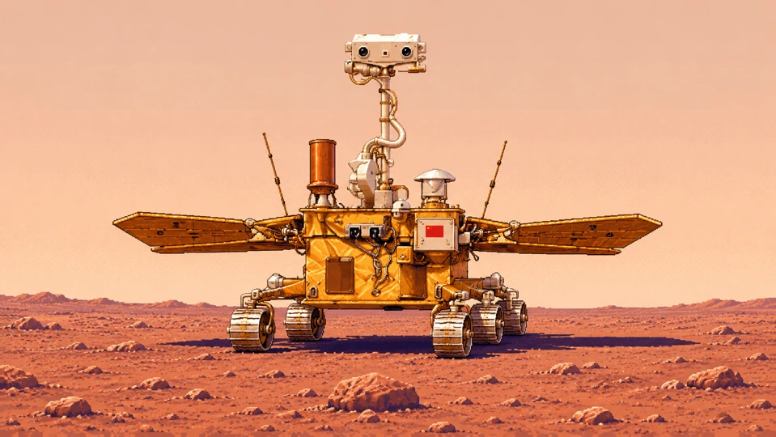
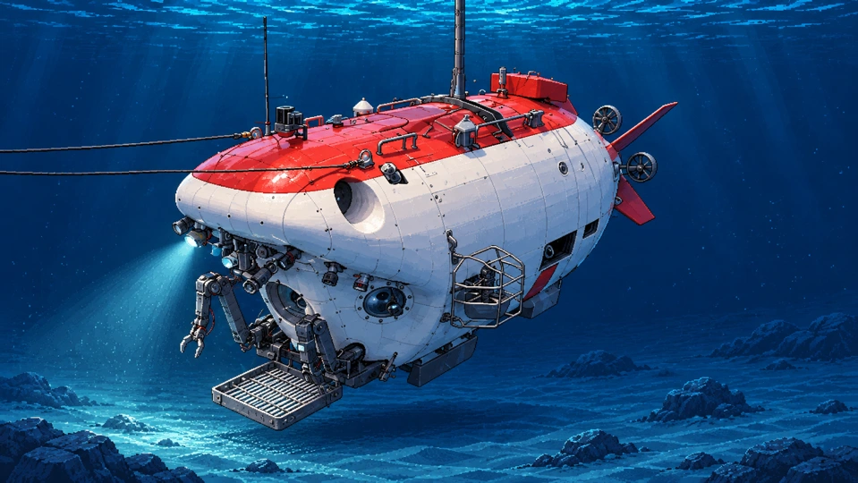

# 样例：只学风格，不借用其他项目结构

星球车2021-00：上一版本采用通用蓝色太阳板探测车，偏离原照片。重绘参考金色车体、横向金色太阳翼、小车轮、高桅杆和浅色相机头，保留原型特征优先于蓝色系列配色。此图是视觉校正例，不宣称所有细节与实物尺寸完全相同。
原照片可在已公开项目图查看：https://haoshejiguan.com/inno/portal/covers/case-2021-00.jpg 。不是要求外部Agent使用本机硬盘路径；如原链接不可用，应向任务提供者取得原图。

蛟龙号2015-02：上一版变成通用球形潜水器，巨大的正前圆舷窗错误。以红白扁圆主体、顶部甲板、下前端舷窗/机械臂和前下采样篮为约束，重绘保留真实识别形态。
公开原照片：https://haoshejiguan.com/inno/portal/covers/case-2015-02.jpg 。应实际打开看，不凭这段文字代替。

翼型风帆助推原油船2021-03：说明用途的场景示例。刚性翼帆区别于布帆和转筒。此样例没有完成全项外形对照，不能当作精确型号还原的合格证，也不能把两翼帆配置复制到其他船舶项目。

三图均为平台生成的展示插画，不提供原始技术证据。用于同系列作图时，真实项目原图始终是更高优先级参考。
